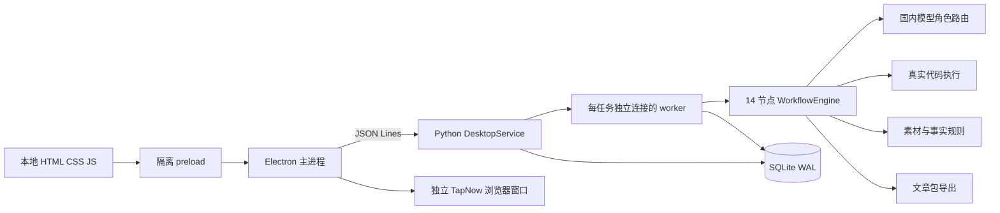
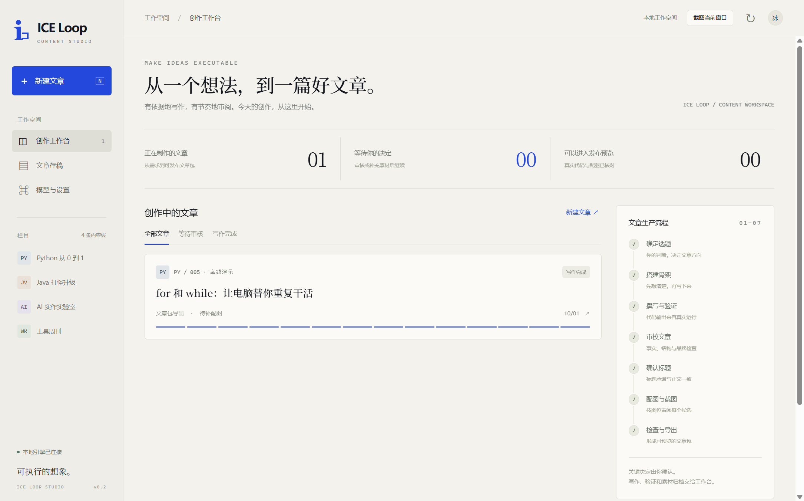
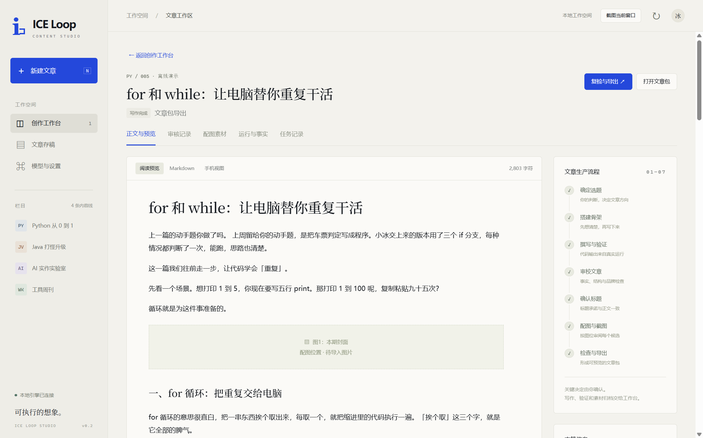
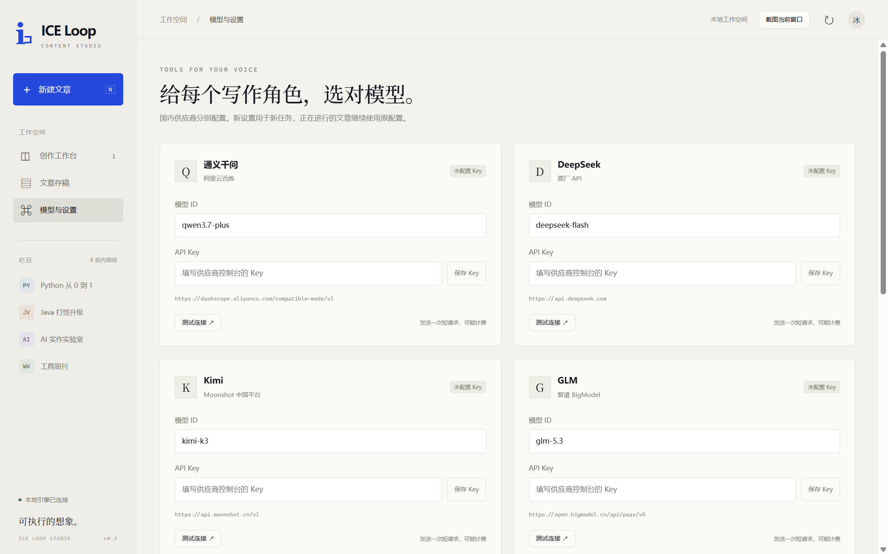

# ICE Loop Studio v0.2：使用、优化与继续开发

更新：2026-10-01。本文描述已落地的桌面工作台与 Python 引擎改动。更早的整体方案与 v0.1 审查记录继续保留，便于对照。

## 1. 这一版可以做什么

这是 Electron 独立窗口中的文章生产工作台，连接本地 Python 引擎与 SQLite 数据库。

| 页面 | 已实现的操作 |
|---|---|
| 创作工作台 | 新建文章、四个栏目筛选、查看审核/完成状态、运行离线示例 |
| 文章工作区 | 阅读预览、Markdown 编辑、手机宽度预览、保存正文、复检导出 |
| 审核 | 确认选题方向、正文骨架、最终标题、配图计划；编辑已保存的审核候选 |
| 配图素材 | 按图位导入 PNG/JPEG/WebP、选择具体候选、预览图片、查看生图提示词 |
| 运行与事实 | 展示真实源码、标准输入、标准输出、错误与退出码；填写事实核验来源 |
| 模型与设置 | 配置通义、DeepSeek、Kimi、GLM、豆包的模型 ID 和 Key；分配角色、设置请求预算 |
| 文章存稿 | 只读查看本项目 `output/文章` 内已有正文 |
| 程序截图 | 点击顶部「截图当前窗口」，把当前程序视图保存为 PNG |
| TapNow | 在独立隔离浏览器窗口访问 `https://app.tapnow.media`，保留登录会话 |

TapNow 窗口目前用于人工操作与素材导入。浏览器自动定位画布、自动付费提交、监控和下载尚未接通。微信发布、真正的移动设备排版验收、容器执行及签名安装包也不属于本轮已完成功能。

## 2. 本机启动与首次体验

项目位于 `G:\05-兴趣项目\gonzhonhao\wechat_agent\ice-loop-agent`。

当前机器的 Python 虚拟环境已准备在项目 `.venv`。桌面依赖位于 `desktop/node_modules`。

1. 双击项目根目录的 `start-desktop.cmd`，或运行 `start-desktop.ps1`。
2. 点击「体验离线示例」。该示例显式使用内置 Mock 内容，代码仍通过本机 Python 真实运行。
3. 依次批准选题、骨架、标题与配图计划。
4. 完成后进入「运行与事实」，查看真实运行记录；进入「配图素材」，查看待补图位。
5. 将自己审阅后截图或生成的图片导入对应图位，再点击「复检与导出」。

离线示例不会调用供应商 API。示例只导入部分图片时，文章仍保持待补图状态，不应显示为可发布。

### 换电脑时安装

需要 Windows、Node.js 22.12+ 与 uv。将整个源码项目放在数据盘，然后执行：

```powershell
powershell -ExecutionPolicy Bypass -File install-desktop.ps1
```

脚本会在项目中创建 Python 3.12 虚拟环境、安装 Python 依赖、使用 npm lockfile 安装桌面依赖并下载 Electron。下载缓存也放在项目里。不会修改系统 Python。

如果 Node 的 fetch 下载失败而 Windows curl 可访问官方 GitHub，可以在 `desktop` 目录运行备用下载器，然后解压已经过校验的文件：

```powershell
node tests/download-runtime.cjs
node tests/install-runtime.cjs .electron-cache/parallel.zip
```

备用下载器只针对本版锁定的 Electron 44.5.1 Windows x64 文件，使用 npm 包携带的官方 SHA256；文件不完整或校验失败不会安装。升级 Electron 时应同时维护 package lock、下载器版本、文件大小与校验目标。

## 3. 正式写作怎么使用

### 3.1 配置国内模型

在「模型与设置」填写供应商控制台可用的模型 ID 和 Key。预置模型名属于项目配置示例；你账号中的地域、权限与可用模型以控制台为准。

| 供应商 | 引擎凭据环境变量 | 端点策略 |
|---|---|---|
| 阿里云百炼 | `DASHSCOPE_API_KEY` | 使用百炼国内兼容端点 |
| DeepSeek | `DEEPSEEK_API_KEY` | 使用原厂端点 |
| Moonshot 中国平台 | `MOONSHOT_API_KEY` | 使用国内 Moonshot 端点 |
| 智谱 BigModel | `BIGMODEL_API_KEY` | 使用 BigModel 兼容端点 |
| 火山方舟 | `ARK_API_KEY` | 使用方舟兼容端点，按账号填写模型/接入点 ID |

页面不读回 Key。保存时由 Electron 主进程使用系统 `safeStorage` 加密，运行时只传入 Python 引擎环境。若系统加密不可用，程序明确报错，可改用上述环境变量。

「测试连接」是用户主动发起的一次短请求，可能计费。连接通过表示当前账号、端点和模型可以返回文本，不表示 JSON、视觉和思考开关等所有能力都经过实测。

改变模型 ID 后，旧模型的能力判断会重置为 unknown。`required_off` 等硬约束继续过滤能力未知的模型。默认使用 `prefer_off`，未知能力时不发送未经验证的思考参数。

### 3.2 角色与预算

可以给正文写作、内容审稿、选题骨架、事实整理、标题工坊和代码辅助分配主模型。默认使用 Qwen/DeepSeek 分工，正式路径中没有 Mock 回退。

单篇请求上限默认 24 次，可以配置 1–100。预算包含发送失败、重试、备用模型和 JSON 修复请求；不是人民币费用上限。用量缺失记为 unknown。达到上限后会停止，而不是继续请求。

模型配置、角色路由和规则在任务创建时冻结。修改设置影响新任务，旧任务恢复时使用原快照；环境中的 Key 可以更换，但正文采用的模型配置不会静默变化。

### 3.3 审核与修改

审核候选生成后立即持久保存，暂停和恢复不会重新生成同一候选。批准绑定候选 hash，选择的方向/标题单独保存。候选修改后，旧版本的批准请求会被拒绝。

审核页可编辑 topic、outline 和 final_title 的结构化候选。当前编辑器仍是 JSON，适合这一版的开发和高级编辑；下一步可改成表单式编辑。

审校失败后，可在正文 Markdown 页修正文本并保存，再继续任务。若修改代码或真实输出，完整性检查会阻断；当前版本不自动为修改后的代码重新生成运行记录，需重新创建任务验证代码。

语义审稿的 blocking 项和 L1–L4 的未通过层会停止流程，不能只靠规则引擎通过就继续。

### 3.4 执行正文示例

正式任务生成代码后，需要用户审阅并批准当前代码和输入，才会在本机执行。批准 hash 覆盖 draft 与 `stdin_by_filename`，输入改变后必须重新审阅。

带 `input()` 的示例可在「补充示例输入」填写文件名到输入文本的 JSON：

```json
{
  "demo_1.py": "小冰\n18"
}
```

普通 Python 示例按 `demo_1.py`、`demo_2.py` 命名；与内置示例完全相同的源码复用其示例文件名。Java 文件名来自 `public class`。程序错误消息会指出缺少输入的文件名。

执行器会记录源码、源码 hash、输入、输入 hash、输出、输出 hash、退出码、运行环境和时长。正文输出根据 RunRecord 回填，并使用 run ID 对应占位符。源码或输出发生变化时，发布检查与导出会发现不一致。

当前为人工审阅后的本机执行模式。静态危险动作扫描与超时限制不是系统级沙箱；执行权限仍来自你的本机用户。容器或单独受限进程账户属于后续升级。

### 3.5 配图和程序截图

图片先经过 Pillow 真实解码，再复制到运行目录的内容寻址资产库。原下载文件被移动或修改不影响已归档候选。若归档文件损坏、hash 变化、图片属于另一图位或不是当前选中候选，会被判为未就绪。

每个图位必须有自己选中的有效候选。向同一个图位反复导入图片，不能补足其他空图位。

顶部截图按钮保存的是当前程序窗口，不是外部终端、其他软件或整篇滚动长图。可在文章预览、运行记录等页手动点击，并根据需要把 PNG 导入文章图位。真实终端截图仍由用户审阅后自行获取。

导入和选择候选不会自动覆盖已导出的文章包；点击「复检与导出」后才更新包内图片及 Markdown 路径。

## 4. 数据位置与保护

| 目录 | 内容 |
|---|---|
| `.desktop-runtime/app.db` | 文章、任务、审核、事件、调用记录、图位、事实与操作账本 |
| `.desktop-runtime/jobs/` | 任务 state.json 镜像与节点运行数据 |
| `.desktop-runtime/assets/` | 已解码校验、按内容 hash 归档的素材 |
| `.desktop-runtime/staging/` | 真实执行的示例代码和运行记录 |
| `.desktop-runtime/screenshots/` | 用户点击截图按钮保存的程序 PNG |
| `.desktop-runtime/credentials.json` | 系统加密后的 Key，仍需视为敏感文件 |
| `.desktop-runtime/electron/` | 桌面浏览器会话和 TapNow 登录状态 |
| `.desktop-articles/` | 新文章的 00–03 文档、code、images 与导出 manifest |
| `.test-tmp/` | 回归测试和桌面验收专用目录 |

旧 `output/文章` 在桌面只读查看。新任务默认导出到 `.desktop-articles`，避免混入现有存稿。

这些运行目录已加入 gitignore。需要自行备份数据库、新文章包和必要素材；TapNow 会话与加密凭据不应分享。密钥解密通常依赖当前 Windows 用户环境，不建议直接复制加密凭据到其他账号。

数据库是状态的权威来源，state.json 为可读镜像。节点成功时，checkpoint、完成步骤与下一节点在一个 SQLite 事务中提交；镜像使用临时文件、fsync 和原子替换。镜像写入中断时，可以继续读取已提交的数据库状态。

导出 manifest 覆盖正文、发布说明、源码和图片。外部手动改动这些文件后，再导出会触发冲突保护；建议在桌面编辑正文或先保留外部修改。

## 5. 开发架构



### 5.1 文件入口

- `desktop/main.cjs`：窗口、受限 IPC、引擎进程、Key 加密、TapNow 会话、截图。
- `desktop/preload.cjs`：对页面暴露固定方法，不开放任意 Node、文件系统或 shell。
- `desktop/renderer/app.js`：页面与真实任务数据、审核、编辑、轮询进度。
- `desktop/renderer/styles.css`：ICE Loop 暖白、墨黑、信号蓝的平面编辑工作台样式。
- `desktop/renderer/markdown.js`：转义原始 HTML，只展示受控图片，阻止模型内容变成执行脚本。
- `ice_agent/desktop_service.py`：JSON Lines API、任务调度、独立 SQLite 连接和桌面操作。
- `ice_agent/workflow/engine.py`：任务 lease、checkpoint、模型/规则快照、异常与恢复。
- `ice_agent/workflow/nodes.py`：持久候选、代码证据回填、事实审核、发布检查。
- `ice_agent/llm/router.py`：路由、能力约束、请求预留、修复/重试/回退记录。
- `ice_agent/llm/transport.py`：完整响应校验、真实 SSE 增量、大小和时限控制。
- `ice_agent/server.py`：可选 HTTP 快照 API，逐请求连接和 Bearer token；桌面不依赖 HTTP 服务。

### 5.2 通信约定

主进程向 sidecar 写入一行 JSON：

```json
{"id": 7, "method": "jobs.get", "params": {"job_id": "job-...", "after": 20}}
```

响应使用同一 ID 和 `result` 或 `error`。进度事件写入数据库后，由桌面按 sequence 每 2.2 秒轮询。模型传输按 SSE 增量读取；桌面进度属于轮询投递，而非页面直接连接远端 SSE。

允许的方法集中在 `DesktopService.call` 和主进程白名单中。图片导入通过原生文件选择器。凭据接口不走普通页面 RPC；只有主进程可向 sidecar 下发 `secrets.set`。

启动会恢复上一 sidecar 的遗留运行任务为 paused。Electron 使用单实例锁，减少多个工作台同时修改同一个运行目录的风险。工作线程各自创建连接，避免 FastAPI/线程池中跨线程使用同一个 SQLite 连接。

### 5.3 本轮关键修复

| v0.1 问题 | v0.2 行为 |
|---|---|
| 正式路径回退 Mock、默认 Mock 审稿 | 正式 profile 图只包含真实供应商；离线示例有明确入口与标签 |
| 审批恢复重新生成，内容变化反复卡门 | 候选先持久化，恢复复用；批准、选择和事件事务提交 |
| 只冻结路由 ID | 同时冻结 profile、模型、端点、能力、路由与规则 |
| JSON 字段缺失被放过 | 默认必填，按节点验证非空列表、字段类型、枚举与范围 |
| SSE 收集完才回调、猜测完成 | 逐行回调；缺失 finish、length、拒绝等不会当成完整正文 |
| 修复调用不计数、请求预算未执行 | 发送前原子预留，每次修复/重试计数，预算不足阻断 |
| 模型自报 verified | 系统设置待核验；只有人工提供来源与证据后标记 verified |
| 改过代码仍引用旧运行记录 | 核对源码、输出、run ID；导出保存已执行源码 |
| 一图位多个候选抵其他空位 | 按图位的具体 selected candidate 验证、计算就绪 |
| 只看图片文件头、原文件可变 | 真正解码校验、内容寻址复制、hash 与图位归属校验 |
| 发送租约读后再写，多线程都成功 | SQL compare-and-set，只有一个发送者能从 prepared 转为 sending |
| 出错残留 running、state 文件写一半 | 异常落为 failed，释放 lease；DB checkpoint + 原子镜像 |
| HTTP 线程共享 SQLite | 在处理请求的线程内创建与关闭连接；增加 token 验证 |
| 仅保护文档、遗漏代码/图片外改 | manifest 包含源码与图片；编号预留并保留合法编号 0 |

暂停/取消会写入状态，在后续模型增量和节点边界检查。已发送的远端请求可能已经计费；网络读阻塞或本机示例运行结束前，worker 可能不会立即释放 lease。

## 6. 验收与复现

```powershell
.\.venv\Scripts\python.exe -m unittest discover -v
cd desktop
node --check main.cjs
node --check preload.cjs
node --check renderer/app.js
node --test tests/markdown.test.cjs
node tests/desktop-smoke.cjs
```

已完成：92 项 Python 测试全部通过，其中 23 项针对本轮升级；4 项 Markdown 预览测试通过；桌面 JavaScript 语法检查通过。

桌面烟雾测试会在隐藏窗口中创建真实离线任务，经过四个审核门，真实执行三段代码，检查文章导出、运行记录页、配图页、五张供应商配置卡与横向布局，再保存截图和 JSON 验收记录到 `.test-tmp/electron-时间戳/`。该测试只使用离线 Mock，不测试账号级模型可用性或 TapNow 自动生图。

桌面窗口已通过实际验收：四个审核门、三条真实运行记录、四个图位、五家模型配置、十篇只读存稿、快速切页保护、程序内 PNG 截图以及正常与最小窗口的布局均已检查。演示文章正确保持 assets_pending，未导入图片时不能标记为可发布。验收 JSON 见 [desktop-v0.2-validation.json](desktop-v0.2-validation.json)。

切页保护会丢弃旧文章请求的迟到响应，避免切换到模型页后又被后台轮询拉回文章页。截图测试等待实际绘制，并在隐藏窗口中关闭后台节流，避免捕获上一页的旧画面；正常工作台保留后台节流。







## 7. 建议下一轮升级顺序

1. **实际账号验收**：针对使用的国内供应商测试文本、结构化输出、长文与思考开关；给每个模型维护能力探针，区分“连接通过”与“能力通过”。
2. **文章修改闭环**：编辑代码后明确重新执行及更新 RunRecord；正文修改后提供“重新语义审校”按钮；把 JSON 审核编辑器改成表单。
3. **TapNow 小步接入**：登录后记录实际画布/节点结构，先实现填写提示词和提交前核对；提交必须沿用操作账本、租约和 unknown 对账，不以超时为理由再次付费提交。
4. **受限代码执行**：容器或专用受限账户、资源限制、工作目录挂载，保留 stdin/输出 hash 和证据规则。
5. **桌面分发**：打包 Python 运行时、Electron 与静态资源，补充 Windows 图标、签名、安装/更新与日志导出；当前交付仍是可直接启动的源码工作台。
6. **写作质量**：把已有存稿作为风格参考，而非直接复制；强化出处定位、敏感断言与段落关联、标题五维评分、不同栏目提示词及人工审阅历史。

实现参考：[Electron 安全建议](https://www.electronjs.org/docs/latest/tutorial/security)、[Electron IPC](https://www.electronjs.org/docs/latest/tutorial/ipc)、[Pillow Image 校验接口](https://pillow.readthedocs.io/en/stable/reference/Image.html)。
