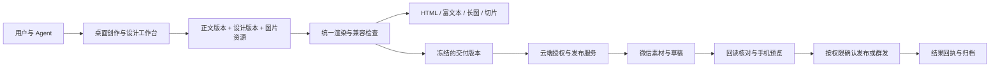

# 一体化公众号 Agent：产品与技术路线

日期：2026-11-05。调研源码：main@480e83a。本文是实施建议，未实现功能不作为完成声明。

用户目标：面向多个用户和各类公众号，把文章创作、图文混排、风格设计、排版、导出、微信草稿同步和发布整合为一个 Agent 产品。秀米/135 是能力与体验参照；内置编辑器是长期主路径。

补充需求：写作方法不固定在程序中，默认预装作者技能，用户可修改、启停、卸载或导入其他技能。详见[可插拔技能系统方案](可插拔技能系统-产品与迁移方案-2026-11-05.md)。技能解析应同时覆盖生成、审阅与导出检查，并放入早期基础阶段；品牌配置和执行权限与写作技能分别管理。

## 1. 产品闭环与账号能力

完整流程：公众号与品牌 → 选题/资料 → 写作与审阅 → 配图/设计 → 可视化排版 → 手机预览 → 导出或同步微信草稿 → 确认发布/群发 → 结果回执与归档。

“支持各类公众号”应定义为所有用户均可使用创作、设计、排版和导出；微信自动写入/发布能力按账号实际权限开放，不能承诺所有账号都能无人值守发布。

| 账号可用能力 | 产品交付路径 |
| --- | --- |
| 未授权或缺少接口权限 | 富文本复制、HTML/图片包、长图/切片导出；在官方后台完成上传、预览与发布 |
| 具备并已验证草稿接口权限 | 上传素材、同步草稿、读回核对；可在官方后台继续编辑和发布 |
| 具备并已验证发布接口权限 | 在验证草稿基础上提交发布，跟踪最终结果并记录文章链接 |
| 具备并已验证群发权限 | 作为独立操作处理接收范围、额度、确认与结果，不用“已发布”推断“粉丝已收到” |

账号绑定时记录能力、来源、验证时间与错误；未知权限不能当可用。权限被撤回后降级到导出路径。认证、主体、接口范围等条件以当前官方文档与目标账号后台为准。

## 2. 现有代码可以复用什么

| 模块 | 当前证据 | 需要补齐 |
| --- | --- | --- |
| 创作与审阅 | creative_chat、agent 工具循环、修改提案、正文版本、事实/执行检查 | 排版/发布工具接入，统一展示任务状态与费用 |
| 编辑器 | React + Tiptap、Markdown 桥、图位与运行输出节点 | 可持久化的设计文档、组件编辑、样式面板、拖动排序与撤销 |
| 图像与品牌 | 多公众号品牌、资源归属、图片候选/选用、原图查看、真实运行截图 | 封面设计、裁切/焦点、版式模块图、字体/模板资产版本 |
| HTML/复制 | export/html_preview.py、export/rich_text.py、clipboard.cjs；经典界面有入口 | 统一渲染器、新工作台入口、微信适配与手机实测 |
| 长图基础 | tools.cjs 截图已导出阅读页，当前限制 20,000px | 正式导出任务、高清倍率、按块切片、图片/字体就绪、大小与像素预算 |
| 发布 | Markdown/文本与审核图片导出，微信后台手动发布 | 真实授权、远端素材映射、草稿同步、回读、发布状态及对账 |
| 账号隔离 | 本地 account_id 边界 | 云端 tenant/workspace/member 权限、授权隔离与撤销；本地多公众号不等于多租户服务 |

已有界面动效的 native/Windows 验收仍开放；本路线不把历史自动化结果当新功能验收。

## 3. 推荐架构：本地优先创作 + 云端连接服务

- 桌面端继续负责离线编辑、本地资料、预览、图像渲染与导出。只上传用户选择同步的交付版本；云端全文协作不作为首期前置。
- 云端新增身份/成员权限、第三方平台授权、令牌管理、发布任务、回调与对账。第三方平台接入资质、申请和具体授权范围需作为早期实测事项，不假定已经具备。
- 面向多个用户优先设计官方授权路径；平台密钥不放进可分发桌面包、不交给模型或写入文章导出。用户无需向运营者交出公众号登录密码。
- 发布与定时任务在云端持久运行；关闭桌面程序不能丢任务。定时是本产品调度能力，不假定微信存在适用所有账号的任意定时接口。
- 按账号串行处理需要顺序的写操作，复用现有任务/租约思想；新增本地和云端任务不混用任务 ID 与状态含义。

## 4. 最关键的改造：内容与设计分离，输出同源

当前 editorial 模块注明 Markdown 是长期规范值（ADR-005）；ArticleEditor 更新会把 Tiptap JSON 序列化回 Markdown。复杂嵌套布局、图片裁切和模块样式不能靠这条回写链完整保存。

首期增量方案：保留正文规范值，新增独立 `DesignDocument`，引用明确的正文版本和资产版本。排版模块树保存布局、样式与内容引用；改文字仍走正文版本/提案链，换模板只产生设计版本，不重写正文。

设计文档至少包含：schema_version、article_revision、design_revision、持久化模块 ID、内容块引用、模板 ID/版本、样式覆盖、资源引用与裁切、画布设置。设计模块 ID 必须独立持久化。现有 `_block_id(index, kind, source)` 会随顺序/内容变化，不能直接当跨版本永久锚点；正文改版后需显式重绑定、检测冲突，对无法定位的模块保留并提示修复。

后续若升级为统一的结构化文档规范值，应单独修改 ADR、迁移与回退策略；Markdown 作为兼容投影，对无法表达的布局明确提示，不默默丢失。

所有输出来自同一个冻结版本：预览、微信 HTML、剪贴板 HTML、长图和发布上传不能各读不同的“当前正文”。交付指纹包含正文、设计、模板、字体/渲染器和图片 hash。图片仍走当前账号/文章的选用校验。

## 5. 编辑与设计能力

界面建议在文章工作区设置“写作 / 设计 / 预览 / 发布”四个模式；左侧为大纲/组件/模板，中央为正文与版式，右侧为选中模块属性。Agent 以侧栏对话辅助，不把所有设计操作藏在对话里。

### 首期组件与模板

- 基础块：段落、标题、列表、引用、代码、表格、图片与说明、分隔线。
- 设计块：重点提示、编号章节、图文卡片、双图、时间线、来源说明、品牌页尾。
- 全局设置：公众号品牌色、字号/行距/段距、对齐、边距、封面与页尾。
- 三套原创完整模板：简洁阅读、技术教程、杂志图文。支持局部套样式、全文换模板、常用样式收藏。
- 操作：选中编辑、替换图片、裁切、拖动排序、复制模块、撤销/重做、自动保存与版本恢复。
- AI 指令：“换成品牌蓝”“把这段做成重点卡”“三张图排成组”“精简留白”。先生成结构化操作与预览，再应用可撤销改动。

建议继续使用现有 Tiptap，扩展受控节点与编辑视图。NodeView 的编辑控件与输出 HTML 分开定义，编辑工具栏不进入发布内容。首期不引入完整实时协作、自由画布或成千模板的前置工程。

### 长图与复杂效果

常规文字优先保留为文字；难以可靠输出的设计模块提供“转静态图片”，并保留可编辑源。整篇长图是独立导出方式。

长图导出先按逻辑宽度排版，再按倍率渲染；等待字体、图片解码完成，关闭动画/光标。按模块边界选择切片点，单个超长块另给分割预览，不能截断文字行或静默漏掉底部。设置总像素、单片高度与文件体积预算，支持取消、失败恢复和结果清单。长图文字由排版渲染产生，不用生图模型重画正文。

SVG 互动、滑动/点击展开等作为后期专项组件：分别验证微信编辑器保存、手机端、不同客户端与接口路径，并提供静态降级。H5 页面与公众号正文是不同输出目标，不承诺任意网页 CSS/JS 可以搬入公众号。

## 6. 微信交付与发布流水线

1. **探测能力与冻结版本**：明确租户、目标公众号、交付模式、正文/设计/资源版本；权限未知时展示受限状态。
2. **预检与渲染**：正文/配图门控、图片是否缺失、字体/资源就绪、模板兼容检查、输出尺寸和体积检查。
3. **上传资源**：分别处理封面与正文资源；记录本地资产 hash 到目标公众号远端资源的映射，不能跨账号复用远端 ID。将本地引用替换为目标平台可用资源引用。
4. **同步草稿**：创建或更新明确目标草稿；回读标题、摘要、署名、正文与图片引用，按预期规范化比较。微信改写 HTML 时不能仅按原始字符串相等判断成功。
5. **外部编辑冲突**：保留上次远端快照；用户在微信后台改过的内容先比对，提供保留远端、另建草稿或确认覆盖，不默认覆盖。
6. **确认交付动作**：用户核对目标账号、封面、手机预览、发布/群发区别和时间。确认绑定冻结版本；之后正文、设计、图片或目标变化，原确认失效。
7. **执行与对账**：提交后记录返回标识，异步查询/接收结果，取得可验证的终态与链接后才标记成功。明确区分“草稿已同步”“发布提交已受理”“已发布”“群发已完成”。

持久任务建议状态：prepared → uploading → draft_syncing → draft_verified → awaiting_confirmation → submitted → succeeded / failed / unknown。

每次外部写入先写持久操作日志、完成后存回执。按租户/公众号/交付指纹/动作生成本地去重键；本地去重不能证明微信侧恰好执行一次。请求超时但可能已成功时进入 unknown，先对账；无法唯一确定则请用户检查，不盲目重复创建草稿或发布。定时任务还需处理取消、账号撤权、过期确认与时区。

## 7. Agent 与多用户基础

- 一个编排器复用现有工具循环，新增受控能力：layout.propose/apply、design.render、delivery.prepare、wechat.draft_sync、wechat.publish_submit 等（拟议命名，注册前检查冲突）。不为“多功能”强制引入多 Agent。
- 模型输出经 schema 校验的设计操作；不直接执行模型生成的任意 HTML、JS、系统命令或发布请求。
- 内容与版式修改可撤销；写入远端与发布经过策略/确认状态检查。未来可提供用户预先配置的自动化规则，但规则必须界定账号、动作、预算和有效期。
- 云端所有资源、任务、授权、模板、缓存与回执按 tenant/workspace/account 鉴权；不能只靠客户端传来的 account_id 过滤。排队执行时再次核对授权，防止撤权后任务继续写入。
- 凭据统一由连接服务管理、加密保存与刷新；日志脱敏。私有稿件/图片按最小范围传给模型，导出不夹带令牌或个人资料库。
- 统一计量创作、排版、图片生成与发布相关资源用量。当前 KI-002“创作对话不计入制作任务预算”在多用户收费前必须解决，不能拿现有任务预算当总费用保证。
- 自建模板与用户模板均保存来源、版本、字体/图片许可信息；支持用户自有样式导入，不默认把第三方编辑器付费模板库打包分发。

## 8. 分阶段实施与完成条件

| 阶段 | 交付 | 完成条件 |
| --- | --- | --- |
| P0 平台与文档验证 | 一个真实账号的能力核对；第三方平台申请条件；设计文档契约；正文/设计迁移 ADR | 使用授权测试内容验证草稿路径或明确受限原因；已有文章备份与往返无损；明确租户与凭据边界 |
| P1 自有排版闭环 | 三模板、常用块、样式面板、手机宽预览、统一 HTML 与富文本导出 | 复杂文章保存/重启/撤销/换模板后不丢字图；微信粘贴、保存与手机预览验收 |
| P2 图像设计与多格式导出 | 封面与图文卡、裁切、整篇长图/切片；可编辑源与导出清单 | 超长文无遗漏，切片不截字，字体/图片缺失明确报错；取消不留半成品冒充成功 |
| P3 多用户授权与草稿同步 | 云端账号/授权/任务、素材映射、草稿回读、冲突处理 | 两租户隔离、两个公众号不串号；断线/重启/超时不盲重传；远端手改不被静默覆盖 |
| P4 发布闭环 | 按权限发布、状态/链接归档、持久定时；群发单独接入 | 有权限测试账号真验最终结果；无权限有导出降级；重复点击、未知结果、撤权、版本改变都被正确处理 |
| P5 进阶设计与规模化 | SVG 专项、模板扩充、团队流程/协作、运营数据 | 每种效果有真实微信兼容证据；负载、费用、任务恢复和跨租户边界通过验收 |

P0/P1 开始时即可并行调研并申请官方授权接入，避免做完编辑器才发现发布资质阻塞。各阶段按完成条件推进，不用模板数量代替闭环质量；时间估算应在权限与原型验证后给出。

第一条贯通旅程：用户 A 绑定账号 → 从既有正文生成设计版本 → 使用三套模板之一、插入一张已选用图片 → 冻结交付 → 输出微信 HTML → 有权限则同步草稿并读回，无权限则复制到后台 → 手机预览 → 用户在可用官方路径确认发布 → 回填链接和版本。该旅程通过后再扩组件和自动化规模。

## 9. 验收矩阵重点

- 内容：长文/中文标点/代码/表格/图注、历史未知块、跨段修改、图片顺序、正文设计版本冲突。
- 编辑：自动保存、重启恢复、连续撤销、换模板保留内容、旧稿迁移；布局不改变事实与运行证据。
- 渲染：不同手机宽度、系统字体替代、缺图、离线、长代码换行、最大像素限制、无动画截图。
- 微信：粘贴后、保存后、手机预览后分别比较；HTML 路径与转图片路径独立验收，不承诺全部像素一致。
- 发布：草稿/发布/群发各自状态；限流/令牌过期/撤权、上传一半断网、提交响应丢失、外部手改、多次点击、多个设备、定时期间电脑关闭。
- 多用户：伪造资源 ID、跨租户缓存/图片映射、任务移交、退出/移除成员后的访问、日志不泄露令牌。
- 计费：每次模型调用归属明确、有总限额，失败与重试也记账；不把估价当供应商账单。

## 10. 调研来源与待核实项

已读取的一手资料：

- [秀米官网](https://xiumi.us/)：图文排版、H5、图片设计的能力划分。
- [135 编辑器基础介绍](https://static.135editor.com/books/chapter/1/20)：样式、全文模板、一键排版、编辑与输出工作流。
- [Tiptap Node Views](https://tiptap.dev/docs/editor/extensions/custom-extensions/node-views)：自定义编辑视图，适合受控布局组件。
- [Tiptap JSON/HTML 输出](https://tiptap.dev/docs/guides/output-json-html)：文档保存与恢复；不代表当前 Markdown 桥自动具备布局无损能力。
- [Electron Clipboard](https://www.electronjs.org/docs/latest/api/clipboard)、[capturePage](https://www.electronjs.org/docs/latest/api/web-contents#contentscapturepagerect-opts)：复用现有复制与渲染基础。

以下微信官方页面本次访问失败，列作 P0 需人工/真实环境核对的依据入口，**未将第三方转述当作当前官方规则**：

- 新增草稿：https://developers.weixin.qq.com/doc/service/api/draftbox/draftmanage/api_draft_add.html
- 发布接口：https://developers.weixin.qq.com/doc/service/api/public/api_freepublish_submit.html
- 发布能力：https://developers.weixin.qq.com/doc/service/guide/product/publish.html
- 第三方授权：https://developers.weixin.qq.com/doc/oplatform/Third-party_Platforms/Authorization_Process_Technical_Description.html

仍需核对：第三方平台当前申请/审核条件、各主体与认证对应权限、授权范围、令牌/回调规则、IP/域名要求、素材格式体积、富文本/SVG 保留行为、发布与群发区别和额度。具体接口字段与阈值应在 P0 固化为适配器契约与能力表，不在本方案中凭记忆写死。

本次产物仅此规划文档，未部署云端、未申请平台、未接入真实凭据、未发布文章。
