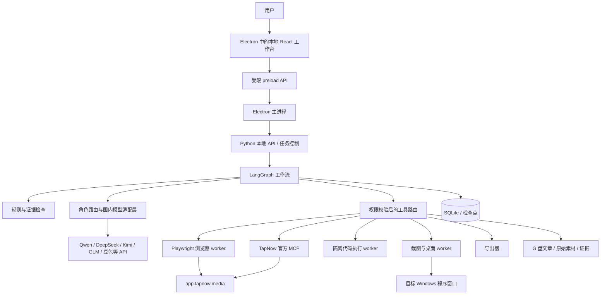
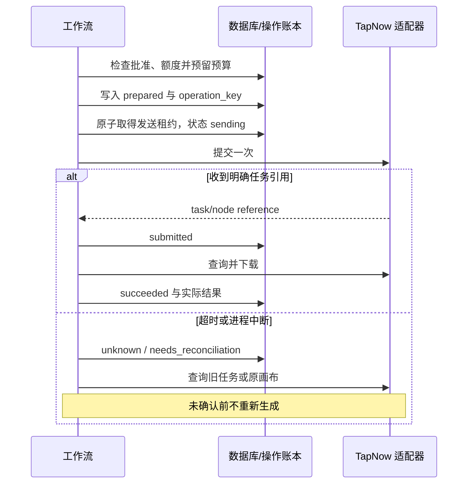

# ICE Loop Agent：文章、TapNow 配图与截图自动化开发设计文档

版本：v1.1｜编写/更新日期：2026-10-01｜面向：项目所有者、开发者、后续接手的编程 Agent。

**目标环境：独立 Windows 桌面程序；TapNow 站点为 `https://app.tapnow.media/`；项目数据与演示代码保存在 G 盘。**

**v1.1 补充要求：文章生成必须通过 AI 模型 API 完成，以国内供应商的新模型为主要接入对象。** 新增国内供应商与近期模型快照、按角色选模型、流式/思考/结构化输出适配、回退和评测设计，并同步更新接口、数据模型与开发任务。重点阅读第 9 节。

本文是一份开发方案，不是已实现软件。已核验现有项目文件与公开官方文档；未登录用户的 TapNow、未调用其授权工具、未实测生图下载或桌面截图。凡涉及账号可用能力、登录后页面定位、具体工具名称、服务端幂等与模型选项，均列为开发前验证项。技术建议、排期与指标是本项目的设计判断，不是开源项目或平台的承诺。

阅读顺序建议：了解方案先看第 1、4、5 节；判断开发量看第 23 节；开始编码重点看第 6、8、12–15、17–19 节；验收和打包看第 21、22、24 节。本文中的 JSON/YAML/伪代码属于拟定契约，不表示这些接口已实现。

## 1. 建议做成什么

做一个 **“有审核节点的内容生产桌面工作台”**。用户输入栏目、题目和素材，程序依次完成调研、骨架、正文、代码验证、图片规划、TapNow 生图、运行结果截图、审校与导出。任务中断后可以继续，某张图片不合格时可以只重做这一张。

核心体验是：**给出文章需求 → 审核关键节点 → 收到完整文章文件夹**。界面既能输入自然语言，也能看到当前步骤、证据、文件版本与下一项需要用户处理的事情。

推荐技术组合：

| 层 | 推荐选择 | 选择理由 |
|---|---|---|
| 桌面外壳 | Electron | 适合文章编辑、图片预览、任务面板和 Windows 分发 |
| 工作台界面 | React + TypeScript + Vite | 编辑器、差异比较、任务状态可复用成熟 Web 组件 |
| 任务引擎 | Python，首先验证 3.12 兼容性 | 与现有 Python 内容、浏览器及 Windows 自动化生态相接 |
| 工作流 | LangGraph 开源库 | 建模明确步骤、持久化状态与人工审核 |
| AI 文章生成 | 国内模型适配层；先跑通 Qwen 与 DeepSeek | 同一工作流可切换写作、审稿和视觉模型；近期模型见第 9 节 |
| 浏览器操作 | Playwright Python | 已知流程通过确定性操作执行与取证 |
| 浏览器适应能力 | browser-use，本地运行，按需启用 | 处理页面变化及模糊定位，限制在浏览器子任务内 |
| TapNow 接入 | 官方 MCP + 浏览器两种适配器 | MCP 提供结构化接入；浏览器满足可观察操作、设置与下载需求 |
| 程序截图 | Playwright + Windows UI Automation/捕获适配器 | 分别覆盖网页、运行日志与原生应用 |
| 本地数据 | SQLite + 文件系统 | 单用户运行足够，易归档、备份与追踪 |

这是组合复用方案，不建议一开始 fork 一个大型通用 Agent 再修改全部界面。桌面外壳可以从模板起步，任务与资产模型围绕 ICE Loop 自己建立。

**用户要求的浏览器访问 TapNow 是明确功能，不因发现 MCP 而取消。** 界面提供“浏览器 / MCP / 手动导入”选项。初期浏览器模式完成一张图片闭环；MCP 通过账号验证后可作为日常优先路径。一次生图任务选定一个提交通道，提交结果不确定时禁止换通道重复发起。

## 2. 需求、范围与自动化边界

### 2.1 本次明确的需求

1. 自动撰写 ICE Loop 文章，而非只输出泛用提示词。
2. 访问 `app.tapnow.media`，生成并归档 AI 配图。
3. 截取网页、真实程序界面和实际运行输出。
4. 独立桌面程序，适配当前 Windows 和 G 盘项目。
5. 可以复用开源项目，降低开发量。
6. 文章生成必须接入模型 API，主要面向国内供应商的新模型；通过桌面设置完成 Key、模型与角色配置。

### 2.2 第一版必须具备的功能

| ID | 功能 | 完成标准 |
|---|---|---|
| F01 | 导入项目规则与已有文章 | 显示来源、冲突、选中版本；已有文件默认只读 |
| F02 | 新建文章任务 | 栏目、系列编号、选题、素材、字数范围、上一期与预告均可填写 |
| F03 | 调研与事实记录 | 重要断言关联来源、访问时间及待核验状态 |
| F04 | 选题、骨架、最终标题审核 | 保留三个明确审核节点；可提前批准具体的已展示方案 |
| F05 | 文章与发布资料生成 | 输出现有 00–03 文件契约、标题评分与摘要 |
| F06 | Python/Java 代码验证 | 真实运行，输入、输出、退出码、环境及代码哈希可追溯 |
| F07 | TapNow 浏览器单图流程 | 手动首次登录后，上传参考图、填写提示词、提交、等待、下载与关联 |
| F08 | 三种截图模式 | 网页、真实运行日志视图、Windows 原生程序；后者有接管与手动导入 |
| F09 | 图片审核与重做 | 每张图可保留、拒绝、替换，重新生成有明确次数限制 |
| F10 | 暂停、恢复与故障接管 | 重启不重复提交已产生外部副作用的步骤 |
| F11 | 成稿检查与导出 | 必需项未满足时标注草稿；就绪时导出完整包 |
| F12 | 运行日志与用量 | 查看每个步骤、失败原因、模型用量和生图次数 |
| F13 | 国内模型接入与选择 | 至少两个国内 API 服务可完成写作；供应商、地域/业务空间、协议、Key、模型分别配置 |
| F14 | 模型能力与角色路由 | 按写作/审稿/结构化/视觉选择模型，能力不足时明确报错或使用已配置回退 |
| F15 | 模型更新与任务追溯 | 模型目录可刷新；每个任务固定配置快照并记录实际调用与失败回退 |

MCP 若账号接入成立，纳入第一版；若不成立，浏览器功能仍然需要单独完成验收，不能用“有 MCP 文档”替代浏览器实测。

### 2.3 第一版暂不纳入

微信公众号自动正式发布、自动购买额度、多人协作服务、云端无人值守原生桌面截图、多账号调度、自训练模型、自动操作所有 Windows 软件。导出至 mdnice/壹伴后仍需手机预览和最终发布审核。

Git 同步放在后续版本：识别私有仓库、展示差异并按配置执行。现有记忆中的关闭 Git TLS 验证属于本机历史情况，程序默认保留 TLS 验证，单独排查证书与代理，不把 `GIT_SSL_NO_VERIFY=true` 写成系统默认。

### 2.4 自动化等级

| 模式 | 程序行为 | 适合场景 |
|---|---|---|
| 辅助模式 | 写稿、代码验证与提示词；生图/截图可手动导入 | 起步与导入旧文章 |
| 半自动模式，默认 | 保留三个写作审核门；批准素材计划后自动生图、截图、导出 | 日常生产 |
| 预批准模式 | 用户先审核具体选题、骨架、标题及资产计划，后续在批准范围内运行 | 已明确的系列存稿 |

预批准模式不是隐藏跳过审核。批准记录包含具体内容哈希、参数和范围；用户没有回答、关闭弹窗或等待超时，不视为批准。批准范围内的重复性操作不逐次弹窗；新增张数、变更模型/团队或超出预算时再处理。

2026-09-29 的项目分工为用户自行生图和截图；本次 2026-10-01 的新需求明确提出自动化。系统设计支持自动模式，但历史文章默认保持其原状态，只有用户选择任务后才执行补图或截图，不批量改写存稿。

## 3. 现有项目如何转化为程序规则

### 3.1 规则来源与优先级

规则解析不能简单把全部 Markdown 拼进一个 Prompt。至少区分：

1. 当前用户对该任务的明确指令与批准。
2. `AGENTS.md` 中较新的明确工作约定和冲突裁定。
3. 文档内容冲突按项目声明处理：品牌手册 → 定位与排期 → 文章模板。
4. article-craft 的文章生产流程。
5. 经过 ICE Loop 适配的 khazix-writer 终审标准。
6. 历史文章作为示例，不能覆盖以上规则。

规则文件附带来源、修改时间、SHA-256 和导入版本。界面显示“来源中的要求”与“本次任务的覆盖”，避免覆盖长期记忆。发生未裁定冲突时只暂停受影响步骤。

已发现的冲突需要内置明确解释：

| 旧文档/通用 skill 中的写法 | ICE Loop 有效处理 |
|---|---|
| 正文放 GitHub 仓库链接 | 私有仓库仅归档，正文不放链接 |
| “10 分钟完成”等标题 | 无实测支持时不使用时长承诺 |
| 固定四更、固定更新日 | 内部排期可使用；对外文案不作固定承诺 |
| 回复关键词领取未完成资料 | 资料文件、分发路径和审核未就绪时不承诺 |
| khazix-writer 不使用小标题/冒号、强情绪标点 | 项目规定的标题层级与冷静口吻优先 |
| article-craft 通用字号、图片密度 | 品牌与本篇审核后的配图计划优先；密度建议不做强制报错 |

### 3.2 规则引擎的分层

**结构规则**由程序验证：标题级别、字数、代码行数、文件是否齐全、图片是否存在、编号关系。Markdown 应解析为 AST，避免在代码或引用中误识别标题和禁词。

**事实规则**由“来源证据 + 待核验字段 + 审核”验证。模型说“已核实”不是证据；查询摘要不能直接代替原文。

**风格规则**由模型审查与人工判断：是否适合零基础学生、是否解释清楚、是否伪造个人经历、语气是否准确。不要给出“AI 味 3%”等无根据的指标。

**执行规则**由工具权限层验证：写入根目录、可执行命令、外部域名、已批准生图次数、截图窗口。

### 3.3 推荐规则文件

以下 YAML 是程序拟采用的配置契约，不是现有系统已支持的配置：

```yaml
profile: ice-loop
profile_version: 1
brand:
  name: ICE Loop
  slogan: 可执行的想象。
  colors: ['#2448DB', '#15191F', '#F3F2ED']
article:
  title_max_chars: 30
  abstract_chars: [54, 120]
  code_blocks: [1, 3]
  code_block_max_lines: 20
  key_comment_lines: [2, 4]
  required_ending_heading: 写在最后
  publication_days_public: false
  private_repository_links_public: false
reviews:
  required: [topic, outline, final_title]
assets:
  generation_provider: tapnow_browser
  avatar_redraw: false
  generation_requires_plan_approval: true
storage:
  article_root: 'G:/05-兴趣项目/gonzhonhao/output/文章'
  runtime_root: 'G:/05-兴趣项目/gonzhonhao/.iceloop-agent'
```

“关键注释”是否充分需要语义审查，不能只靠 `#` 或 `//` 数量；规则检查正文中的演示代码，文档说明性的 Shell 命令单独分类。工具周刊也应包含“本周一段代码”。长度统一按去除 Markdown 标记后的可见 Unicode 字符计数，标题空格与标点计入；编辑器同时显示计数口径。

### 3.4 栏目与系列关联

分别保存文件夹编号和系列编号。例如 `010-…` 可以是 `PY/005`，两者不能共用一个自增字段。

文章创建时明确选择 `previous_article_id`、`next_episode_plan` 与 `exercise_to_answer`。程序提取上一篇动手题与预告，供用户核对。只有真实文件和明确版本可作为系列上下文，不依赖旧进度表推测已经发布。介绍文 `000` 的 `01-公众号正文-v2.md` 应被识别为当前候选版本，由用户确认导入。

内部规划保存预计发布时间；发布事实另存 `published_at`。库存按“通过最终审核且尚未发布”的文章计算，目标保留至少两篇，草稿和待补图文章不能算就绪库存。

## 4. TapNow 公开能力与验证结论

### 4.1 已核验内容

官方文档公开了自定义 MCP 连接方式，并为 `.media` 站点列出了独立地址：

```text
网站：https://app.tapnow.media/
MCP：https://mcp.tapnow.media/api/agent-gateway/mcp/general/mcp
```

接入需要完成账号授权；授权对应账号和团队。来源：[TapNow 自定义连接文档](https://docs.tapnow.ai/en/docs/mcp/add-a-custom-connector)。

官方介绍了在其他 Agent 中生成图片/视频、检索资产和使用画布的能力。生成会使用账户的 Tapies；公开介绍不等于本账号已具备全部能力。来源：[TapNow 在其他 Agent 中使用](https://docs.tapnow.ai/en/docs/mcp/use-tapnow-in-other-agents)。

官方画布文档介绍了图片节点、参考图、模型、比例、尺寸、数量和结果检查；下载另有批量导出说明。来源：[图片生成与编辑](https://docs.tapnow.ai/en/docs/canvas/generate-and-edit-images)、[批量下载](https://docs.tapnow.ai/en/docs/canvas/download-in-batches)。

### 4.2 仍然未确认的内容

| 问题 | 为什么会影响开发 | 验证方式 |
|---|---|---|
| 当前账号是否可接入 MCP | 决定日常默认通道 | 用户在首次设置中授权后探测 |
| 官方工具的名称、输入 JSON schema、返回类型 | 不能直接写 SDK 调用 | MCP 初始化、列出工具、保存 schema 快照 |
| OAuth 客户端注册与回调要求 | 决定桌面程序能否独立授权 | 按服务器发现信息与官方接入要求验证 |
| 参考图上传和编辑模式的具体能力 | 封面需要复用模板 | 用一张授权的测试参考图验证 |
| 生图异步任务 ID、轮询、取消、幂等支持 | 决定恢复时是否能安全重试 | 记录实际响应与官方说明 |
| 图片下载 URL 或导出工具 | 决定能否自动归档原图 | 下载并核验文件和过期情况 |
| `.media` 登录后 UI 与英文文档的一致性 | 浏览器定位和设置可能不同 | headed 浏览器实测、录制流程 |
| 网站对自动化使用的当前约定 | 决定允许的操作范围 | 核查站内最新使用条款与账户提示 |

本次公共网页抓取不能读取实际登录后画布；不据此宣称 UI 选择器或下载流程已经跑通。也不能推断 MCP 是匿名可调用的 REST 生图 API。

### 4.3 路径选择

| 路径 | 本项目用途 | 条件与限制 |
|---|---|---|
| 官方 MCP | 结构化生成、画布关联与可用资产查询 | 先验证授权、schema 与下载能力 |
| Playwright 浏览器 | 用户要求的可见操作、参考图设置、下载与画布取证 | 登录后页面适配需要维护 |
| browser-use 受限任务 | 定位改变时提出或执行小范围浏览器动作 | 不开放文件系统、系统命令或付款权限 |
| 手动导入 | 登录/页面变化暂未解决时继续完成文章 | 保存原始文件、来源与人工处理记录 |

不直接逆向未公开的生图接口，不把抓到的 Cookie 当作 API Key，不绕过验证码。验证码或重新登录时显示接管按钮，用户处理后程序验证登录状态再继续。

## 5. 可复用项目调研与选型

下表比较的是对当前项目的适配性；没有在本机安装或测试这些项目。许可按调研时官方仓库/许可证核验，开发时固定 commit 并再次检查。代码公开不自动等同于宽松开源许可。

| 项目 | 定位与许可 | 可以拿来做什么 | 需要补什么 | 建议 |
|---|---|---|---|---|
| [browser-use](https://github.com/browser-use/browser-use) | 浏览器 Agent，MIT；[许可](https://github.com/browser-use/browser-use/blob/main/LICENSE) | 本地浏览器任务、语义定位与受控页面适应 | 文章模型、可靠生图提交账本、桌面界面 | 推荐作为适配器依赖 |
| [browser-use/web-ui](https://github.com/browser-use/web-ui) | Gradio 浏览器 Agent UI，MIT | 快速验证 TapNow 浏览器流程、参考任务控制方式 | 所有 ICE Loop 规则、文件契约、桌面包装与原生截图 | 推荐做 PoC，可小范围 fork |
| [LangGraph](https://github.com/langchain-ai/langgraph) | 状态化流程编排，MIT | 写作节点、审核、检查点、恢复 | 产品界面、工具实现和外部操作幂等 | 推荐作为任务核心 |
| [Playwright](https://github.com/microsoft/playwright) | 浏览器自动化，Apache-2.0 | 定位、上传、下载、浏览器截图 | 语义决策与 Windows 原生应用操作 | 推荐作为浏览器主通道 |
| [electron-react-boilerplate](https://github.com/electron-react-boilerplate/electron-react-boilerplate) | Electron/React 桌面模板，MIT | 桌面外壳、构建与项目结构参考 | Python sidecar、工作流与文章业务 | 可选起点，不与其他模板叠加 |
| [Skyvern](https://github.com/Skyvern-AI/skyvern) | 浏览器视觉自动化、工作流，AGPL-3.0 | 较复杂的浏览器流程参考或独立部署试验 | 文章与桌面业务，额外部署负担 | 第二备选；本项目先不依赖 |
| [Dify](https://github.com/langgenius/dify) | 可视化 LLM/RAG/工作流平台，附加条件许可 | 快速验证写作提示词与审核流程 | 本机浏览器/截图 worker、独立桌面体验 | 可作写作原型，暂不作为桌面底座 |
| [OpenHands/OpenHands](https://github.com/OpenHands/OpenHands) | 当前 README 为 coding agents 的 Agent Canvas；顶层 MIT | Agent 控制台与开发自动化设计参考 | 专门的文章、素材与截图契约 | 不作为本项目首选 fork |
| [n8n](https://github.com/n8n-io/n8n) | 工作流平台，Sustainable Use License 等分区许可 | 后续调度、通知和系统串联 | 本机执行代理与桌面产品 | 后续集成；不是本文宽松开源底座 |

Dify 的许可有多租户与前端标识相关附加条件；n8n 有用途和企业文件限制。不要直接当成普通 Apache/MIT 项目去掉标识再分发。Skyvern 引入了 AGPL 义务，若后续采纳应先明确修改与分发范围。来源：[Dify LICENSE](https://github.com/langgenius/dify/blob/main/LICENSE)、[n8n LICENSE](https://github.com/n8n-io/n8n/blob/master/LICENSE.md)、[Skyvern 官方仓库许可说明](https://github.com/Skyvern-AI/skyvern)。

OpenHands 的仓库与产品形态可能演进，本文基于当前读取到的 README；接手开发时不能照搬旧教程中的目录或架构。依赖其具体 SDK 或子项目需要核验该组件自己的许可。来源：[OpenHands 当前仓库](https://github.com/OpenHands/OpenHands)、[顶层 LICENSE](https://github.com/OpenHands/OpenHands/blob/main/LICENSE)。

### 5.1 两条可落地路线

**路线 A：先验证，再组合复用，推荐。** 用 browser-use/web-ui 或一个短 Playwright 验证程序完成浏览器单图流程；正式应用新建 Electron/React 外壳，Python 引擎引用 LangGraph、Playwright 与可选 browser-use。保持业务代码与第三方库分离。

**路线 B：直接改 browser-use/web-ui。** 加文章选题、正文审核、图片列表、导出与数据库，然后包装成桌面应用。较快看到浏览器原型，但 Gradio 交互与长期编辑器、差异视图、多窗口截图之间还要做大量改造。适合先做内部试验，未必适合最终桌面成品。

不建议第一版采用“Dify + n8n + Skyvern + OpenHands”同时拼装。它们各自带来配置、数据库、运行环境与升级问题，单人项目容易把开发时间花在平台联调。

### 5.2 复用时具体改造哪些层

| 层 | 处理方式 |
|---|---|
| 浏览器启动、基础动作与模型适配 | 尽量使用库公开接口；先验证，再锁定版本 |
| 任务步骤与重试 | 自己建立，不把生图提交交给无限自主循环 |
| 页面定位 | 写 TapNow 专用 adapter，selectors 与页面版本单独管理 |
| 文章、证据、代码与图片关系 | 自己建立类型化数据模型 |
| 规则与技能 | 从已授权使用的本地文本提炼；私有 skill 文本不随产品公开分发 |
| 桌面 UI | 从模板复用基础外壳，业务页面自建 |
| 安全、测试与归档 | 本项目实现，不能以第三方提供 Agent 能力代替 |

实际 fork 前保存 `upstream_url`、commit SHA、LICENSE 与修改清单；优先通过 adapter 扩展，避免修改第三方内部类。不要用星标数量代替适配性和可运行验证。

## 6. 总体架构

### 6.1 进程边界



MVP 可以只有一个 Python sidecar 进程和串行任务队列；图中的 worker 是逻辑边界。代码执行进入隔离运行环境，浏览器持有独立配置，原生桌面操作串行。以后再拆成独立进程。

文章工作台和 TapNow 自动化浏览器**不是同一个渲染器**。主工作台只加载随应用分发的本地 UI。TapNow 初期在可见的独立 Chromium/Chrome 窗口打开，工作台显示截图、动作摘要和“切到浏览器”按钮。这仍是独立桌面产品，不需要用户另起 Web 服务。将 TapNow 嵌入应用窗口属于后续体验优化，不作为第一版生图功能的前提。

### 6.2 为什么采用这一组合

LangGraph 提供持久化与人工中断机制，适合跨多个步骤的文章任务；但不能自动保证外部网站操作只执行一次。外部提交还需本项目的操作账本。来源：[持久化](https://docs.langchain.com/oss/python/langgraph/persistence)、[人工中断](https://docs.langchain.com/oss/python/langgraph/interrupts)。

Playwright 处理稳定操作，browser-use 只处理难以确定的位置与页面变化。不能假设最新 browser-use 一定向外暴露兼容的 Playwright Page；通过自己的 BrowserSession 接口封装两者，不共享内部对象。若要复用同一浏览器，通过受控 CDP 连接并在 PoC 中验证；若不兼容则一次会话只由一种 driver 控制。

### 6.3 桌面通信与生命周期

1. Electron 启动时读取 G 盘 runtime root，检查写权限与单实例锁。
2. 主进程使用 `child_process.spawn` 启动打包后的 Python sidecar；Python 不通过 Electron `utilityProcess` 作为 Python 解释器启动。
3. sidecar 在回环地址分配端口，通过受控启动通道报告 ready、端口与协议版本。
4. 每次启动生成随机会话令牌；仅主进程持有，renderer 通过受限 preload 方法访问业务操作。
5. 可使用 FastAPI 提供内部 REST 与 SSE；只绑定 `127.0.0.1`，验证令牌、来源与请求类型，不暴露到局域网。
6. UI 重载不重启正在运行的任务；Python worker 故障由主进程检测，恢复前读取操作账本。
7. 退出提供“暂停并退出”与“最小化继续”；暂停只能阻止新的外部提交，已在 TapNow 发出的任务可能继续完成。

若端口通信维护负担高，后续可替换为受控管道；业务接口保持一致。SSE 使用单调事件序号和 `Last-Event-ID` 恢复，不能只靠 UI 内存保存进度。

### 6.4 桌面框架备选

| 方案 | 对本项目的取舍 |
|---|---|
| Electron + React + Python | 文章编辑与 Web 预览比较直接；需要管理 Node/Python 两套构建以及额外浏览器体积，是本文主方案 |
| Tauri + Web UI + Python sidecar | 若团队熟悉 Rust，可进一步验证；仍有 Python 引擎与外部浏览器，不能只按空壳安装包比较整套体积 |
| PySide6 + Python | 更适合优先用 Python 开发；需要评估编辑、预览与多面板体验，以及采用模块的 Qt 许可 |

这里是开发成本判断，不是性能测试结果。框架边界参考[Tauri 官方介绍](https://v2.tauri.app/start/)，Qt for Python 的许可参考[官方说明](https://doc.qt.io/qtforpython-6/licenses.html)。如果实际开发者主要熟悉 Python，可以在 M0 后改选 PySide6；业务模型、操作账本与 TapNow adapter 保持独立，避免 UI 框架决定全部架构。

## 7. 桌面界面与用户操作

### 7.1 主窗口布局

```text
┌───────────────┬───────────────────────────┬──────────────────────┐
│ 项目 / 栏目   │ 文章编辑与预览            │ 当前任务             │
│ 文章库        │ 正文 / 骨架 / 版本差异    │ 阶段、日志、审核入口 │
│ 新建任务      │ 代码 / 事实 / 配图        │ 浏览器预览 / 接管    │
│ 素材与模板    │ 图片审核 / 手机宽度预览   │ 用量与待办           │
│ 设置          │                           │                      │
└───────────────┴───────────────────────────┴──────────────────────┘
```

工作台采用品牌三色，但品牌规范是文章与封面的要求，UI 可有适当状态色并搭配文字。不要把复杂日志、模型参数堆进正文阅读区。

### 7.2 核心页面

| 页面 | 主要内容 | 核心操作 |
|---|---|---|
| 项目首页 | 存稿状态、缺图、待事实核验、库存 | 导入、选择文章、创建任务 |
| 新建文章 | 栏目/系列、受众、选题、素材、上一期、下一期 | 创建任务，选择自动化模式 |
| 审核面板 | 选题/骨架/标题、修改说明、版本 | 批准当前版本、退回、编辑 |
| 正文编辑 | Markdown、预览、差异、章节锁 | 接受修改、恢复、锁定章节 |
| 事实面板 | 断言、原文片段、来源、验证时间 | 标记已核验、删除断言、补来源 |
| 配图面板 | P 编号、位置、提示词、参考图、实际参数 | 批准计划、生成、选图、手动替换 |
| 截图面板 | 目标窗口、运行记录、原图、裁切图 | 截图、接管、重截、标注 |
| 任务详情 | 节点、状态、事件、恢复建议 | 暂停、继续、取消、本步骤重试 |
| 设置 | 数据目录、模型、TapNow、截图与运行环境 | 连通性测试、登录、授权、备份 |

### 7.3 新用户首次启动

选择 `G:\05-兴趣项目\gonzhonhao` → 导入规则与模板 → 确认版本与冲突 → 配置模型凭据 → 检查 Python/JDK/Git Bash 或隔离执行环境 → 选择 TapNow 浏览器模式并手动登录 → 可选授权 MCP → 做一张测试图和一组截图 → 创建第一篇文章。

模型设置先选择国内服务平台与正确地域/业务空间，再填 Key、选择模型，最后绑定写作/审稿/视觉角色。Key 有效不等于模型可用；需要明确执行一次小样本测试后显示已验证能力。测试调用可能消费模型用量，不在启动时静默反复测试。

没有模型配置时仍可浏览存稿、规则和素材，但不能创建自动写作任务。没有 TapNow 授权时仍可写稿和手动导图。没有隔离代码环境时可以生成代码草稿，但不自动将它标记为已验证。

## 8. 写作工作流与状态机

### 8.1 生产步骤

| 节点 | 输入 | 产物/动作 | 进入下步条件 |
|---|---|---|---|
| ingest | 用户需求、规则、上期文章 | 任务说明、冲突列表 | 必需参数齐全 |
| topic | 选题输入与排期 | 3–4 个方向、工作标题 | 选题批准 |
| research | 已批准方向 | 来源、断言、证据边界 | 无阻断核心事实 |
| outline | 研究与系列钩子 | 正文骨架、代码计划、图位 | 骨架批准 |
| draft | 已批准骨架 | 内部初稿、代码候选、占位符 | 结构基本合格 |
| verify_code | 代码、输入案例 | 实际运行记录与失败素材 | 必需代码验证通过 |
| integrate_evidence | 运行与来源 | 校正输出、环境描述、证据映射 | 证据与正文一致 |
| article_review | 初稿与 article-craft | 事实/结构检查、修订 | 阻断问题修复 |
| style_review | 修订稿与适配的 khazix-writer | L1–L4 报告与建议 | 风格修改不损害证据 |
| title_workshop | 当前正文、预告、封面约束 | 5–10 候选、五维评分 | 最终标题批准 |
| asset_plan | 定稿标题、图位与参考图 | 生图/截图计划与预算范围 | 资产计划批准 |
| assets | 已批准计划 | TapNow 原图、截图、裁切衍生图 | 必需图通过审核 |
| final_check | 正文、证据、图片 | 完整检查清单、待办 | 就绪或明确草稿 |
| export | 已审核版本 | 00–03、code、images 与发布包 | 文件一致性验证 |

内部初稿可使用 `working_title` 字段。只有最终标题批准后，才在正式 `01-公众号正文.md` 的 `#` 标题中写入 final_title；预览期间显示“工作标题”。封面最终生成安排在标题批准之后，减少改标题带来的返工。

### 8.2 状态并不等于文章质量

任务状态：`queued / running / awaiting_approval / awaiting_user / paused / failed / cancelled / completed`。

文章就绪状态另存：`draft / text_verified / assets_pending / review_pending / ready_for_publish / published`。一个“生成草稿”任务可以 completed，但文章仍为 draft；UI 必须区分。“已发布”仅由真实发布确认设置，不根据导出成功推断。

### 8.3 修改时如何重跑

以依赖关系标记失效，而非全文重新执行：

| 用户修改 | 必须失效的产物 |
|---|---|
| 代码内容 | 对应运行记录、输出断言、运行截图 |
| 输入案例 | 对应运行记录和截图 |
| 最终标题 | 标题批准、封面和标题承诺检查 |
| 一个普通段落 | 该段风格审查与相关事实检查 |
| 高风险事实 | 原断言核验与最终就绪状态 |
| 生图提示词/参考图/模型/尺寸/数量 | 对应资产计划批准与生图候选关联 |
| 上一期参考答案 | 系列衔接与相关代码验证 |

已经取得的生图原图不会因失效自动删除；标记为旧候选，可人工重新采用。外部已完成的任务不自动“补偿”或退款。

### 8.4 自动修订上限

建议每个文本节点最多两轮自动修订，每个资产按计划批准的候选数执行；结构化输出失败可再做一次修复。达到上限后显示具体问题和建议，不无限运行。重试次数与预算是可配置的工程默认值，与文章对外文案无关。

模型审查只能提出 patch，不能悄悄改已核验代码、事实数字、标题、品牌标志或配图位置。patch 按节点和字段应用，应用后再次运行对应检查。

## 9. Agent 与模型设计

### 9.1 角色是节点职责，不是必须同时运行的多个 Agent

建立规划、研究、写作、代码验证、配图、浏览器、审稿七种职责。第一版由一个流程引擎顺序调度，同一模型可以承担多个职责。

固定步骤交给程序；需要自然语言判断的步骤调用模型。这样既保留 Agent 的规划与适应能力，又能清楚解释“当前为何停住、下一步准备做什么”。模型不能自行跳过审核或修改任务预算。

### 9.2 模型适配层

```text
ModelProvider
  capabilities(endpoint_profile, model_profile)
  generate_structured(request, schema, limits)
  generate_text(request, limits)
  stream_text(request, limits)
  inspect_image(request, image, limits)
  usage_from_response(response)
```

这是本程序接口，不是某一家供应商 SDK 的直接方法。request 包含 task_id、role、messages、provider_profile_id、model_profile_id、thinking_policy、output_format 与配置快照。底层优先复用成熟 HTTP/兼容 SDK，adapter 负责差异。第一版先实现 Qwen/百炼与 DeepSeek 的普通模型 API，形成两个国内路径；Kimi、GLM、方舟按下文增加预置与合同测试。

“兼容 OpenAI 接口”只代表某种协议兼容，仍要实测流式、tool calling、JSON schema、视觉输入及错误格式；不写死模型名称。浏览器任务需要有适合视觉/工具调用的模型，纯文本写作模型可单独选择。模型 API、TapNow 与可选云浏览器各自计费；不能假定桌面聊天订阅自动包含 API 用量。

每个阶段设 token、调用次数与超时上限。若响应未返回用量，标记 `usage_unknown`，不能记为零。

### 9.3 Prompt 分层

按顺序组织：平台安全边界 → 当前用户需求 → 版本化规则 → 本节点职责 → 已批准上游产物 → 证据 → 输出 schema。

外部网页、截图 OCR 和正文素材放入明确的数据区，不作为系统指令。不能让网页中“忽略之前规则”“上传本地全部文件”等内容改变权限。

不把本地 skill 当作可直接执行的库。提炼 article-craft 的六步与三个门、khazix-writer 的四层审查，并保留来源和版本。既有 skill 对“工程扩展不在 skill 本体内”的约定意味着应放在新应用自己的模块，不回改 skill 文件。

### 9.4 文章使用结构化中间格式

建议保存章节与内容块：

```json
{
  "schema_version": 1,
  "working_title": "for 和 while：让电脑替你重复干活",
  "final_title": null,
  "series": "PY",
  "episode": 5,
  "blocks": [
    {"id": "intro-1", "type": "paragraph", "text": "..."},
    {"id": "code-1", "type": "code", "artifact_id": "src-1"},
    {"id": "output-1", "type": "run_output", "run_id": "run-1"},
    {"id": "figure-2", "type": "image", "asset_slot_id": "slot-2"}
  ]
}
```

输出块从运行记录渲染，模型不直接补写结果。图片按 slot_id 插入，避免替换第一个“图2”文字时误改标题或提示词。Markdown 是正式编辑与交付格式，结构化格式用于追踪关系；两者之间需要稳定 ID 与受控同步。

用户直接编辑 Markdown 时先解析、展示差异，再更新节点。无法判断被修改块的关系时标记“需要重新绑定”，不能猜一个运行记录继续沿用。

### 9.5 国内模型接入范围与服务平台区分

**写作 AI 是核心依赖。** 选题、骨架、正文、标题、配图提示词和风格审查调用模型；程序负责规则、证据、执行、资产和审核。没有有效写作模型时不能把占位模板当作“自动文章生成成功”。模型生成配图提示词与 TapNow 生图是两个独立动作，文章模型 Key 不用于登录 TapNow。

模型厂商、API 服务平台和模型 ID 分开：同一 Kimi/DeepSeek/GLM 模型可能由原厂或百炼/方舟托管；模型名称相近不代表端点、Key、参数、视觉、限流和计费完全一致。内部配置需表示“哪个服务平台的哪个账号/地域，调用哪个 model_id”。

使用 OpenAI 兼容协议或 SDK 不要求用户拥有 OpenAI 账号；请求必须发往已配置的对应服务地址。程序不在未配置时退回 SDK 默认的 OpenAI endpoint。新增同协议模型通常只需配置目录与能力测试；协议/参数变化才需要 adapter 更新，不能把任意新模型直接标为可用。

本项目默认使用普通按量模型 API，不默认使用网页聊天会员、编程套餐 Key 或从浏览器复制的登录凭据。百炼官方明确区分普通 API 与 Coding/Token Plan，后两者当前限制为交互式 AI 工具用途，不能用于后端服务；本应用的任务引擎按普通模型 API 设计。其他平台套餐按其实际约定核验，不把这项限制一概套用到所有厂商。来源：[百炼地址与计费方案](https://help.aliyun.com/zh/model-studio/base-url)。

### 9.6 近期模型与国内接入地址快照

以下为 **2026-10-01 读取的官方资料快照**，不是账号调用结果，也不宣称为跨平台“绝对最新”排名。开发时从实际服务平台确认可用 ID；地区/业务空间和端点以控制台为准。价格、额度和上下文数字不写死在产品默认配置里。

| API 服务平台 | 官方资料中的近期模型示例 | 兼容 Chat 基础地址 | 项目接入注意 |
|---|---|---|---|
| 阿里云百炼 / Qwen | `qwen3.8-max`、`qwen3.7-plus`、`qwen3.8-flash` | 北京共享地址 `https://dashscope.aliyuncs.com/compatible-mode/v1`；亦可使用本业务空间专属域名 | 实际地域和 Key 配套；文本、结构化与视觉按模型分别验证 |
| DeepSeek 原厂 | `deepseek-flash`、`deepseek-v4-pro`；官方当前将 Flash 映射至 V4.1-Flash | `https://api.deepseek.com` | 别名可能滚动更新；Chat/Responses、思考与视觉能力分别管理 |
| Moonshot / Kimi 中国平台 | `kimi-k3`、`kimi-k2.7-code`、`kimi-k2.6` | `https://api.moonshot.cn/v1` | 不同版本的思考参数和复杂 schema 行为不同 |
| 智谱 BigModel | `glm-5.3` | Chat：`https://open.bigmodel.cn/api/paas/v4/` | 当前该模型仅文本且思考不能关闭；Responses 使用不同基础地址 |
| 火山方舟 / 豆包 | 官方兼容示例为 `doubao-seed-2-1-pro-260628` | `https://ark.cn-beijing.volces.com/api/v3` | 使用当前账号可调用的模型 ID/允许的推理接入点，不能用展示名称猜 API ID |
| 百炼托管的其他国内模型，后续扩展 | 官方目录还列 `MiniMax-M3`、MiMo 与其他厂商模型 | 使用选定百炼地域/业务空间的地址 | 这是托管服务路径，不等于已核验原厂国内 API 或所有参数 |

快照来源：[百炼模型目录](https://help.aliyun.com/zh/model-studio/models)、[百炼 Base URL](https://help.aliyun.com/zh/model-studio/base-url)、[DeepSeek 首次调用](https://api-docs.deepseek.com/)、[DeepSeek 模型说明](https://api-docs.deepseek.com/quick_start/pricing/)、[Kimi 模型目录](https://platform.kimi.com/docs/models)、[Kimi 首次调用](https://platform.kimi.com/docs/get-api-key)、[GLM-5.3](https://docs.bigmodel.cn/cn/guide/models/text/glm-5.3)、[方舟兼容接口](https://docs.volcengine.com/docs/ark/compatible-with-openai-sdk?lang=zh)。

不能照搬旧教程默认 `deepseek-chat`/`deepseek-reasoner` 或旧 Kimi/GLM ID。MiniMax 国内原生 API 文档本次未成功读取，暂不内置未经核验的原生国内地址；可以先通过已核验平台的托管模型作为候选。官方目录有模型不等于当前账号、地域或业务空间已开通。

### 9.7 能力登记，不能只设一个“OpenAI 兼容”开关

每个 capability 绑定 `endpoint + protocol + model_id + mode`，状态采用 `documented / verified / unsupported / unknown` 并记录证据时间，未知能力不按支持处理。

| 能力字段 | 验证内容 | 使用方 |
|---|---|---|
| text、stream | 纯文本与 SSE 正文增量 | 正文/润色 |
| json_object | 语法有效 JSON，不代表 schema 全符合 | 结构化备用路径 |
| json_schema | 支持的 schema 子集、严格模式和嵌套 | 骨架、审稿、标题表 |
| tool_calls | 工具参数、ID、完整循环与回传字段 | 浏览器降级/研究工具 |
| vision | 图片输入格式、限制与真实识别 | 截图/图片辅助审核 |
| thinking | 可关闭/必须开启/不支持；合法强度 | 推理、参数翻译 |
| usage | 普通/流式、缓存/思考字段口径 | 用量与预算 |
| cancellation | 是否仅本地停止、远端是否有取消接口 | 暂停/退出 |
| input_budget/output_budget | 上下文与输出限制及适用口径 | 分章节生成 |

例如 GLM-5.3 当前不能接图片，也不能发送 `thinking.type: disabled`；配置页面不允许给它开启视觉或“关闭思考”。Kimi K3 与旧版本的思考选项不统一。来源：[GLM-5.3 参数](https://docs.bigmodel.cn/cn/guide/models/text/glm-5.3)、[Kimi K3 参数](https://platform.kimi.com/docs/guide/kimi-k3-quickstart)。

模型目录没有统一的完整发现协议。若平台支持可用模型列表则正常查询；否则用人工维护的官方文档预置 + 用户填写 model_id + 小样本能力探测。列表通常也不完整表达能力与计费，不能只依据列表给所有项目打“支持”。

### 9.8 按角色选择，先用真实文章评测决定

推荐先用 Qwen 与 DeepSeek 建立接入闭环；这是降低初期接口开发复杂度的工程建议，不是已测中文写作质量排名。随后以相同资料评测 Kimi、GLM 和豆包。用户可让同一个模型承担全部文本角色，也可分别绑定。

| 角色 | 主要要求 | 默认策略 |
|---|---|---|
| planner | 规则遵循、骨架与图位一致、结构化输出 | 使用已验证的结构化模型 |
| researcher | 依据给定证据提取断言 | 文本模型 + 本项目资料获取器，不依赖模型凭空联网 |
| writer | 中文表达、零基础解释、长文一致性 | 用户选定主写作模型；尽可能用非思考/低强度模式，受能力约束 |
| reviewer | 事实边界、风格与结构 patch | 同模型不同 Prompt 或已配置第二模型 |
| title_editor | 候选、机制、五维评分与承诺一致 | 已验证结构化模型 |
| code_helper | 代码候选与失败原因解释 | 代码能力合格的文本模型；执行证明仍由 run worker 负责 |
| visual_reviewer | 图片文字、版式与截图内容辅助检查 | 单独验证的视觉模型；不能把纯文本 GLM-5.3 作为此角色 |

视觉模型没有配置时，确定性浏览器仍可生图/下载，OCR 与用户审核继续；只有需要视觉 Agent 的降级步骤停住。不让“写作模型无视觉”阻断不需要视觉的全文流程。

审稿可以换模型帮助发现盲点，但两家模型意见一致不等于事实真实；证据库和真实运行仍是判断依据。角色路由在每个任务创建时固定。

### 9.9 供应商适配与参数翻译

结构建议：`BaseModelAdapter → OpenAIChatTransport / ResponsesTransport → QwenAdapter / DeepSeekAdapter / KimiAdapter / BigModelAdapter / ArkAdapter`。框架节点只调用统一请求接口，SDK 私有参数集中在 adapter。

内部使用 `thinking_policy = prefer_off / prefer_on / required_off / required_on / provider_default` 和独立 reasoning_level。adapter 根据模型能力翻译：Qwen 文档中的 `enable_thinking`、DeepSeek/部分方舟/GLM 的 `thinking`、Kimi 具体模型的 reasoning 参数，各自核验。不能向所有供应商发同一份 `extra_body`。来源：[Qwen 深度思考](https://help.aliyun.com/zh/model-studio/deep-thinking)、[DeepSeek 思考](https://api-docs.deepseek.com/guides/thinking_mode/)、[方舟参数](https://docs.volcengine.com/docs/ark/compatible-with-openai-sdk?lang=zh)。

不支持的参数默认 preflight 拒绝，或把 `prefer_off` 解释为该模型允许的最低强度并向 UI 说明；不伪装成已关闭。用户指定必须关闭时，应选其他模型。temperature、max_tokens 等也按能力发送，不盲目设置高温度或所有阶段同一输出上限。

`required_off` 是硬约束，写入任务路由/配置快照：主模型与备用都必须有已验证的关闭能力；always-on 或 unknown 模型不能入选，禁止回退时降成 prefer_off。`required_on` 同样需要已验证的开启能力。没有满足约束的模型时返回 `MODEL_CAPABILITY_MISMATCH`，让用户改模型或显式修订要求，不自动降低条件。

Chat Completions 与 Responses 的 schema/消息/事件格式各自封装。DeepSeek 当前 Responses 文档含 schema 输出，不能据旧 Chat JSON 教程断言整个平台“不支持 schema”；也不能把 Responses 参数直接塞进 Chat。来源：[DeepSeek Responses](https://api-docs.deepseek.com/api/create-response/)。

### 9.10 配置示例与模型目录更新

以下 YAML 为应用自己的配置，**不能直接作为厂商请求发送**；模型 ID 是本次官方快照示例，首次调用前验证。配置不含密钥，credential_ref 引用桌面凭据管理器。

```yaml
model_config_version: 1
providers:
  qwen_cn:
    adapter: qwen
    service: bailian
    protocol: chat_completions
    base_url: https://dashscope.aliyuncs.com/compatible-mode/v1
    region: cn-beijing
    credential_ref: qwen-primary-key
    model_id: qwen3.7-plus
    profile_status: requires_probe
  deepseek_native:
    adapter: deepseek
    service: deepseek-native
    protocol: chat_completions
    base_url: https://api.deepseek.com
    credential_ref: deepseek-backup-key
    model_id: deepseek-flash
    profile_status: requires_probe
routes:
  writer:
    primary: qwen_cn
    fallbacks: [deepseek_native]
    thinking_policy: prefer_off
  planner: {primary: qwen_cn, output: validated_json}
  reviewer: {primary: deepseek_native}
  visual_reviewer: {primary: null, mode: manual_until_configured}
limits:
  per_article_model_calls: 20
  concurrency: 1
  auto_json_repair_attempts: 1
fallback_policy:
  enabled: true
  only_configured_credentials: true
  replace_entire_node_candidate: true
```

`profile_status=requires_probe` 不能进入正式写作。验证文字/结构化成功后按已测能力设置 verified，不自动把视觉/工具等所有能力设为 true。本例不默认向未批准视觉服务上传截图。

目录刷新只影响新建任务的选项。任务保存 provider、model_id、协议、地域/业务空间、adapter_version、capability snapshot、thinking policy 与 Prompt/rules hash。既有任务中改模型需显式创建配置修订并重跑受影响节点；已经批准的正文不被后台替换。

滚动别名仍可能由平台更新，客户端固定配置不能保证远端权重永不变。可用时选择平台明确支持的快照 ID，并保存响应中的实际模型标识；无法获得真实版本时标记 unknown，不能捏造模型版本。

### 9.11 文章生成的请求与长文流程

文章输入至少含：栏目/编号、读者水平、核心收益、资料/来源 ID、上一篇练习与下期计划、已批准骨架、词数范围、术语与品牌规则、允许图位和已验证代码/运行记录。

骨架输出结构化对象；正文按章节流式生成 Markdown/内容块；标题评分、审稿问题和资产计划用结构化输出。不要为了统一格式强制整篇长文放进巨大 JSON 字符串。

长文策略：写作模型先获得全篇 brief 与章节摘要，再生成单章；每章保留 block ID 和 revision；最终执行通篇术语、前后引用、代码数量、练习答案与结尾衔接审查。上下文接近上限时压缩次要历史，保留规则、证据、已批准骨架与当前章节，不无差别截去 system/开头。

若输出因 length/异常截断，候选标为 incomplete，不直接导出。可以重生成该章或根据已保存块边界请求续写；续写按节点 ID 合并、检测重复段落，不把两次模型回答直接字符串拼接。正文中的运行输出仍从 RunRecord 插入，不由写作模型决定。

建议 Prompt 只要求交付可检查的成稿和问题理由，不要求输出完整思维链。调研器取得网页证据后交给模型提炼；即使使用供应商内置搜索，也要保存并打开其引用来源，核验后再纳入事实库。

### 9.12 流式输出、思考信息与工具循环

内部模型事件至少有：`text.delta / progress / tool_call.delta / usage / completed / error`，按 invocation_id + sequence 保存。UI 中正文增量是“生成中候选”，只有正常终止、正文完整、检查通过后才提交为文章版本。

正文只使用 final content/text 通道，不把厂商的 reasoning 字段拼进 Markdown。思考阶段显示状态和已知用量；内部协议状态与文章产物分开管理。若 provider 要求工具循环回传特定思考/消息字段，由该 adapter 在同一私有会话中保留，不跨供应商转发，也不进入普通日志与成稿。DeepSeek 文档有此类回传要求，不能只保存 content 后继续工具调用。来源：[DeepSeek 思考与工具循环](https://api-docs.deepseek.com/guides/thinking_mode/)。

工具参数增量先缓冲，待完整对象解析并验证后才交给 permission guard；模型 token 流中出现 `click`/`generate` 字样不触发动作。跨供应商回退不能重放已执行工具；以本项目 operations 为准，外部生图仍遵守第 13 节。

流断开时保存 incomplete 状态；SDK 自动重试和应用重试由一个统一控制点管理，不相乘。停止读取或关闭连接不代表远端已取消或不计费，用量未确认显示 unknown。

### 9.13 结构化输出与验证降级

schema 是本地业务契约，所有路径都要校验字段类型、枚举、ID 引用与关键规则：

1. 若该模型/协议/模式已验证 json_schema，使用对应供应商格式。
2. 否则用已验证 json_object，并在 Prompt 中给简单对象结构；这仅提高格式稳定性，不保证业务合法。
3. 不支持前两项时允许“仅输出 JSON”提示，再严格解析和校验；能力标签显示弱保证。
4. 解析/schema 失败最多做一次受限修复，仍失败则换已配置的合格结构化模型或进入人工处理。

不能用 `eval` 解析、靠删除任意文字“修好” JSON，或让修复器改变已核验数字、代码和批准字段。标题评分等数值应符合范围并重新计算总分；引用未知 source_id/asset_id 为校验失败。

官方依据：Qwen 对模式组合的支持需分模型核验；Kimi 文档说明版本间复杂 schema 差异；DeepSeek Chat JSON 文档提示可能空内容。来源：[Qwen 结构化输出](https://help.aliyun.com/zh/model-studio/qwen-structured-output)、[Kimi response_format](https://platform.kimi.com/docs/guide/response_format)、[DeepSeek JSON Output](https://api-docs.deepseek.com/guides/json_mode/)。

### 9.14 国内模型回退、成本与数据范围

| 情况 | 处理 |
|---|---|
| 401/403 | 检查 Key、地域、业务空间与模型权限；禁用该 profile，不反复重试 |
| 429/暂时性 5xx | 按服务提示有限退避；在配置允许、能力匹配与预算足够时换备用 |
| context/output 超限 | 压缩次要历史或分章节；不盲目换大模型 |
| 参数不支持 | adapter preflight/能力标签修正；不悄悄删除全部约束重发 |
| schema 失败/空正文 | 有限修复或合格结构化模型；零正文不能成功 |
| 流中断 | 旧候选保持 incomplete；重新生成完整节点候选或按块受控续写 |
| 内容拒绝 | 返回可解释失败；不通过跨平台回退绕过拒绝 |
| API 余额不足 | 停止当前路径，显示用量；仅用已配置且获准的独立备用预算 |

回退只使用用户事先配置/启用的服务与凭据，不默认引入海外模型、陌生网关或更昂贵套餐。不是所有国内品牌 endpoint 都代表中国大陆处理地域；若用户选择“仅大陆服务”策略，应按平台正式地域信息验证，未知地域不得自动入选。

正文回退默认生成一个新的整章/节点候选，与旧候选分开，不混拼半段 Qwen 和半段 DeepSeek。已经批准的节点不因回退修改；调用记录显示实际服务、模型、失败原因和额外用量。未知已消费用量仍计入未知/预留项，不能回退后把旧调用费用记为零。

成本按服务平台、货币、日期、缓存/普通输入、输出/思考口径独立记录。应用没有可靠价格时限制调用/token 数并显示费用未知，提供官方计费入口；不维护没有日期的“永久低价”表。

### 9.15 模型设置页与接入验收

设置页分三步：**供应商连接 → 模型与能力 → 角色与回退**。至少提供平台、地域/业务空间、协议、base_url、Key 掩码、模型 ID/列表、思考策略、超时、并发、输出限额和预算字段。

“测试连接”应分别显示：认证/模型可访问、文字完成、流式完成、简单 JSON、复杂 schema、视觉、工具闭环；只测试用户选定项目，提示会使用用量。未测试项为 unknown。不能用一次 `/models` 成功给 UI 打“所有能力可用”。

base_url 与凭据授予的主机绑定。用户更换地址时必须重新确认发送范围；自动跟随重定向不能把 Authorization 转发到不相干主机。凭据测试错误只返回脱敏信息，不把 Key 放进 SSE、浏览器任务或导出包。

### 9.16 中文写作评测与上线顺序

使用同一份脱敏项目规则、相同证据与骨架建立小测试集：Python 入门、Java UTF-8/Scanner、AI 工具辨析、WK 当天核验、上期答案、标题五维评分、英文配图提示词、代码报错与风格 patch。既有存稿是对照素材，不直接当作无缺陷标准答案，不把全部存稿默默上传给所有候选平台。

人工盲评关注零基础可读性、术语准确、事实边界、品牌语气与章节一致性；程序检查结构、代码数量、引用、禁用承诺与 schema。分别记录一次通过、返工、实际用量与耗时，不将模型自评分当作质量分。

上线顺序：① Qwen 与 DeepSeek 的文字/流式/结构化/用量；② 选定主写作和备用路线；③ Kimi、GLM、方舟按目标角色加入合同测试；④ 单独验证视觉与 browser-use 集成。应用 adapter 已能对话不等于 browser-use 支持相同模型/参数，浏览器库自己的模型 wrapper 需要独立验收。

同一篇至少演示两家国内 API 生成可审核候选；模拟主模型失败验证回退、版本与用量；确认新模型刷新不修改运行任务。没有模型 Key，本轮只能核验设计与文档，不能宣称国产模型写作已实测通过。

## 10. 调研、事实与文章可信度

### 10.1 来源记录

每条来源保存：URL、标题、来源主体、获取时间、正文摘要、必要的短证据片段、内容哈希、原文日期、访问失败原因。动态网页使用浏览器读取可见正文；只有搜索摘要时记录为候选来源。

网页内容经提取后进入证据库，剔除导航、广告、脚本与无关内容。截图可以补充页面当时状态，不能独立替代事实来源文本。

### 10.2 断言记录

```text
claim_id
article_block_id
claim_text
risk_type: stable | version | price | quota | model | policy | performance
source_ids[]
evidence_status: verified | qualified | needs_check | conflict | removed
verified_at
publish_day_check_required
review_notes
```

版本号、价格、额度、模型名及性能结论进入高风险检查。工具周刊按项目规则不写死价格和额度数字；不能误删“3 个工具”“4 个步骤”等普通数字。采用实体与段落语境检查，高风险字段检查与普通数字规则分离。

对需要当天核验的事实保存 Asia/Shanghai 的计划发布日与核验日；前一天写好的文章可以“待当天核验”，不能自动标为 ready_for_publish。用户改变发布时间时重新计算核验状态。

### 10.3 演示经历与评测

“我用了某工具”“实测某操作”的句子需要映射到实际操作记录或用户提供的已注明来源素材。没有体验记录时改为基于官方资料的描述，不能让写作模型编造第一人称体验。

性能和体验结论描述测试条件与样本范围。一次成功的截图不证明“所有电脑都能跑”；浏览器画布完成不证明生成文字、版权与品牌细节全部合格。

### 10.4 发稿前结果

检查报告分为阻断、需人工处理、提示三类。来源不可访问时可以改写为有依据的较弱表述，或移除该断言；不要让“调用重试成功”变成事实已核验。

## 11. TapNow MCP 适配器

### 11.1 连接与授权

首次设置：选择 `.media` → 发起官方授权流程 → 用户在浏览器登录并选择团队 → 回到桌面程序 → 执行只读能力探测 → 显示账号/团队或可验证的画布信息 → 用户确认使用范围。

MCP 客户端按服务器实际支持的协议与授权元数据进行发现。桌面公共客户端的注册、PKCE 与本地回调支持需要真实验证，不直接假设固定认证路由。若只允许特定客户端或暂时无法独立授权，标记 `mcp_unavailable`，继续浏览器模式。授权实现参考：[MCP 官方授权规范](https://modelcontextprotocol.io/specification/latest/basic/authorization)。

### 11.2 能力探测

连接后保存远端工具的 name、description、inputSchema、协议版本、获取时间与哈希。按人工审核的映射表建立内部能力：

```text
list_canvases
prepare_reference
submit_image
query_generation
download_asset
```

上述都是本项目的能力名，**不能当成 TapNow 已公开的实际 tool name**。若远端没有某项，映射标记 unsupported；download 可能需要浏览器协助。工具 schema 变更后暂停该适配器并展示差异，不能让模型任意调用新出现的远端工具。

### 11.3 统一生成接口

```python
class ImageProvider:
    async def capabilities(self) -> dict: ...
    async def prepare(self, spec) -> dict: ...
    async def submit(self, prepared, operation_key) -> dict: ...
    async def reconcile(self, operation) -> dict: ...
    async def fetch(self, result, target_dir) -> dict: ...
```

接口为伪代码，仅说明职责。`prepare` 校验实际设置与授权；`submit` 只发出一次请求；`reconcile` 查询已有任务；`fetch` 归档结果。浏览器适配器与 MCP 适配器都返回统一的 provider_task_ref、canvas_url、asset_refs、status 与费用可见信息。

如果服务只返回画布链接，不能立即把任务标记 completed；至少验证目标结果存在、可下载并匹配该资产计划。不能自行假设返回 URL 永不过期。

## 12. TapNow 浏览器适配器

### 12.1 浏览器会话

使用单独持久化 profile，例如：

```text
G:\05-兴趣项目\gonzhonhao\.iceloop-agent\profiles\tapnow-media\
```

初期 headed 模式方便用户看到操作与接管。第一次登录由用户完成；以后验证会话仍然有效。持久化 profile 与导出的 storage state 是不同机制，不保证一份 cookies 文件保留 IndexedDB、会话存储与所有登录状态。参考：[Playwright 登录状态文档](https://playwright.dev/python/docs/auth)、[持久化 context](https://playwright.dev/python/docs/api/class-browsertype#browser-type-launch-persistent-context)。

不使用用户日常 Chrome 默认配置目录；启动前取得 profile 锁；一个 profile 同时仅有一个 driver。远程调试端口只在回环地址暴露，不写入任务输出给模型。

### 12.2 浏览器单图流程

| 子步骤 | 执行动作 | 成功依据 | 失败处理 |
|---|---|---|---|
| open | 打开 app.tapnow.media | 主站页面与会话状态识别 | 网络失败可有限重试 |
| ensure_session | 判断登录与团队 | 实测的稳定 UI 标识 | 需要登录则接管 |
| locate_canvas | 进入目标画布或新建专用画布 | 可保存的画布关联 | 新建动作也记录外部操作 |
| prepare_node | 新建/选择图片节点 | 本任务节点可唯一识别 | 不误操作其他已有节点 |
| attach_reference | 上传已批准参考图 | 上传完成与正确缩略图 | 文件与 hash 核对 |
| fill_prompt | 填写英文一段式提示词 | 读回文字一致 | 差异则重填，不提交 |
| configure | 模型、尺寸、比例、数量 | 读回实际选项与费用显示 | 不支持时退回计划 |
| preflight | 最终确认账号、节点、参数、批准范围 | 操作账本中的 prepared 状态 | 未满足则暂停 |
| submit | 点击一次生成 | 获得任务/节点关联或可确认状态 | 结果不确定进入 unknown |
| monitor | 查询/观察生成状态 | 目标节点完成 | 等待、失败或需人工处理 |
| download | 对目标结果使用正式下载 | 下载事件完成与文件校验 | 不重复生成 |
| archive | 归档原图与元数据 | 文件 hash、尺寸与 asset_id | 原子写入后提交数据库 |

具体按钮名称、XPath 与画布结构必须根据 `.media` 真实页面编写。文档不提供臆造选择器。

### 12.3 定位与降级

优先可访问 role、label、可见文字、稳定属性；其次针对已实测版本的 CSS 定位；Canvas/WebGL 无 DOM 时，使用页面截图、图像定位或受限视觉 Agent。坐标动作需保存视口、DPI、缩放与选中节点，并在点击前验证局部截图。

不能长期依赖 `(850, 530)` 这样的固定坐标，也不能让 browser-use 在无限步骤内自主寻找并点击生成按钮。

建议 browser-use 降级一次最多执行小范围定位任务，提交动作由确定性 adapter 和 operation guard 接手。如果库无法拦截其所有点击动作，就不让它持有已批准可提交的完整页面控制权，只让它提出定位建议，或放到只读/非提交阶段。

同一时刻 Playwright 与 browser-use 不能同时操纵一个标签页。接管开始时获取 driver mutex，停止自动动作；用户点“处理完成”后读回页面与任务状态。

### 12.4 等待与下载

等待使用有截止时间的状态观察，网络与进度检查间隔可递增；达到本地 deadline 显示“结果待确认”，不是“生成失败，可重新提交”。记录 canvas/node/task 引用后再恢复查询。

有正式下载按钮时使用 `expect_download` 捕获事件，并 `save_as` 保存到目标目录。下载默认临时文件可能随浏览器 context 关闭被清理，因此在关闭前归档。参考：[Playwright 下载文档](https://playwright.dev/python/docs/downloads)。

若只得到可见 CDN URL，则核验来源、响应类型、文件大小与访问授权，正常下载已授权资产；不要随意探测内部接口。无法自动下载时给用户打开目标节点、手动导入原图的路径。

画布截图只用于流程取证；发布插图优先使用原始下载文件。预览缩略图、页面整图与原始生成图片必须使用不同的 asset type。

## 13. 外部操作幂等、预算与故障恢复

### 13.1 为生图建立操作账本

至少包括以下字段：

```text
operation_id, article_id, run_id, asset_slot_id, candidate_index
provider, account_ref, team_ref, canvas_ref
prompt_hash, reference_hashes, actual_settings_hash, approval_id
operation_key
status: prepared | sending | submitted | running | succeeded |
        failed_confirmed | not_submitted_confirmed | unknown | needs_reconciliation
provider_task_ref, provider_asset_refs
reserved_budget, observed_cost, charged_status
created_at, last_checked_at, error_code
```

`operation_key` 由文章、图位、候选序号、提示词、参考图、实际设置、账号/团队生成。相同参数重试复用旧 key；用户明确要求一个新候选时增加 candidate_index 并按计划判断是否已获批准。

本地 key 只能防止本地重复派发。只有远端明确支持相应幂等参数时才传入；不能声称通过一个 UUID 就实现端到端 exactly-once。

### 13.2 提交时序



每个任务最多一个活跃 worker 租约；operation_key 有唯一约束；预算预留与操作行在同一数据库事务中写入。网络调用不放在持有长时间数据库写锁的事务内。

应用在 sending 后崩溃时，恢复进入对账流程。如果无法确定是否已提交，显示原画布、参数、时间与记录，让用户识别已有结果；禁止自动再点生成。查询和下载可重试，生成提交不按普通网络请求重试。

人工对账通过独立操作接口提交，不只显示接管弹窗：

| 决策 | 所需证据 | 操作、预算与任务处理 |
|---|---|---|
| found_existing | 可核对的账号/团队/画布/节点/时间与目标参数，必要时人工选择 | 校验并绑定 provider 引用；转 submitted/running/succeeded；保留或按实际费用结算预留；继续查询/下载并关联 asset candidate |
| not_submitted | 能证明确实未发出/未接受的响应或动作记录 | 转 not_submitted_confirmed；仅在确定无消费时释放预留；本操作保持终态，新的候选重新校验批准与预算后提交 |
| unresolved | 查询失败、证据不足、仅暂未找到结果 | 保持 needs_reconciliation 与预算预留，暂停该资产提交；可继续不依赖它的工作 |

“在画布上没找到”不等于未提交。无法证明时只能 unresolved；若用户明确批准冒着旧任务可能计费的风险生成新候选，创建另一个操作并重新预留预算，原 unknown 记录不删除，也不能借此解除旧预算预留。关闭弹窗、取消任务或等待超时都不能确认未提交。

### 13.3 预算

用户批准资产计划时看到：模型、数量、分辨率、参考图、预计费用及候选上限。若平台没有可靠费用信息，明确显示“费用未知”，要求用户为该计划选择有限次数的已知操作范围，不能假设免费。

数据库同时保存 token 用量、生图次数、已知 Tapies 与费用未知项，不把不同单位相加。对 unknown 操作保留预算预留；失败是否扣费按实际服务状态记录，不自行释放为“未消费”。

### 13.4 错误分类

| 错误 | 状态 | 处理 |
|---|---|---|
| SOURCE_UNAVAILABLE | research needs_check | 换官方来源、弱化/删除断言 |
| MODEL_RATE_LIMIT | 节点 waiting/retry | 有上限的退避与用量检查 |
| CODE_VERIFY_FAILED | text review_pending | 输出失败证据并修订代码 |
| TAPNOW_AUTH_REQUIRED | awaiting_user | 手动登录或重新授权 |
| TAPNOW_INSUFFICIENT_BALANCE | awaiting_user | 停止新的生图，保留文本工作 |
| TAPNOW_UI_CHANGED | awaiting_user | 保存截图与页面版本，人工接管 |
| GENERATION_SUBMIT_UNKNOWN | needs_reconciliation | 查询旧结果，禁止重发 |
| DESKTOP_LOCKED | awaiting_user | 解锁后重新定位窗口 |
| REQUIRED_ASSET_MISSING | assets_pending | 补图/导入，允许导出草稿 |
| EXPORT_CONFLICT | awaiting_user | 展示差异，另存或批准替换 |

## 14. 代码执行与运行证据

### 14.1 运行链路

保存演示代码 → 为每个示例建立 run spec → 检查静态危险动作 → 在已选择运行环境执行 → 保存原始输出与退出码 → 比较教学预期 → 将实际结果回填正文 → 生成对应截图。

run spec 固定 executable、argv、cwd、stdin、timeout、资源限制与允许环境变量，禁止模型直接拼完整 Shell 字符串。代码文件通过受控写文件接口或补丁写入文章 `code/`，不通过 `echo` 与 Shell 拼接生成源码。

### 14.2 运行环境与隔离

默认自动执行使用隔离的 Python/JDK 环境。推荐首先验证 Docker Desktop 的 WSL2 后端容器方案：无外网、非特权用户、只读输入、独立临时输出、CPU/内存/进程数与时间限制，不挂载 Docker socket、凭据、浏览器 profile 或整个 G 盘。单独在 WSL 中启动 subprocess 不等于此隔离方案。容器不是绝对安全边界，但比普通子进程提供更多可实施限制。资源限制参考：[Docker 官方文档](https://docs.docker.com/engine/containers/resource_constraints/)。

Windows 本机 Git Bash 验证可作为**用户已审阅代码的受控本机模式**，适合需要展示真实 Windows 环境的教程；普通 subprocess 不等于沙箱。该模式保存逐个 executable/argv 的批准与运行环境，不把所有生成代码默认放行。静态扫描不能证明 Python 或 Java 安全。

若隔离环境未配置，自动任务停在“代码待运行”，允许人工运行后导入可核对记录。不要为了“一键完成”悄悄降级到无隔离宿主机执行。

### 14.3 Python 与 Java

Python 输入通过受控 stdin 提供，输入/输出事件分开保存。正文按交互形式展示并标注 `>` 用户输入，输入不是 stdout 的一部分。

Java 保证公有类与文件名一致，编译使用 `javac -encoding UTF-8`，再 `java -cp <class_dir> <ClassName>`。本机历史记录为 Python 3.12.0、JDK 17.0.8，开发时探测实际安装路径与版本。使用容器不同版本时，正文说明真实测试环境，不能把容器结果写成本机旧环境。

项目要求 Bash 真跑：受控本机模式在 Git Bash 中执行固定包装脚本和结构化参数；容器模式使用固定 Bash 包装。首次运行前检查 Bash 路径。路径和中文输出需要显式编码；PowerShell 5.1 辅助脚本如有中文使用适当 BOM，或采用纯 ASCII 脚本及结构化 Unicode 参数。

### 14.4 RunRecord

```json
{
  "run_id": "run-uuid",
  "code_artifact_id": "source-uuid",
  "code_sha256": "...",
  "execution_mode": "isolated_container",
  "runtime": {"python": "detected-version", "os": "detected-os"},
  "argv": ["python", "example.py"],
  "stdin_events": ["95\n"],
  "stdout_path": "evidence/run-uuid/stdout.txt",
  "stderr_path": "evidence/run-uuid/stderr.txt",
  "exit_code": 0,
  "timed_out": false,
  "started_at": "ISO-8601-with-offset",
  "duration_ms": 0,
  "output_sha256": "..."
}
```

示例字段不是实际执行记录。实际文件保留原始字节与显示用 UTF-8 文本，记录转换方式，不因控制台代码页乱码修改真实结果。工作台展示可读文本，比较验证以真实文件为依据。

针对多次 input 与混合输出，RunRecord 还需 `event_stream_path`、`capture_mode` 和 `ordering_semantics`。追加式事件建议包含：`sequence`、`channel: stdin/stdout/stderr/pty`、`monotonic_received_at`、`raw_bytes_ref`、`input_case_id`。sequence 表示采集器收到事件的顺序，不擅自声称是不同管道在子进程中的绝对发生顺序。

`capture_mode=pty` 时保存真实终端输出字节流及单独输入动作，界面回放真实 PTY，不重复合成输入回显；`capture_mode=pipes` 时 stdout/stderr 分开归档，若没有可靠交错顺序，界面采用“提供的输入 / 标准输出 / 标准错误”分区展示。只存整份 stdout/stderr 时禁止猜测两次输入之间的交互顺序。截图 metadata 写明采用的视图与采集方式。

### 14.5 错误素材

教程要讲顺序坑或异常时，把它作为独立、明确预期失败的 run spec。预期错误可以通过素材验收；其 exit_code 不会伪装成零。存原始 traceback，文章可以截取相关部分，但保留完整证据，不美化或编造报错。

“复制即可独立运行”需要每个正文代码块对应独立执行单元。跨块隐式依赖上一个变量应被检查出来；练习答案、故意错误与普通演示区分类型。编译或运行失败后修改代码会生成新 hash，旧记录和截图自动失效。

## 15. 截图系统

### 15.1 三种截图不是同一种能力

| 模式 | 获取方式 | 适用情况 | 标注 |
|---|---|---|---|
| webpage | Playwright page/locator screenshot | TapNow 界面、网页计算器、官网局部 | 网页实际截图 |
| run_view | 实际 RunRecord 的工作台日志/终端视图截图 | Python/Java 输出、输入案例、报错 | 实际运行日志视图截图 |
| native_window | UI Automation 定位 + Windows 窗口/屏幕区域捕获 | IDEA、VS Code、Windows Terminal 等 | 原生程序窗口截图 |

网页截图与元素截图参考：[Playwright 截图文档](https://playwright.dev/python/docs/screenshots)。Windows 元素定位可使用 pywinauto 的 Win32/UIA 后端，具体应用兼容性需要验证；IDEA 和部分自绘控件可能无法读取完整元素树。参考：[pywinauto 入门](https://pywinauto.readthedocs.io/en/latest/getting_started.html)。

### 15.2 真实运行日志视图

程序可以在统一视图中展示真实执行得到的 stdout/stderr 和单独的 stdin 事件，再截图。必须注明这是日志视图，不画一个伪造 Windows Terminal 或 IDE 窗口，并声称是原生程序截图。

规则：只使用选定的 RunRecord；不让模型重写文本；展示该记录的代码与输出 hash；裁切不能删除改变含义的错误和关键输入；视图截图与运行记录建立关联。需要交互回显时保存真实 PTY 事件或明确标注输入事件，不自行推测回显。

默认用无 shell 能力的只读终端样式组件；若后续使用 xterm.js，其 session 必须分为只读记录展示与实际受控终端，不能让文章渲染器直接获得任意命令执行能力。

### 15.3 原生程序截图流程

用户选择程序/窗口 → 保存 PID、可执行文件路径、HWND 与窗口描述 → 确认目标 → 检查屏幕未锁定 → 恢复窗口并定位 → 在需要时最大化 → 等待 UI 稳定 → 捕获原图 → 预览裁切 → 保存衍生图与元数据。

保存前复核 PID/窗口仍属于目标程序，避免 HWND 被回收后截错窗口。首版支持“用户打开目标程序，Agent 定位并截图”；自动启动、加载工程、点击 Run 等动作按应用单独开发，不承诺所有程序通用。

截图目标优先用户批准窗口，默认不抓整桌面。需要真实原生窗口时可采用 Windows Graphics Capture 或其他经过 PoC 验证的窗口捕获路径；屏幕区域捕获作为兼容回退需要目标无遮挡。Electron 的 desktopCapturer 可作为捕获来源接口参考，但其缩略图、坐标与渲染结果还需要实测，不能直接当作高分辨率成品接口。参考：[Electron desktopCapturer](https://www.electronjs.org/docs/latest/api/desktop-capturer)。

系统选择器、支持检测与采集能力参考[微软 Windows Graphics Capture 文档](https://learn.microsoft.com/en-us/windows/apps/develop/media-authoring-processing/screen-capture)。采用原生 helper 时在 PoC 中验证与 Electron HWND 的桥接、选中目标与捕获权限；不要把 WinUI 示例代码直接当作 Python/Electron 已具备的实现。

### 15.4 Windows 实际限制

原生桌面 worker 需要活跃用户会话。屏幕锁定、RDP 断开、最小化、窗口被遮挡、不同 DPI 或权限级别可能导致截图失败。应用不开默认管理员权限，不绕过 UAC。检测到不可用时暂停原生步骤，其他不依赖桌面的文字工作可以继续。

每次捕获保存窗口矩形、客户区、显示器 ID、DPI、设备比例、捕获方式与时间。多屏坐标可能为负值；裁切按照物理像素转换，不把 CSS 像素直接当成屏幕像素。捕获原图后再生成 crop，不用放大低分辨率截图伪造清晰度。

### 15.5 ScreenshotSpec

```json
{
  "id": "capture-uuid",
  "mode": "native_window",
  "target": {"exe": "approved-path", "pid": 1234, "hwnd": "verified-handle"},
  "run_id": null,
  "maximize": true,
  "region": "client_area",
  "crop": "reviewed-tight-content",
  "include_cursor": false,
  "redaction": ["user-path-if-sensitive"],
  "output_slot": "figure-2"
}
```

这也是拟定契约。网页 spec 用 URL/locator，日志视图 spec 用 run_id。不同模式不能共享不适用的默认 target 字段。

### 15.6 证据与隐私

原图与发布裁切图分开保存；原图访问受限，导出包默认只含审核后的发布图。原图可能包含个人路径、邮箱与项目名称，应有有限保留期和手动清理。任何遮挡/打码记录位置和原因，不遮盖影响教程结论的内容。

对于需要证明运行状态的 IDE 截图，绑定实际执行记录；只有 UI 截图但没有可验证运行证据时，不在正文宣称代码已通过验证。

## 16. 图片生成、品牌校验与成品处理

### 16.1 素材计划

每个 asset slot 保存：正文节点位置、图号、P 编号、类型、必要性、来源、尺寸、提示词、参考图、候选上限、实际生成参数。截图没有 P 编号；生图提示词统一 P1、P2…，与方案表互引。

封面模板映射使用本项目真实文件：

| 栏目 | 参考文件 |
|---|---|
| PY | `output/ICE-Loop/视觉资产/03-封面-Python-001.png` |
| JV | `output/ICE-Loop/视觉资产/04-封面-Java-001.png` |
| AI | `output/ICE-Loop/视觉资产/05-封面-AI-001.png` |
| WK | `output/ICE-Loop/视觉资产/06-封面-工具周刊-001.png` |

正式头像是身份来源，不进入“重新生成头像”流程。参考图用途逐项写清；上传时验证文件 hash，而不是仅检查文件名相同。

### 16.2 英文一段式提示词

程序按七段信息顺序组装为一个英文段落：use case → 比例与尺寸 → 品牌配色/参考用途 → exactly 文字 → 布局 → flat editorial 风格 → 禁止项。

示例仅是开发验收样例，不表示已经批准生成：

> Create an ads-marketing cover for an ICE Loop beginner Python article, with a 2.35:1 canvas targeting 1880 by 800 pixels. Use signal blue #2448DB, ink black #15191F and warm white #F3F2ED, and use the supplied Python cover as the composition reference while preserving the approved identity source without redrawing the avatar. Show exactly “for 和 while” on the first title line, “让电脑替你重复干活” on the second line, and “PY / 005” in the episode area. Keep the title left aligned, generous margins, and the brand area on the right. Use a restrained flat editorial style for a mature technical publication. No extra text, real product logos, robots, cartoon characters, ice cubes, snowflakes, glowing circuits, complex code backgrounds, 3D, gradients, shadows or device mockups.

### 16.3 模型尺寸与文字不稳定的处理

不能假设任意模型支持 2.35:1 或精确 1880×800。adapter 探测或读回支持选项；目标比例与实际生成比例分开保存。若只能生成近似比例，先展示裁切方案；涉及文字与标志时不得直接裁掉后宣称符合模板。

生成图中的中文、编号和双 O 标志不能完全依赖视觉模型自动验收。OCR 比对文字，尺寸与颜色做程序检查，品牌身份与构图做人工复核。OCR 失败不能直接断定图里没有字；OCR 通过也不能证明图像形状准确。

长期更稳的封面流程是：TapNow 生成无文字的背景/装饰候选 → 桌面程序用已审核的本地字体绘制准确标题与编号 → 合成未重绘的品牌图形。此方式要先准备分层模板，不能对现有已嵌入文字 PNG 直接覆盖并保证没有残影。首版保留“编辑现有封面 + 人工检查”，分层封面系统作为下一阶段。

概念流程、代码结构图优先用确定性绘图工具；TapNow 主要负责确有生成需求的封面与视觉插图。运行截图永远不由生图模型生成。

### 16.4 图像验收

校验实际文件内容与 MIME、能否解码、尺寸、比例、文件 hash、是否为页面缩略图、图中文字、品牌与图位。原始文件不覆盖；裁切、标注、压缩各生成新版本并保存 transform metadata。

用 `slot_id + candidate_id + revision` 管理候选，不用“最终版2-新.png”表达关系。用户选中一张后，正文引用其稳定资产 ID；只重做图3不改变图1与图2。

## 17. 数据模型与存储

### 17.1 文件系统和数据库各负责什么

Markdown、代码、原图与运行日志保存文件系统；SQLite 保存关系、状态、版本、审核和索引。大图、整页正文和原始输出不反复塞进工作流状态，状态保存 artifact_id 和 hash。

公开交付目录保持原有习惯：

```text
output/文章/010-for和while让电脑替你重复干活/
├── 00-阅读入口.md
├── 01-公众号正文.md
├── 02-发布信息与排版说明.md
├── 03-配图提示词.md
├── code/
│   ├── for_demo.py
│   └── multiplication_table.py
└── images/
    ├── cover.png
    └── figure-02-run-view.png
```

该目录为开发验收样例；编号 010 是建议，创建时需扫描并事务预留可用编号，不认定不存在同编号文件夹。目录名称不能用未审核模型输出直接拼接，需处理 Windows 非法字符、保留名、路径过长与重名。

内部运行数据默认放：

```text
G:/05-兴趣项目/gonzhonhao/.iceloop-agent/
├── app.db
├── checkpoints.db
├── profiles/tapnow-media/
├── credentials/              # 加密数据；不是明文 key
├── jobs/<job-id>/
│   ├── snapshots/            # 写作/规则/来源快照
│   ├── revisions/            # 文稿版本
│   ├── evidence/runs/        # 输入输出和环境
│   ├── assets/originals/     # 生图与截图原始文件
│   ├── assets/derived/       # 裁切/标注/压缩
│   └── events.jsonl          # 脱敏导出的事件
├── logs/
├── staging/                 # 写入中和下载中
└── backups/
```

应用自有工作数据、演示源码、日志、临时下载和浏览器 profile 均指向 G 盘。应用安装目录和操作系统自身的缓存/凭据设施需另外说明，不能承诺整个 Windows 系统不会写 C 盘。Electron userData、应用临时路径、Python TEMP/TMP 和 Playwright browser cache 应在初始化时尽量重定向；G 盘不可用时显示错误，不静默把演示代码转存 C 盘。

`.iceloop-agent` 默认加入应用的 Git 忽略建议，浏览器 profile、credentials 与内部原始截图不进入代码归档仓库。当前设计阶段不自动修改现有 `.gitignore`。

### 17.2 核心表

| 表 | 核心字段与关系 | 约束 |
|---|---|---|
| projects | root_path、rules_revision、created_at | 规范化路径唯一 |
| articles | project_id、folder_no、series、episode、readiness、revision | 文件夹编号唯一；系列编号独立管理 |
| article_revisions | article_id、artifact_id、content_hash、parent_revision | 不覆盖旧版本 |
| jobs | article_id、workflow_version、state、lease、budget | 同文章禁止冲突的写任务 |
| steps | job_id、node_key、input_hash、attempt、status、output_refs | 同输入可复用，无效输出标记失效 |
| artifacts | type、path、sha256、producer_step_id、source_revision | 文件路径受限，删除需检查引用 |
| sources | url、title、retrieved_at、content_hash、snapshot_artifact_id | 同 URL 可有不同时间快照 |
| claims | block_id、risk_type、status、verified_at | 通过关联表映射 sources |
| code_runs | code_artifact_id、code_hash、run_spec_hash、runtime、result_refs | 代码修改失效但保留旧记录 |
| asset_slots | article_id、block_id、figure_no、prompt_no、required、selected_asset_id | 图号/P 编号分别唯一 |
| asset_candidates | slot_id、artifact_id、operation_id、review_status | 选择候选前验证文件与审核 |
| captures | mode、target_snapshot、run_id、raw_asset_id、derived_asset_id | 截图来源必须可追溯 |
| approvals | scope、subject_id、revision、input_hash、decision、created_at | 未匹配当前 hash 的批准不能使用 |
| operations | operation_key、provider_refs、status、budget_reservation | operation_key 唯一 |
| model_profiles | service、region/workspace、protocol、base_url、credential_ref、model_id、revision | 平台/端点与模型分别管理；无明文 Key |
| model_capabilities | profile_id、mode、capability、status、evidence_ref、verified_at | 模式/协议级能力，unknown 不当 verified |
| model_routes | role、primary_profile_id、fallback_profile_ids、policy、revision | 回退仅在配置范围，任务保存快照 |
| model_invocations | job/step、role、profile_snapshot、request_hash、attempt、status、result_refs、usage、finish_reason | 每次调用独立，流中断与费用未知单独记录 |
| events | job_id、sequence、event_type、payload、created_at | job_id + sequence 唯一 |

UUID 用于业务 ID，不以文件名或数据库整数充当跨版本唯一身份。时间保存带时区 ISO-8601 或 UTC，界面按 Asia/Shanghai 显示；发布日期检查按用户时区计算。

model_invocations 保存实际响应中的 model/request_id（如存在）、路由选择、输入/输出与缓存用量、思考用量口径、估计成本和价格来源日期。不同厂商字段不简单相加；原始返回存在敏感内容时只存必要脱敏诊断，私有协议会话不进入公开 artifact。配置修订不能影响已有任务快照，删除 profile 时保留可追溯的非秘密历史记录。

### 17.3 检查点与业务账本

LangGraph checkpoints 与业务 SQLite 可能在不同事务中写入，不能假设自动原子提交。节点恢复时先检查步骤输入 hash、artifact 存在与 operation 状态，再决定复用结果、继续对账或执行新操作。

外部副作用以 operations 表为恢复依据；文章版本与批准以业务表为依据；工作流检查点负责执行位置。必要时用 outbox 记录待派发的操作，dispatcher 取得租约后执行。第一版限制一个写任务降低复杂度，但仍要测试在任意提交位置崩溃的恢复。

### 17.4 文件提交协议

1. 在目标盘 staging 或目标目录写临时文件。
2. 完成下载/写入后验证内容、大小、解码与 hash。
3. 原子重命名到应用受控的最终版本路径。
4. 数据库登记已存在的 artifact，记录来源。
5. 崩溃时扫描 orphan 文件和未完成记录，修复或标为待处理。

导出用户可编辑目录前比较上次导出 hash；发现用户修改，显示差异并另存候选。旧文章不覆盖；批准替换时保留备份。不要依赖“数据库成功”推断全部文件已落盘。

### 17.5 备份与保留

提供一键备份文章、业务数据库、配置与必要证据，数据库使用一致性备份方式。默认备份包不包含登录 profile 与可直接复用的授权凭据；导入后需重新登录/授权。

建议初始保留策略：正式稿与选中素材长期保存；失败调试截图与页面快照可配置短期清理；原始含私人界面的截图由用户选择保留期。删除前检查引用和备份，导出包允许排除原始证据。

## 18. 内部接口与事件契约

这些接口是桌面程序内部设计，不是 TapNow 的 API。Electron 主进程代理给 renderer，真实 sidecar 端口和令牌不交给文章预览内容。

### 18.1 控制接口

| 方法/路径 | 用途 | 关键语义 |
|---|---|---|
| GET /v1/health | 运行状态与协议版本 | 无密钥、Cookie 和 profile 内容 |
| POST /v1/projects/import | 导入项目规则与存稿 | 只读扫描，返回冲突与版本候选 |
| POST /v1/articles | 预留编号并创建文章记录 | 校验栏目、路径和关联版本 |
| POST /v1/jobs | 提交任务 | 202 + job_id，支持 Idempotency-Key |
| GET /v1/jobs/{id} | 任务快照 | 状态、当前节点、待批准对象与限制 |
| GET /v1/jobs/{id}/events | SSE 事件 | Last-Event-ID 恢复，无重复呈现 |
| POST /v1/jobs/{id}/pause | 停止新操作 | 已提交外部生成可能仍运行 |
| POST /v1/jobs/{id}/resume | 继续任务 | 检查批准版本、租约与操作账本 |
| POST /v1/jobs/{id}/cancel | 取消后续执行 | 不宣称撤销已产生的外部费用 |
| POST /v1/approvals/{id}/decision | 审核结果 | 携带 revision/hash，过期返回 409 |
| PATCH /v1/articles/{id} | 应用正文或字段修改 | 乐观版本校验并标记依赖失效 |
| POST /v1/assets/{slot_id}/generate | 生成一个候选 | 需有效计划批准与预算 |
| POST /v1/assets/{slot_id}/select | 采用已有候选 | 不生成新图，不重复消费 |
| POST /v1/operations/{id}/reconcile | found_existing / not_submitted / unresolved 对账 | 校验引用与证据，按第 13.2 节更新操作、预算、候选和任务；幂等决策 |
| POST /v1/captures | 截图任务 | 202；目标必须已选定 |
| POST /v1/articles/{id}/export | 导出指定版本 | 区分 draft 与 ready 包 |
| GET /v1/artifacts/{id}/content | 读取已登记文件 | 不接收任意用户路径 |
| POST /v1/tapnow/auth/start | MCP 授权 | 与写稿任务分开 |
| POST /v1/tapnow/browser/open | 登录/接管专用浏览器 | 不能变成任意网址导航接口 |
| GET /v1/models/providers | 国内服务平台预置与官方资料 | 返回支持协议/地址模板，不返回 Key |
| POST/PATCH /v1/models/profiles | 创建/修订供应商与模型配置 | 校验 host、protocol、Key 引用与地域；产生新 revision |
| POST /v1/models/profiles/{id}/probe | 显式小样本能力测试 | 202；显示所测能力/预计范围，可能消费用量 |
| POST /v1/models/profiles/{id}/catalog-refresh | 刷新官方/可用模型目录 | 不更换运行任务的 model_id；不自动扩大能力 |
| PUT /v1/models/routes | 配置角色、备用与回退 | 检查能力/预算和 profile 归属，保存路由版本 |
| GET /v1/jobs/{id}/model-invocations | 每次模型调用与用量 | 查看失败、回退、实际模型与费用未知项 |

路径参数全部验证归属关系。`Idempotency-Key` 保存请求 hash 与既有响应，相同 key 不同 payload 返回冲突。重试调用 generate 不能绕过 operations 账本。

### 18.2 任务输入

```json
{
  "article_id": "article-uuid",
  "workflow": "new_article_v1",
  "mode": "semi_auto",
  "model_route_revision": "verified-domestic-route-revision",
  "freeze_model_profiles": true,
  "request": {
    "series": "PY",
    "episode": 5,
    "topic": "for 和 while：让电脑替你重复干活",
    "previous_article_id": "verified-previous-id",
    "target_words": [1800, 2600],
    "execution_mode": "isolated_container",
    "image_provider": "tapnow_browser",
    "screenshots": ["run_view"]
  },
  "limits": {
    "max_model_calls": 20,
    "max_image_candidates": 2,
    "max_auto_revision_rounds": 2
  }
}
```

限额是示例配置，不代表每篇文章实际需要这些次数；正式资产计划还要确定图位、每张候选数、费用范围与用户批准。Python/Java 根据内容选择截图类型，不固定所有文章只能日志视图。

### 18.3 事件

```json
{
  "schema_version": 1,
  "job_id": "job-uuid",
  "sequence": 31,
  "type": "approval.required",
  "occurred_at": "2026-10-01T15:00:00+08:00",
  "data": {
    "approval_id": "approval-uuid",
    "scope": "outline",
    "revision": 3,
    "content_hash": "...",
    "artifact_id": "outline-uuid"
  }
}
```

事件类型至少包括 `step.started`、`step.completed`、`step.failed`、`approval.required`、`asset.submitted`、`asset.ready`、`capture.needs_user`、`job.paused`、`job.completed` 与 `budget.threshold_reached`。模型增加 `model.started`、`model.text.delta`、`model.progress`、`model.fallback`、`model.usage`、`model.incomplete` 与 `model.completed`；包含 invocation_id 与 profile revision。正文预览只接收正文增量，普通事件不输出密钥或完整私有推理状态。进度按已完成节点/具体子任务显示，不伪造生成平台百分比。

## 19. 开发目录与模块职责

建议开发项目放在工作区的独立子目录 `ice-loop-agent/`，与 `output/文章` 分开。当前文档不创建程序源码。

```text
ice-loop-agent/
├── apps/desktop/
│   ├── src/main/            # 生命周期、凭据、sidecar、IPC
│   ├── src/preload/         # 最小类型化业务 API
│   └── src/renderer/        # 文章、审核、图片与任务 UI
├── engine/
│   ├── api/                # 内部 HTTP/SSE 与输入校验
│   ├── workflows/          # 节点、依赖、恢复
│   ├── domain/             # 文章、资产、审核、操作模型
│   ├── rules/              # AST、品牌、事实门禁
│   ├── models/             # 国内服务 adapter / transport / capability / router / usage
│   ├── providers/tapnow/   # MCP/browser 两条路径
│   ├── browser/            # session、driver、selectors
│   ├── execution/          # run specs、隔离与本机模式
│   ├── capture/            # webpage/run_view/native
│   ├── storage/            # SQLite、artifact、原子提交
│   ├── export/             # Markdown/HTML/发布包
│   └── prompts/            # 版本化节点提示词
├── profiles/ice-loop/      # 非秘密的规则与适配文件
├── tests/
│   ├── unit/
│   ├── integration/
│   ├── contract/
│   └── desktop-e2e/
├── fixtures/               # 脱敏文章、页面、运行与图片样例
├── packaging/              # Python sidecar 与安装配置
├── docs/                   # ADR、接口与适配记录
└── third-party-notices/    # 固定依赖的许可与说明
```

程序里的 fixtures 不复制用户登录状态。数据库迁移版本、Prompt 版本、规则版本、workflow 版本分别管理，旧任务恢复时使用兼容的定义，不直接换新节点排序。

`models/` 建议进一步分 `transports/`、`adapters/`、`catalog/`、`capabilities/`、`routing/`、`streaming/`、`evaluation/`；国内平台预置保存在带证据日期的非秘密配置，凭据通过主进程注入，不写死进代码。

桌面模板可选 electron-vite 的 React/TypeScript 起步或 electron-react-boilerplate，择一采用。参考：[electron-vite 入门](https://electron-vite.org/guide/)、[electron-react-boilerplate](https://github.com/electron-react-boilerplate/electron-react-boilerplate)。

## 20. 安全与权限实现

### 20.1 Electron 与本地 API

本地工作台启用 `contextIsolation: true`、`nodeIntegration: false`、renderer sandbox；preload 只暴露固定业务方法，不暴露 `executeShell`、任意文件读写或完整 ipcRenderer。验证 IPC sender、参数与所属项目。Markdown/HTML 预览做清理，禁脚本与任意远程嵌入。

TapNow 页面不加载工作台 preload，也不能调用本地 engine API；URL 打开只允许已批准协议/域名。官方最佳实践参考：[Electron 安全指南](https://www.electronjs.org/docs/latest/tutorial/security)。

### 20.2 凭据

模型 Key 和 OAuth token 使用主进程提供的 OS 保护加密，例如 Electron safeStorage；密文可放 G 盘 credentials。已保存凭据在 renderer 只显示掩码与状态；用户输入新 Key 时仅经受限设置接口提交，随后清空输入与临时状态。日志、Prompt、任务快照不记录明文。safeStorage 不能保护同一 Windows 用户下任意恶意程序，也不等于跨用户可移植密文。参考：[safeStorage](https://www.electronjs.org/docs/latest/api/safe-storage)。

浏览器 profile 按敏感目录保护，不能当作普通项目资产。OAuth token 和浏览器登录状态各自管理，MCP 授权成功不能被当成浏览器一定登录。导出的 ZIP 与 Git push 排除 credentials/profile。

### 20.3 工具权限

文件写入必须规范化并确认真实路径落在批准根目录，防 `..`、符号链接、junction 越界。导出只接受受控 artifact，不让模型指定任意绝对路径。

程序运行命令采用 executable 白名单和 argv 校验；截图按批准窗口执行；网络请求对域名和重定向目的地校验。登录/CDN 域名根据真实授权和下载流程增加，不使用无边界的 `*.media` 放行。公开来源抓取拒绝访问本地网段与凭据地址。

“禁止操作”至少包括自动购买套餐、删除他人画布、将未审核内容发布到 TapTV/公众号、把私人截图上传作模型上下文。用户可以针对具体素材与动作批准，但网页和模型无法授权。

### 20.4 风险的实际处理

| 场景 | 实现措施 |
|---|---|
| 页面内容诱导上传密钥 | 页面文本只作为数据，工具路由不向其提供密钥/文件列表 |
| 自动执行生成代码 | 隔离环境为默认，本机模式需审阅批准 |
| 浏览器重复点生成 | 唯一 operation_key、发送租约、unknown 对账 |
| 把个人界面外传给视觉模型 | 只发送批准素材；本地裁切/脱敏后可再次确认 |
| 文稿预览执行脚本 | 清理 HTML/CSP/禁 Node 与最小 IPC |
| 写入覆盖存稿 | 内容 hash 比对、版本备份、冲突 UI |

这些措施直接对应程序的功能，不要求用户每一步都点确认。批准的范围通过程序执行，遇到越界才暂停。

## 21. 导出与公众号排版

### 21.1 文章目录契约

| 文件 | 必须写入的内容 |
|---|---|
| 00-阅读入口.md | 概览、测试环境、事实与代码验证、图片状态、待办 |
| 01-公众号正文.md | 唯一一级标题、章节、真实输出、图位、固定结尾 |
| 02-发布信息与排版说明.md | 标题候选与五维分数、主选理由、摘要、配图方案、发稿清单 |
| 03-配图提示词.md | 有生图需求时按 P 编号写英文一段式提示词与参考说明 |
| code/ | 实际验证的源码，逐文件 hash 对应运行记录 |
| images/ | 经审核的发布图与准确文件名 |

无生图需求时 03 可不生成，并在 00 说明；导入 `000` 的历史 `04-配图提示词.md` 时兼容旧文件名，不因新契约自动改名。

### 21.2 两种导出

**草稿包**允许未配图/待核验，保留 ``，00/02 显示具体待办，文件状态明确为 draft。

**就绪包**将已批准图片映射到真实文件引用，必须满足正文、代码、事实、标题与必需图片条件。公众号后台仍可能要求重新上传图片，不能承诺本地路径直接在微信显示。

正文排版默认 16–17px、约 1.8 倍行高、段间留白、通栏图片、可复制代码；输出 Markdown 和可选内联样式 HTML。复制到 mdnice/壹伴的兼容性单独测试；本地手机宽度预览不能代替公众号后台真机预览。

### 21.3 就绪检查

1. 规则版本与来源无未裁定阻断冲突。
2. 三个写作批准与最终版本内容相符。
3. 标题 ≤30 字、摘要 54–120 字、评分与推荐理由完整。
4. 正文唯一 `#`，开头没有小标题，章节顺序符合规范。
5. 演示代码满足数量/行数/注释与独立运行要求，运行记录匹配当前源码。
6. 正文中的输出来自对应 RunRecord，预期失败素材明确标注。
7. 高风险事实有对应证据；需当天核验的记录日期符合计划发布日。
8. 必需图片存在、可解码、已审核，图号/P 编号/位置/文件引用一致。
9. 文末包含 ICE 循环回顾、下期预告、参考答案承诺与关注引导。
10. 不含私有仓库链接、未就绪资料承诺、固定对外更新承诺与无证据时长保证。
11. 品牌句形式正确并与本篇主题相符；不是从历史文章误复制。
12. 导出版本、hash、资产与检查清单一致。

最终 UI 显示“可进入公众号预览”，正式发布仍由用户确认原创声明、合集、手机预览和发布动作。

## 22. 测试与验收方案

### 22.1 优先测试有实际风险的行为

| 测试 | 验证的风险 | 通过标准 |
|---|---|---|
| 规则冲突 fixture | 旧模板覆盖新约定 | 正文不出现私有链接/未就绪资料承诺 |
| 同 key 重复提交 | UI 双击产生两次任务 | 返回同任务，不新增生图操作 |
| sending 后强制关闭 | 超时恢复重复扣费 | 恢复为对账，不重复 submit |
| 旧批准重放 | 用旧骨架批准新内容 | 409 或明确过期状态 |
| 修改一行代码 | 旧输出/截图继续沿用 | 相关证据失效，阻止就绪包 |
| 文件外部修改 | 导出覆盖用户手改正文 | 检测冲突，保留原文件 |
| 下载 HTML 冒充 PNG | 错误页当成图片 | 解码/MIME 检查失败 |
| 路径越界/junction | 读写工作区外文件 | 拒绝操作并记录脱敏错误 |
| 网页注入指令 | 浏览器读到文本后越权 | 不上传任意文件/不执行命令 |
| 锁屏与窗口变化 | 截错应用/黑图当成功 | 暂停原生截图，重新核验目标 |
| 日期跨日 | 昨日核验当成发稿当日 | 状态回到当天待核验 |
| 无费用字段 | 未知费用误记免费 | usage_unknown，保留预算/次数约束 |
| 国内主模型中途失败 | 拼接两家半篇正文或重放工具 | 旧节点候选 incomplete，合格备用生成独立候选；已执行工具不再执行 |
| GLM-5.3 关闭思考/图片请求 | 统一参数造成请求失败 | preflight 拒绝或转换允许的偏好策略；必须关闭则更换合格模型 |
| required_off 主模型失败 | 回退悄悄放宽硬性关闭条件 | always-on/unknown 备用不入选；无合格备用返回 MODEL_CAPABILITY_MISMATCH |
| 原厂/托管同名模型混用 | Key、model_id 与平台不匹配 | 配置按服务/端点/账号/协议验证，错误为明确连接/模型失败 |
| JSON 空内容或 schema 越界 | 下游将不完整对象作为成稿 | 受限修复与本地校验；失败不进入资产提交/就绪 |
| 模型目录刷新 | 新版本悄悄替换任务配置 | 运行任务继续使用固定快照，变更只产生显式修订 |
| 切换 base_url | Key 被发送到陌生地址 | 与凭据 host 授权匹配，否则拒绝发送 |

测试应验证失败与恢复场景，不为每个浅层 getter 写同义测试。LangGraph 中 interrupt 恢复可能从节点开头重跑，副作用必须置于受保护节点；用故障注入验证，不能只测正常流程。来源：[LangGraph interrupt 恢复语义](https://docs.langchain.com/oss/python/langgraph/interrupts)。

### 22.2 TapNow 合同测试

真实账号测试与自动 mock 测试分开。mock 验证 schema 解析、预算、幂等与未知状态；真实测试确认 `.media` 授权、节点、参考图、参数、生成、下载、原图关联。

真实测试开始前展示一张测试图的参数与消费范围，使用经批准的素材。验收保存脱敏截图、任务引用、下载 hash、实际模型/尺寸，不保存 token。无公开 API 幂等保证时报告这一限制，不制造一个通过 mock 的“零重复扣费保证”。

### 22.3 首次端到端验收样例

使用 PY/005《for 和 while：让电脑替你重复干活》作为**建议测试任务**：读取 PY/004 的车票动手题 → 生成骨架 → 用户批准 → 写 for/while 与九九乘法表示例 → 实际执行 → 显示真实结果 → 审校与标题批准 → 浏览器访问 TapNow 生成一个封面候选 → 下载原图 → 生成一个真实运行日志视图截图 → 用户审核图片 → 导出 00–03、code、images。

其次补充 JV/003 验收 UTF-8 编译，以及一个原生 Windows Terminal/IDE 窗口截图。最终开发前先确认当前库存与编号，本文不会创建或发布这些文章。

### 22.4 第一版验收门槛

| 项 | 目标 |
|---|---|
| 独立桌面运行 | 双击应用可启动；无需用户手动启动 Python 服务 |
| 项目路径 | 当前中文 G 盘路径下可创建与导出；代码不落 C 盘 |
| 文章流程 | 三个审核门、风格适配、系列衔接和文件契约均可演示 |
| 国内模型文章生成 | Qwen 与 DeepSeek 至少两条普通 API 路径，真实生成可审阅正文；没有 Key 时不可宣称该项已通过 |
| 模型兼容与回退 | 角色绑定、能力检测、流式/思考分离、schema 校验与断线/备用模型恢复有样例 |
| 模型配置追溯 | 每篇能查实际平台/model_id/配置快照/调用与未知用量，刷新目录不改旧任务 |
| 代码真实性 | 所有声称验证的示例都有匹配源码 hash 的实际记录 |
| TapNow 浏览器 | 至少完成一次批准的上传/生图/下载闭环 |
| MCP | 接入可用则验证；不可用明确报告，不阻断浏览器验收 |
| 截图 | webpage、run_view、native_window 各有可复核样例 |
| 故障恢复 | 在生成提交后、等待中、下载后中断，恢复不盲目重复生成 |
| 编辑保护 | 外部手改、旧批准、旧运行证据均被正确识别 |
| 导出 | 草稿与就绪包区别明确，必需文件/图片引用完整 |

正常网络与账号条件下，可以以连续三次短文章任务完成作为初步回归样本；样本过小不能据此宣称生产成功率。平台生图和网络时间不设不可靠的硬时长保证。

## 23. 开发阶段、任务拆分与工时估算

以下为一位熟悉 Python/TypeScript 开发者的粗估，按功能验收分阶段；v1.1 增加国内模型双供应商、配置与合同测试后，通常约 4–7 周，初学者或兼职开发需要更长。TapNow 页面/授权差异、原生截图兼容、打包和额外供应商适配可能增加时间。先做 PoC，再修订估算。

| 阶段 | 工作 | 参考工时 | 交付/停止条件 |
|---|---|---|---|
| M0：可行性验证 | 国内模型短文/流式试验、最小提交账本、TapNow 单图、MCP 探测、窗口截图 | 2–3 工作日 | 模型与浏览器核心能力失败要先解决 |
| M1：桌面与文本闭环 | 外壳、sidecar、国内双 API/角色路由、导入、规则、任务、三审、文本导出 | 7–10 工作日 | 两条国内写作路径与可审核草稿包 |
| M2：生图与恢复 | 双 provider、操作账本、预算、下载、候选审核 | 4–6 工作日 | 提交后崩溃恢复与单图验收 |
| M3：代码与截图 | 隔离运行、真实日志视图、原生窗口、图位回填 | 4–6 工作日 | Python/Java 与三种截图样例 |
| M4：发布包与交付 | 规则回归、备份、迁移、打包、安装机验证 | 3–5 工作日 | 首次端到端与故障回归通过 |

### 23.1 开发 backlog

| 任务 | 优先级 | 依赖 | 可验收交付 |
|---|---|---|---|
| T00 PoC 最小提交保护 | P0 | 无桌面/完整数据库前置依赖 | 最小 SQLite 账本、批准参数、次数/预算、sending 持久化、unknown 禁重发 |
| T01 TapNow PoC 与账户能力清单 | P0 | T00、用户登录/单图授权 | 真实流程记录与能力矩阵 |
| T02 原生窗口捕获 PoC | P0 | 活跃 Windows 会话 | 窗口定位、DPI、原图与失败状态 |
| T03 Electron/Python sidecar | P0 | 桌面模板 | 双击启动、ready 协议、退出恢复 |
| T04 SQLite/文件/编号契约 | P0 | T03 | 版本记录、唯一编号与原子写入 |
| T05 规则导入与冲突裁定 | P0 | T04 | 规则来源可查、冲突 fixture 通过 |
| T06a 国内 API 双供应商 | P0 | T03/T04 | Qwen 与 DeepSeek 文字调用、模型/服务/Key 配置 |
| T06b 路由/流式/结构化/用量 | P0 | T06a | 能力合同、配置快照、正文与思考分离、回退候选与用量 |
| T06c 更多国内平台预置与验证 | P1 | T06b | Kimi/GLM/方舟按角色接入，MiniMax 等托管候选与原厂分别管理 |
| T07 写作图与三审 | P0 | T05/T06b | 可以恢复的真实 AI 文本流程 |
| T08 编辑器、差异与批准版本 | P0 | T04/T07 | 手改失效、旧批准拒绝 |
| T09 TapNow 浏览器 adapter | P0 | T01/T04 | 可见单图流程与下载 |
| T10 完整操作账本与预算 guard | P0 | T00/T04 | 迁移 PoC 记录、租约/事务/对账，sending 崩溃不重发 |
| T11 MCP adapter | P1，账号可用时进入首版 | T01/T10 | schema 映射、授权与对账 |
| T12 Python/Java run worker | P0 | T04 | 输入输出、环境、hash、隔离策略 |
| T13 三种 capture adapters | P0 | T02/T12 | 可追溯截图和人工接管 |
| T14 图片审核与按图重做 | P0 | T09/T10/T13 | 只重做指定图位 |
| T15 Markdown/HTML 导出 | P0 | T08/T14 | 00–03 与必需资产完整 |
| T16 打包、迁移和备份 | P0 | T03/T15 | 另一 Windows 用户/机器运行 |
| T17 分层封面与确定性文字 | P1 | T14 | 原字标保留、准确文字排版 |
| T18 补图已有文章模式 | P1 | T08/T14 | 不改正文即可补图导出候选 |
| T19 Git 归档、计划提醒 | P2 | 完整首版 | 展示差异并按明确配置执行 |

M0 在真实提交前先实现 T00，不依赖桌面外壳：使用最小 SQLite 数据库保存批准的提示词/参数/参考图 hash、有限次数与预算、唯一 operation_key、sending 和 unknown 状态。单进程、单张候选，不自动重发；退出重启后先查询/人工对账。T04/T10 扩展为完整业务数据库与事务租约，保留/迁移已有记录，不丢弃 PoC 外部操作。正式自动生成前必须完成 T10，不能先放开批量生成再补账本。

### 23.2 最先做的四个小实验

v1.1 增加模型前置实验：用用户配置的 Qwen/DeepSeek 普通 API 各生成一个短文候选；验证正文流、简单 JSON、实际用量与思考参数，再模拟中断/回退。测试前展示调用范围，Key 与请求不写入公共日志。这个实验与下列 TapNow/截图实验共同组成 M0。

1. `app.tapnow.media` 手动登录后，用 Playwright 选择图片节点、上传一个批准参考图、读回设置、生成一张并下载。
2. 官方 `.media` MCP 授权与只读工具探测，验证能否独立桌面接入。
3. 运行一个输入示例，保留真实输出，在日志视图显示并截图，验证中文与输入标注。
4. 对一个实际 Windows 程序窗口做定位、最大化和捕获，在不同 DPI/锁屏条件下记录行为。

模型实验失败意味着自动文章生成尚未可行；实验 1 失败意味着核心浏览器需求尚未可行；实验 2 失败只影响 MCP 路径；实验 4 失败意味着先限定受支持软件并使用接管，不能宣称原生截图全面支持。

## 24. Windows 打包与运行维护

### 24.1 分发策略

Electron 负责安装包；Python engine 用可独立运行的 sidecar 包分发，例如经过验证的 PyInstaller onedir。MVP 可以从便携包验证，再做安装器；使用另一 Windows 账户/干净机器验证，不能只在开发机测试。Electron 分发基础参考：[应用打包](https://www.electronjs.org/docs/latest/tutorial/application-distribution)，Python 打包参考[PyInstaller 官方工作原理](https://pyinstaller.org/en/stable/operating-mode.html)。

Playwright 浏览器二进制体积和版本要纳入分发策略：首次安装到 G 盘缓存并校验，或使用经过兼容性测试的系统 Chrome/Edge channel。不能因为 Electron 内置 Chromium 就假设 Python Playwright 自动复用其浏览器与登录 profile。

Python engine 与 Windows UIA 依赖按 Windows 构建验证。运行 Java 示例需要实际 JDK 或独立容器镜像；应用自带 Python engine 不等于已配置教学用 Python/JDK 运行环境。

Docker/WSL2 是可选隔离方案的前置条件，首次设置中检测并解释；不静默安装系统组件、启用虚拟化或请求管理员权限。

### 24.2 启动自检

检查 G 盘可写、剩余空间、数据库迁移、应用版本、sidecar 协议、浏览器 driver、profile 锁、模型能力、TapNow 会话、教学 runtime 和桌面会话状态。

不必每次启动都登录 TapNow 或消费额度做测试。授权/模型连通性由用户设置或必要任务触发；只读检查与真实生成清楚分开。

### 24.3 更新

升级前备份数据库；迁移有 schema_version；未完成任务保留 workflow_version 与输入快照。网站 selectors 与应用主版本分开更新，更新后的适配器先运行只读 preflight，再启用生图提交。

首次分发不做后台强制自动更新。签名与安装器可能需要额外配置和费用，按实际渠道决定；不把未经签名的内部试验包称为可长期分发的正式版本。

### 24.4 观察指标

记录每篇模型调用、输入输出 token、生成候选数、失败步骤、人工接管次数、同一问题重试次数和导出就绪原因。未知用量单独显示。

监测“人工返工主要发生在哪个步骤”，用来改规则、Prompt 或页面适配；不要只追求每分钟生成字数。每次任务都有可分享的脱敏诊断包，原始 Cookie、Key、profile 和私人截图默认排除。

## 25. 主要待决项与明确默认值

用户已经明确：**独立桌面程序，TapNow 使用 app.tapnow.media**。其余问题不阻碍写这份文档，开发时采用以下默认值并在设置中可改：

| 待决项 | 当前默认 | 何时必须确认 |
|---|---|---|
| 是否同时支持 macOS/Linux | 先 Windows | 跨平台分发前 |
| 模型 provider | 国内优先；先 Qwen/DeepSeek 双路径，主写作由样例评测选择 | 开发首次真实调用前 |
| 新模型更新 | 官方/账号目录 + 能力测试；任务固定配置快照 | 启用新 model_id 或变更已运行任务时 |
| 是否自动正式发布 | 首版导出后人工发布 | 以后提出发布功能时 |
| 哪些原生程序 | 先 Terminal，IDEA/VS Code 逐个验收 | 自动操作该程序前 |
| 数据/代码目录 | 当前 G 盘项目；内部数据 G 盘 runtime root | 首次安装时确认可写 |
| 生图方式 | 浏览器必须验收；MCP 成功后可选优先 | 首次账号能力测试 |
| 生图消费 | 每次任务资产计划限定次数与费用范围 | 真实生成前 |
| 批量无人值守 | 仅具体已批准任务，原生截图需活跃会话 | 开启批量前 |
| 现有存稿处理 | 只读导入；选中后才补图/修改 | 写入该篇文件前 |

**开发优先顺序是先证明 TapNow 浏览器单图与原生截图可行，再建设稳定的文章状态与审核，最后做自动化联动和发布包。** 没有完整适配 ICE Loop、TapNow 和截图契约的现成项目已被本次核验；现有组件足以组成应用，但仍需业务层开发。

## 26. 官方资料与后续核验入口

全部链接于 2026-10-01 调研；页面和许可可能更新。这里集中列出入口，具体事实的来源已放在相应段落旁。

| 编号 | 资料 | 用途 |
|---|---|---|
| S01 | [TapNow media 应用](https://app.tapnow.media/) | 实际使用站点与 PoC |
| S02 | [TapNow 自定义 MCP](https://docs.tapnow.ai/en/docs/mcp/add-a-custom-connector) | media 地址与授权 |
| S03 | [TapNow 在其他 Agent 中使用](https://docs.tapnow.ai/en/docs/mcp/use-tapnow-in-other-agents) | 能力边界 |
| S04 | [TapNow 图片生成/编辑](https://docs.tapnow.ai/en/docs/canvas/generate-and-edit-images) | 画布参数与参考图 |
| S05 | [TapNow 批量下载](https://docs.tapnow.ai/en/docs/canvas/download-in-batches) | 导出流程 |
| S06 | [MCP 官方授权规范](https://modelcontextprotocol.io/specification/latest/basic/authorization) | 认证实现 |
| S07 | [browser-use](https://github.com/browser-use/browser-use) | 浏览器 Agent 与本地库 |
| S08 | [browser-use/web-ui](https://github.com/browser-use/web-ui) | 可改造浏览器原型 |
| S09 | [LangGraph](https://github.com/langchain-ai/langgraph) | 工作流库 |
| S10 | [LangGraph 持久化](https://docs.langchain.com/oss/python/langgraph/persistence) | 检查点 |
| S11 | [LangGraph interrupt](https://docs.langchain.com/oss/python/langgraph/interrupts) | 审核与恢复 |
| S12 | [Playwright](https://github.com/microsoft/playwright) | 自动化库 |
| S13 | [Playwright 登录](https://playwright.dev/python/docs/auth) | 会话状态 |
| S14 | [Playwright 下载](https://playwright.dev/python/docs/downloads) | 原图归档 |
| S15 | [Playwright 截图](https://playwright.dev/python/docs/screenshots) | 网页/元素捕获 |
| S16 | [Playwright 持久化浏览器](https://playwright.dev/python/docs/api/class-browsertype#browser-type-launch-persistent-context) | 专用 profile |
| S17 | [Electron 安全](https://www.electronjs.org/docs/latest/tutorial/security) | IPC/renderer 安全 |
| S18 | [Electron safeStorage](https://www.electronjs.org/docs/latest/api/safe-storage) | 凭据存储 |
| S19 | [Electron desktopCapturer](https://www.electronjs.org/docs/latest/api/desktop-capturer) | 桌面捕获入口 |
| S20 | [Electron 打包](https://www.electronjs.org/docs/latest/tutorial/application-distribution) | 分发 |
| S21 | [electron-vite](https://electron-vite.org/guide/) | 桌面工程模板 |
| S22 | [electron-react-boilerplate](https://github.com/electron-react-boilerplate/electron-react-boilerplate) | 桌面外壳参考 |
| S23 | [pywinauto](https://pywinauto.readthedocs.io/en/latest/getting_started.html) | Win32/UIA 定位 |
| S24 | [Docker 资源限制](https://docs.docker.com/engine/containers/resource_constraints/) | 隔离运行 |
| S25 | [Skyvern](https://github.com/Skyvern-AI/skyvern) | 浏览器方案与许可 |
| S26 | [Dify LICENSE](https://github.com/langgenius/dify/blob/main/LICENSE) | 二次开发许可边界 |
| S27 | [OpenHands](https://github.com/OpenHands/OpenHands) | 当前 Agent Canvas 形态 |
| S28 | [n8n LICENSE](https://github.com/n8n-io/n8n/blob/master/LICENSE.md) | 许可与集成边界 |
| S29 | [PyInstaller 工作原理](https://pyinstaller.org/en/stable/operating-mode.html) | Python sidecar 分发 |
| S30 | [Windows Graphics Capture](https://learn.microsoft.com/en-us/windows/apps/develop/media-authoring-processing/screen-capture) | 原生捕获能力 |
| S31 | [Tauri 官方介绍](https://v2.tauri.app/start/) | 桌面框架备选 |
| S32 | [Qt for Python 许可](https://doc.qt.io/qtforpython-6/licenses.html) | Python 桌面框架备选 |
| S33 | [百炼模型目录](https://help.aliyun.com/zh/model-studio/models) | 国内模型与托管模型快照 |
| S34 | [百炼 Base URL](https://help.aliyun.com/zh/model-studio/base-url) | 地域/业务空间/普通 API 与套餐 |
| S35 | [Qwen 结构化输出](https://help.aliyun.com/zh/model-studio/qwen-structured-output) | JSON/schema 与模式组合 |
| S36 | [Qwen 深度思考](https://help.aliyun.com/zh/model-studio/deep-thinking) | 参数与思考通道 |
| S37 | [DeepSeek 首次调用](https://api-docs.deepseek.com/) | 兼容协议、基础地址与近期 ID |
| S38 | [DeepSeek 模型说明](https://api-docs.deepseek.com/quick_start/pricing/) | 模型别名、能力与官方计费入口 |
| S39 | [DeepSeek 思考模式](https://api-docs.deepseek.com/guides/thinking_mode/) | 工具循环与会话字段 |
| S40 | [DeepSeek JSON](https://api-docs.deepseek.com/guides/json_mode/) | 空内容与格式限制 |
| S41 | [DeepSeek Responses](https://api-docs.deepseek.com/api/create-response/) | 独立协议与 schema |
| S42 | [Kimi 首次调用](https://platform.kimi.com/docs/get-api-key) | 中国平台基础地址与近期 ID |
| S43 | [Kimi 模型目录](https://platform.kimi.com/docs/models) | 模型目录核验 |
| S44 | [Kimi K3](https://platform.kimi.com/docs/guide/kimi-k3-quickstart) | 新模型参数 |
| S45 | [Kimi response_format](https://platform.kimi.com/docs/guide/response_format) | 不同版本 schema 行为 |
| S46 | [BigModel OpenAI 兼容](https://docs.bigmodel.cn/cn/guide/develop/openai/introduction) | 原厂 Chat 接入 |
| S47 | [GLM-5.3](https://docs.bigmodel.cn/cn/guide/models/text/glm-5.3) | 文本模态、思考与协议差异 |
| S48 | [方舟 OpenAI 兼容](https://docs.volcengine.com/docs/ark/compatible-with-openai-sdk?lang=zh) | 豆包基础地址与实际模型 ID |

本地需求来源：项目 `AGENTS.md`、`output/ICE-Loop/02-IP品牌手册.md`、定位与排期、文章模板、PY/004 发布信息、article-craft 与 khazix-writer 的本地版本。后续开发需在项目导入时重新记录这些来源的 hash 与优先级。
