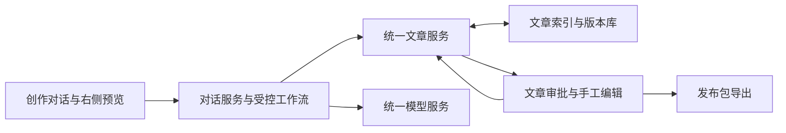

# v1.3 对话创作工作台设计方案

日期：2026-10-04。本文为当时的设计方案；用户后续已批准浅色三栏并要求实施。当前实现与验收以 [开发实现进度-v1.3](开发实现进度-v1.3.md) 和使用说明为准，概念参考图仍保留作设计记录。

## 1. 产品定位

新增一个类似 Codex 交互方式的“创作对话”工作台，专门讨论观点、分析历史文章、拟题、规划结构、修改文稿和准备配图提示词。

文章生产以可恢复工作流推进，AI 的编辑决策通过对话呈现。用户在对话中形成候选稿，点击“同步至文章审批”，再到文章区审批和手工修改。保留讨论会话，不要求每次讨论都生成文章。

这里将“公众号文章板块”理解为当前程序的文章存稿、编辑/审批页面及用户配置的本地文章目录。软件内部读取这些数据，不依赖 Codex 会话、Codex 账号或访问 Codex 私有界面。

核心分工：

| 模块 | 主要职责 |
| --- | --- |
| 创作对话 | 用户表达想法，AI 读取引用素材、讨论、拟题、写稿、提出修改；生成候选版本 |
| 文章审批 | 对比候选稿、采用/拒绝修改、手工编辑、核验事实和配图、确认交付 |
| 文章存稿 | 检索历史内容、关联栏目和期号，作为会话引用来源 |
| 配图资源箱 | 查看参考图和配色、管理图位、保存提示词及导入图片 |
| 网页工作台 | 程序内打开 TapNow 中国站和微信公众号后台，由用户完成生图与发布 |

文章区的“AI 拟题”“AI 自动填充”“AI 改稿”入口迁移到创作对话；文章区继续保留手工标题、正文编辑、审批和版本记录。模型配置放在统一“模型与设置”，无需在文章页面另配一套 Key。资源箱原有识图能力也使用统一模型服务。

## 2. 推荐界面：方案 A，浅色三栏

参考图：[对话创作工作台-方案A.png](界面方案/对话创作工作台-方案A.png)。图内数据为示例，预览不是运行中的新界面。

### 左侧：公众号与会话

- 顶部为软件名和当前公众号选择器。
- “新建对话”是主要入口。
- 导航包含创作对话、文章审批、文章存稿、配图资源箱、网页工作台。
- 最近会话按当前公众号显示，可重命名、搜索、归档；会话可以关联栏目和某篇文章，也可以只讨论观点。
- 底部保留公众号与品牌、模型与设置。ICE Loop 使用现有暖白、墨黑、信号蓝；其他公众号可切换自己的主题色。

### 中间：创作对话

- 顶部显示会话名称、关联文章和当前模式。
- 引用条明确显示“引用文章”“栏目大纲”“品牌规范”等材料；点击查看具体条目和来源。
- 对话流支持流式回复、停止生成、重新生成、从某条消息继续讨论。
- 标题候选、候选文章、修改方案、配图提示词以卡片显示，可查看、编辑、采用。
- 下方输入框支持引用文章、附加文档、选择写作模型。
- 提供“讨论 / 改稿 / 配图”三种意图：讨论通常只回复；改稿会生成可预览的候选修改；配图模式围绕图位和提示词展开。

### 右侧：文章与修改预览

- 标签为文章预览、修改对比、配图，右侧可收起。
- 文章预览展示本轮候选内容；明确标注“候选草稿 · 未审批”。
- 修改对比显示采用前后内容，可切换全文或本轮修改段落。
- 选中文段后可使用“改得更自然”“压缩”“扩写”“解释这个观点”“自定义要求”，请求仍进入中间对话。
- 底部标注“文章区 v2 → 对话候选 v3”，防止用户混淆当前稿和候选稿。
- 中间候选卡提供主按钮“同步至文章审批”；提交后显示对应文章和审批状态。

推荐宽屏默认三栏；窄窗口保留侧栏和对话，预览改为抽屉或单独标签，避免三个窄面板同时显示。默认侧栏约 220–250px，剩余空间对话约 55%、预览约 45%，边界可拖动。

参考图沿用 Codex 的会话与文件预览交互思路，采用原创编辑工作台设计。界面不设置终端、代码仓库、提交按钮或代码执行授权弹窗。

## 3. 典型操作

### 3.1 先讨论，不立即创建文章

用户新建会话：“我想讨论学生应该怎样使用 AI 学习编程。”

助手可以比较观点、追问受众、梳理论据。此时不创建文章，不推进期号，也不产生待审批稿。用户提出“整理成文章”后，才选择栏目与目标文章并开始工作流。

### 3.2 从历史文章准备下一期

1. 选择公众号和栏目，读取当前已发布进度。
2. 按当前栏目引用前五篇正文和全部已有标题；正文不足五篇时使用实际存在的篇数，说明缺失。
3. 引用栏目大纲、上篇预告和品牌规范；如果某期已有手工标题，优先使用该标题。
4. 用户在会话中调整方向，或选择已授权的自动准备模式。
5. 生成标题候选、大纲和正文，审校结果在会话里可查看。
6. 用户修改候选稿或提出新要求。
7. 点击“同步至文章审批”，创建一份待审批版本。

期号以已发布记录及当前任务关联关系计算，不能把“磁盘里有 005 文件夹”当成“005 已发布”。同一期多轮拟题属于同一篇文章的候选版本，不自动创建多个相同期号文章。

### 3.3 修改已有文章

用户从文章区选择“在创作对话中修改”，系统创建或打开关联会话，载入当前正文、标题、图位及版本号。用户可要求只改一段、重新拟标题、调整观点或优化结尾。

助手只产生候选版本；同步后进入审批。历史存稿和已发布原文的修改，默认生成关联新稿，不静默覆盖磁盘原文件。

### 3.4 在文章区手工改稿后继续讨论

用户在文章区保存修改，回到会话时提示“文章已更新，是否基于最新版继续”。后续请求使用新的版本快照；原会话消息保留，旧候选仍可对比，但不会继续假定旧正文是当前稿。

### 3.5 配图讨论

对话可提出配图位置、检索现有资源、生成和调整提示词，并将图位计划同步到对应文章。截图和生图操作通过现有图位工具及公众号配置的制作规则完成。

TapNow 使用 `https://app.tapnow.media/home`；生成图片由用户在程序内网页完成，再导入资源箱。对话不会把“生成了提示词”标记为“图片已完成”。

## 4. 同步与审批规则

采用“共享文章数据 + 候选版本”的衔接方式，避免两套正文分别保存在聊天和文章页面里、之后再互相覆盖。

| 动作 | 数据结果 |
| --- | --- |
| 对话讨论 | 保存消息和引用记录，不改变当前文章 |
| AI 提出改稿 | 保存候选版本及修改范围，不改变已审批稿 |
| 用户编辑候选 | 更新候选的新版本，保留生成来源 |
| 同步至文章审批 | 校验当前文章版本，保存待审批候选，返回审批入口 |
| 审批采用 | 将所选内容设为当前稿，记录审批人、时间和来源 |
| 审批拒绝 | 保留原稿和候选，拒绝理由可送回关联会话继续改稿 |
| 文章区手工保存 | 保存新版本，旧确认失效；会话后续改稿引用最新版 |
| 导出 | 对确认版本检查正文、图位、事实记录，生成文本/图片发布包 |

同步请求必须携带目标文章、候选版本、基础版本号或内容 hash、公众号 ID 和幂等请求 ID。

如果 AI 基于 v2 改稿期间，用户已在文章区保存 v3，不能用旧候选直接覆盖 v3。界面应展示冲突内容，允许基于最新版重新修改，或由用户比较并选择合并结果。对话生成期间，也不能自动覆盖右侧尚未保存的手写修改。

同步只表示提交待审批稿，不表示审批通过或发布。正文、标题、图位/所选图片改变后，需要重新确认相关内容；发布记录仍由用户在实际发布后登记。

## 5. 历史文章调用

先建立当前公众号的统一文章索引，再让对话调用。索引范围仅是用户配置的文章/存稿目录和本应用的受管文章，不扫描整个磁盘。

需要支持新的栏目目录结构，例如 `output/文章/PY/005-标题/`，也支持顶层介绍文和旧扁平结构。正文文件优先级沿用现有规则：`01-公众号正文-v2.md`、`01-公众号正文.md`、`正文.md`。发布说明及提示词文件作为辅助材料单独记录。

每篇文章记录：稳定文章 ID、公众号 ID、栏目、期号、标题、发布状态、正文位置、当前版本、内容摘要、最后索引时间。历史目录没有发布状态时显示“未标注”，不能猜测为已发布。

默认拟题读取当前栏目前五篇正文、全部标题、关联大纲与上篇预告；用户也可以显式引用跨栏目的文章。跨公众号引用默认关闭，需要用户明确选择引用来源，来源标签一直保留。

长会话不能每次把全部文章和资源发送给模型：先检索标题/摘要，再读取相关段落；目标改稿必须携带对应版本的真实正文。摘要和长期偏好是上下文辅助，不能替代当前源文件，也不能自动改写已确认品牌规范。

## 6. 技术结构

保留当前 Electron 桌面程序、Python sidecar、国内模型适配器、账号隔离、工作流恢复、版本历史和内嵌 Chromium。新增页面和统一文章服务，不更换整套技术栈。

新增对象建议：

| 对象 | 作用 |
| --- | --- |
| Conversation | 当前公众号的会话，可选关联栏目/文章、模式与最后活动时间 |
| Message | 用户和助手消息、流式状态、工具结果引用、采用状态 |
| ContextReference | 引用文章/大纲/品牌/资源的 ID、版本、内容 hash 与引用片段 |
| ChangeSet | 一次候选改稿的基础版本、目标文章、候选内容、修改范围与审批状态 |
| ArticleIndex | 受管文章和本地存稿的统一检索入口 |

模型输出文本不能直接当成保存操作。对话服务校验结构化工具请求，再通过统一文章服务读取、创建候选或同步。对话 Agent 只获得文章、引用、资源和图位相关工具，不获得通用命令执行、编程工程修改或任意路径写文件工具。

拟新增接口是设计建议，不是现有可调用 API：会话新建/列表/消息/停止、上下文引用、候选版本预览/编辑/提交、审批采用/拒绝、文章目录索引刷新。所有接口按公众号和文章范围校验。

工作流运行可以在对话中以“分析历史、拟题、改稿、配图、待同步”摘要展示；详细任务记录继续保存。已完成步骤复用，关闭窗口或中断后能恢复，重试不会重复提交审批候选。

## 7. 现有代码接入点与已发现差距

- `ice_agent/desktop_service.py` 的 `library_list` 当前只枚举存稿目录首层；需要支持栏目子目录并返回统一文章身份。`library_read` 使用首层文件夹名校验，也需一起调整为受控文章 ID/相对路径。
- 已有 `articles.revisions`、`articles.compare`、`articles.restore` 和正文 hash 校验可作为版本、差异与并发保护的基础。
- 现有 `articles.save` 绑定工作流任务状态，不适合直接创建没有写作任务的新对话稿；应抽离统一 ArticleService，再增加候选稿的创建和提交路径。不能为了保存对话稿而伪造代码验证、事实检查或配图已完成。
- 已有 `WorkflowEngine` 可继续承担节点执行、缓存、暂停和恢复；新增对话服务负责把用户意图转成有范围的工作流操作。
- 现有模型路由和国内供应商适配器继续使用；模型参数和 Key 统一管理，对话不暴露凭据。
- 已有配图候选、提示词编辑、资源检索、发布包导出和内嵌浏览器保留，改为能被关联会话引用和提交。
- 原补图任务保留原稿只读语义；用户要改正文时建立新的关联编辑候选，不能绕过原补图保护。
- 原数据不重新生成。会话、索引和候选记录以增量迁移添加，先备份；原审批记录、发布状态、图片和期号保留。

## 8. 实施顺序

### 一期：对话与审批的核心闭环

1. 补齐栏目文章索引和统一文章身份。
2. 新增会话页面、会话保存、模型流式回复与停止。
3. 支持引用历史文章、大纲和品牌规范。
4. 支持拟题、整稿/段落改稿、右侧预览与修改对比。
5. 新增候选稿提交、文章审批采用/拒绝、并发修改保护。
6. 调整文章区入口，把 AI 创作入口集中到会话，保留手工修改与现有历史数据。

### 二期：编辑效率

选中文段改稿、反馈回到原会话、长会话上下文检索、候选分支、相关步骤重算、会话搜索和恢复。

### 三期：配图与完整交付

将图位计划、资源参考和提示词卡片接入对话；按规则调用原有图片工具；补齐统一审阅摘要和发布包交付。TapNow 生图与公众号发布继续按用户已选择的手动流程完成。

## 9. 实施后的验收标准

- 一次纯观点讨论不会创建文章或推进期号。
- 会话能找到栏目子目录里的正文，并显示引用来源与版本。
- 标题和正文候选能提交至文章审批，不需要在文章区再次调用 AI 拟题。
- 多次点击同步只提交一个候选；刷新、关闭和重开后，消息和候选仍存在。
- 文章区能对比、审批和手工修改；对话后续能基于修改后的版本继续。
- AI 生成期间及提交时均保护用户新修改；旧候选不能覆盖新版本。
- 切换公众号后，会话、引用、文章和资源保持隔离。
- 已发布文章改稿先生成关联新稿，原文件和原发布记录不被静默覆盖。
- 对话没有通用编程或命令执行入口；已有制作规则和验证记录不因聊天而失效。
- 所有受管数据和运行工作区按用户配置保存在非 C 盘；本轮设计不运行演示程序、不创建运行临时目录。

## 10. 供用户决定的界面调整项

本轮默认选择：浅色、三栏、对话为主、右侧常驻预览、显式同步至审批。

可以优先调整：右侧预览是否默认收起、左右栏宽度、是否改为深色、顶部导航数量、候选卡按钮位置，以及文章审批是否默认在右侧展开。建议保留明确的“候选/当前稿/已审批”标签和可见同步动作。

图片由内置 imagegen 生成，保存于 `界面方案/对话创作工作台-方案A.png`；使用提示词见 `界面方案/方案A-生图提示词.md`。现有程序和安装包未因本轮方案而修改。
