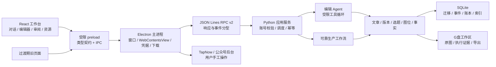

# ICE Loop Studio v2.0 研发提升报告

日期：2026-10-07  
目标读者：项目负责人、GLM 5.3 Flash 编程执行端、后续维护者  
基线：当前源码 v1.5.3；现有开发设计文档与版本验收记录  
状态：**研发方案与任务书，尚未实施 v2.0，也未重新执行历史验收**

## 0. 使用这份报告的方法

本报告定义下一轮产品与工程升级。配套文件：

- `02-研发任务与验收矩阵.md`：100 项实施任务、明确依赖与完成标准，是执行清单。
- `03-GLM5.3Flash长任务实施提示词.md`：交给编程模型的完整行为规范、实施顺序、恢复策略与交付要求。
- `00-开始执行.md`：简短启动指令，可直接复制。
- `04-外部方案对照与融合.md`：追加外部方案的源码核对、借鉴项及冲突裁定，与本报告一起适用。
- `notes.md`：本次读源与官方资料记录，供核对结论。
- `task_plan.md`：报告编制状态；**不是未来编码任务完成状态**。

先读报告和矩阵，再让执行端按照阶段实施。模型名称按用户提供的 GLM 5.3 Flash 使用；本文不假定该模型的上下文长度、工具能力或实际运行时长。执行环境须能修改仓库文件、运行终端、操作隔离测试应用并读取结果。纯聊天窗口只能生成建议，不能完成源码升级。

“工作量大”通过跨前后端、数据迁移、编辑器、Agent 工具、可靠任务、素材管理、模型治理、发布导出和打包验收体现。不要为了工作量增加微服务、制造多套状态或批量换皮。最终评判标准是功能链路可用、数据安全、操作减少、故障可恢复。

## 1. 研发结论与目标形态

建议保留 Electron + Python + SQLite + 本地文件的主体，把产品升级为：

> 面向多公众号的本地创作工作台：编辑 Agent 负责讨论、检索、起草与修改；可靠工作流负责生产任务；文章编辑器、证据与资源箱共享同一篇文章；人统一审阅，再手工生图和发布。

这不是增加一个聊天按钮。v2.0 必须实现四个连续闭环：

1. **内容闭环**：导入历史文章 → 栏目知识检索 → 拟题或选择预设排期 → 对话起草 → 分段修改 → 保存新版本 → 同步审批。
2. **制作闭环**：持久任务计划 → 真进度 → 暂停/取消/故障恢复 → 演示程序真实执行 → 指定图位截图 → 人审。
3. **视觉闭环**：品牌资产与样式包 → 图位需求 → 受约束提示词 → TapNow 手工生图 → 下载归档 → 候选审核 → 与正文稳定绑定。
4. **交付闭环**：事实/代码/配图检查 → 移动端预览 → Markdown、纯文本和图片目录 → 导出清单核对 → 用户手工发布 → 手工登记发布状态。

v2.0 完成后，用户不应再靠记忆知道“聊天候选、审批稿、资源图片、旧文和导出文件到底是哪一版”；每个对象都要有清楚来源、状态、关联关系和下一步操作。

## 2. 当前基线：已有能力与真实升级空间

### 2.1 已有能力必须继承

源码核对到 `desktop/package.json` 与 `pyproject.toml` 均为 1.5.3。Python 版本要求 >=3.12，主要必选依赖 Pillow。桌面依赖包含 Electron 44.5.1、electron-builder 26.0.12、esbuild 0.25.12、Shoelace 2.20.1、Motion 14.0.0。以下是已有基线，不能当作未实现功能重新报功：

| 已有能力 | v2.0 必须保留的行为 |
|---|---|
| 多公众号与品牌/栏目配置 | 当前公众号隔离、可导入、自定义栏目，不写死 ICE Loop 四线 |
| 历史正文与标题上下文 | 本栏目前五篇正文 + 全部既往标题；期号按已发布进度 |
| 排期大纲文档 | 可预设对应期题目；人工题目优先，允许修改 |
| 创作对话 | discuss/draft/edit/images、真实流式回调、澄清、引用、分支、重试 |
| 候选稿、草稿箱和审批 | 候选不会偷偷覆盖原稿；有内容哈希冲突保护与版本 |
| 会话和任务生命周期 | 删除、归档、恢复及重复会话修复要回归验证 |
| 视觉资源 | 原图、缩略图、色彩分析、视觉模型、推荐、参考图、品牌资源 |
| 内嵌浏览器 | 已用 WebContentsView；公众号/站点隔离；TapNow 中国网址 |
| 提示词工坊 | 品牌模板、英文提示词、参考图上传顺序与人工修改 |
| 工作流 | 节点、事件、检查点、租约、审批、自动准备与外部操作账本 |
| 程序执行 | 独立 stdin、超时、2 MiB 输出限制、所有权进程树与运行证据 |
| 图像查看 | 原图按需加载、缩放/拖拽/键盘、关闭释放、异步防串图 |
| 文件与缓存清理 | 只清理本次所有权目录和中间文件；正式证据不自动删除 |
| 预算 | 全局默认、任务次数上限、补图次数预算、预算不足恢复 |
| 桌面 UX | Ctrl+K、动效/密度设置、部分公共控件、输入保护 |
| 导出、备份、安装 | 文章导出、数据备份/恢复、安装器限定范围停进程 |

现有期号校验范围为 1–9999，不是“最多十篇”。v2.0 要把大量栏目和批量排期验证做扎实，不把已经解决的问题重新包装成新增能力。

### 2.2 读源观察与改进方向

| 读源观察 | 影响与升级方向 | 结论边界 |
|---|---|---|
| renderer 以 JavaScript 全局状态、字符串模板和 DOM 更新组织；候选使用 textarea | 多面板状态与焦点维护困难；增量组件化和富编辑器 | 不是断言现有页面全部有 bug |
| 创作流式回调已存在，页面主要轮询读取 | 真流式仍可能带来反复取数和整块渲染；统一增量事件 | 不得声称系统没有流式 |
| Python JSON Lines 主入口逐行 dispatch；创作后台线程 | 部分重操作要排队与异步化，避免取消和查询被堵 | 不等同于全部模型调用同步阻塞 |
| SQLite user_version=9，WAL、事务、预留、租约已实现 | 需要显式编号迁移、升级演练及事件/队列扩展 | 不能直接删库重建 |
| 制作任务按请求次数预算；创作讨论尚不归入制作任务计数 | 统一会话/任务/操作预算归属，明确“次数”与“金额” | 没有价格表时不能显示准确人民币 |
| 截图准备队列依赖内存 attempted 集合，部分自动截图使用全部运行记录 | 持久队列与图位—run_id 映射，重启后不重复截图 | 现有队列已有 busy 保护 |
| Ctrl+K 是本地记录搜索 | 新增正文段落检索与引用证据，帮助 Agent 调用旧文 | 不把记录搜索说成向量知识库 |
| 主服务/创作页面体积较大 | 按业务职责提取边界、合同测试和生命周期管理 | 文件大小只作为复杂度信号 |

大文件快照：`desktop_service.py` 97,290 字节、`creative_chat.py` 65,985 字节、`renderer/app.js` 64,087 字节、`renderer/creative-chat.js` 55,304 字节。模块化的验收是职责清楚、依赖可测试、迁移兼容，不是强行把每个文件压到某个行数。

### 2.3 基线验收记录怎样使用

`docs/v1.5.3-验收结果.json` 记录：81 个不同后端测试、62 项 Node 检查；最终打包程序原生 49 项预算/配图/执行/原图、85 项创作、32 项浏览器检查。

这些是**历史记录**。本次只核对文档与源码，不重新运行测试。实施时必须用当前源码、隔离工作区重跑适用检查；保留原记录，另写 v2.0 的真实结果。不能把 88/42/1 的重复测试记录相加冒充新测试数量。

## 3. 范围、优先级与升级幅度

所有 100 项矩阵任务均纳入本轮主线。P0/P1 表示先后与阻断程度，不是允许只做 P0 就宣称 v2.0 全部完成。M0–M9 各阶段都有可用成果，阶段完成后继续下一阶段。可选项放在本节末尾，不混入强制验收。

| 工作包 | 主要提升 | 用户能够感受到的成果 |
|---|---|---|
| M0 基线与迁移保护 | 可追踪升级与恢复 | 升级失败可以恢复；旧文章、资源和会话仍可读 |
| M1 契约、事件与任务调度 | 可靠执行核心 | 停止、重启、并发、重试都有明确结果 |
| M2 工作台与设计系统 | 统一信息架构与组件 | 三栏可调、明确焦点、顺手快捷键、真实忙碌反馈 |
| M3 统一文章编辑器 | 段落级编辑与版本 | 在文章里选段修改，逐项采纳，避免整稿反复覆盖 |
| M4 知识与选题系统 | 有依据的内容规划 | 旧文可引用、短词能搜索、重复选题可解释 |
| M5 编辑 Agent 工具闭环 | 对话能驱动真实工作 | Agent 检索、出计划、产候选、准备图位；看得见动作 |
| M6 工作流与评审中心 | 内容生产可编排可回溯 | 批量准备、依赖重跑、统一审阅、冲突提示 |
| M7 视觉资源与浏览器 | 品牌一致性和素材归档 | 知道用哪张参考图、哪个提示词、哪个下载对应哪个图位 |
| M8 模型治理与运维 | 预算、兼容、容量和诊断 | 对话也有预算；故障可定位；磁盘占用可解释 |
| M9 导出与发行 | 真正可交付 | 完整文章包、隔离升级演练、最终打包程序验证 |

工程量预估为**约 80–150 人日等价开发/验证投入**，由上述跨层任务综合推断，非报价、非模型执行时长承诺。按熟悉代码的单人连续研发通常是多周到数月规模，具体受现有耦合、编辑器兼容、Windows 测试和数据质量影响；AI 可以提高效率但不能消除验收工作。M0 后根据实际基线调整估算并说明理由，不能为追求“长时间”故意低效。

本轮可选、不阻断 v2.0 的内容：多设备云同步、多人实时协作、自动公众号发布、真实付费生图自动化、任意第三方 MCP 插件市场、复杂向量数据库、Docker 安装引导、OCR/ASR 大模型包。不要提前实现这些，把主线闭环拖成巨型平台。

## 4. 开源选型与复用策略

### 4.1 推荐技术组合

保留 Electron、Python、SQLite 和现有执行模块。新增 renderer 采用 React + TypeScript + Vite，按路由逐页替换。前端不引入 Next.js/SSR/独立服务端，桌面数据继续走受限 IPC。

| 层 | 推荐 | 采用理由与边界 |
|---|---|---|
| 新前端 | React + TypeScript + Vite | 组件、类型、构建；只迁 renderer，不强改 main/preload 成 ESM |
| 基础控件 | Radix Primitives + 自有品牌 tokens | 对话框、菜单、提示、焦点；旧 Shoelace 渐进退出 |
| 异步数据 | TanStack Query | 包装 IPC Promise、缓存、分页、失效；account_id 必须在 key 中 |
| UI 状态 | 小型 Zustand store 或局部 React state | 仅面板/选择/未提交输入；不要复制数据库整份文章 |
| 编辑器 | Tiptap 开源核心 + 自定义 image_slot 节点 | ProseMirror 文档事务；版本、审批自建，不依赖付费扩展 |
| Markdown源模式 | CodeMirror最小适配或安全textarea降级 | 仅源模式，和Tiptap同一规范值；不同时双向保存；具体版本核验 |
| Markdown | remark/unified AST 链 | 结构处理、代码块和占位符转换，禁止 regex 贯穿整文 |
| HTML 安全 | DOMPurify | 预览/粘贴内容清洗；协议和图片来源还需单独白名单 |
| 长列表 | TanStack Virtual | 会话、资源、引用列表的分页与虚拟化 |
| 动效 | 复用现有 Motion；新 React 页面使用相应适配 | 不并存三套动画引擎；真实阶段驱动 |
| 工作流图 | React Flow 开源部分 | 先做节点/状态/依赖可视化和受限配置，禁止任意代码节点 |
| 数据契约 | Pydantic 导出 JSON Schema + Ajv 预编译验证 + TS 生成类型 | 避免 Python/TS 各写一套字段定义；限制依赖与启动成本 |
| 检索 | SQLite FTS5 + 中文短词 fallback | 先离线全文/词项检索；向量是以后可插拔能力 |
| 多格式导入 | 标准库/现有读取优先，MarkItDown 按需插件 | DOCX/PDF 受限解析；不默认联网、不一次装所有可选依赖 |
| 测试 | 现有 Python/Node/native smoke + 针对新增模块的测试 | Playwright Electron 辅助；最终发行仍运行打包原生测试 |

上述属于建议组合，版本由实施时的最小兼容实验和锁文件确定，不能照抄网上“最新”安装。Vite 开发服务器只在开发环境使用，正式包必须离线加载本地产物。所有依赖许可证、具体扩展许可证、版本与用途进入 `docs/v2.0/DEPENDENCIES.md`，保留 attribution。

官方资料： [Tiptap 核心与许可](https://github.com/ueberdosis/tiptap)、[Radix](https://github.com/radix-ui/primitives)、[TanStack Query](https://github.com/TanStack/query)、[TanStack Virtual](https://github.com/TanStack/virtual)、[Zustand](https://github.com/pmndrs/zustand)、[Vite](https://github.com/vitejs/vite)、[React Flow](https://github.com/xyflow/xyflow)。

### 4.2 不踩免费与许可误区

Tiptap 的核心是 MIT，部分 Pro 扩展需要订阅。采用开源核心及自有修订/批注模型；某项 API 无法在开源包找到，不能装一个收费扩展后假装免费可用。[Tiptap 官方仓库](https://github.com/ueberdosis/tiptap)

DOMPurify 是 Apache-2.0 或 MPL-2.0 双许可；按实际选定许可保留声明，不记录成 MIT。[DOMPurify 官方仓库](https://github.com/cure53/DOMPurify)

Cherry Studio 可参考多模型工作台、消息操作和设置体验，但其社区版是 AGPL-3.0；本项目默认不复制源码，以免未经裁定改变发行条件。[Cherry Studio 许可说明](https://github.com/cherryHQ/cherry-studio#-license)

Dify 可以参考节点、等待用户输入和失败恢复的概念，其许可含额外条件，包含多租户限制。桌面多公众号工作区不直接等同于云多租户服务，但不应未经审查嵌入其完整平台。[Dify LICENSE](https://github.com/langgenius/dify/blob/main/LICENSE)

browser-use 可用于研究浏览器 Agent 的定位/动作边界，本项目的默认生图和发布仍手工，已有浏览器保持主线；不为复用而换一套登录管理。[browser-use 官方仓库](https://github.com/browser-use/browser-use)

### 4.3 采用前的最小验证

为 Tiptap、React/Vite、Pydantic/Schema/Ajv、FTS5 各建立最小实验，测试：
- 打包离线可加载，CSP 无需 unsafe-eval；Ajv renderer 使用构建时 standalone 产物。
- 中文输入法、选区、代码块、未配图占位符与撤销正常。
- Markdown → 文档 → Markdown 的受支持格式语义不丢失；未知结构保持原文并提示。
- 冻结 Python 引擎可包含新增依赖，版本/schema 一致。
- FTS5 可用与不可用两种环境、1/2/3 字中文搜索都能返回预期结果。
- 普通 Win32 桌面、125%/150% DPI、弱磁盘环境可启动。

最小实验验证后固化 ADR（架构决定记录），不把新框架当成必须迁移所有主进程代码的理由。

## 5. 目标架构与渐进迁移

### 5.1 进程和业务边界



Agent 决定需要做什么、调用哪些编辑工具；工作流约束顺序、状态、预算与恢复；领域服务决定数据是否合法；Electron 主进程只承担桌面特权。模型无法直接写 SQLite、任意磁盘、执行任意 shell 或发起发布。

### 5.2 建议目录与实际迁移方式

目录是建议的目标布局，不是现有目录声明：

```text
desktop/
  main.cjs                     # 保持入口，逐步提取模块
  main-services/               # RPC、凭据、窗口、下载、生命周期
  preload.cjs
  renderer/                    # 过渡期旧页面保留
  ui/
    src/app/                   # 布局、导航、路由和错误边界
    src/features/              # chat/editor/review/planning/assets/browser/settings
    src/components/            # 封装基础控件和品牌设计系统
    src/contracts/             # 生成 TS 类型与预编译验证器
    src/data/                  # account-scoped query、事件订阅、游标
    src/styles/                # tokens、density、motion
ice_agent/
  contracts/                   # Python 权威请求/事件/响应模型
  application/                 # 按业务拆分 RPC handler
  editorial/                   # brief、段落、修订、事实、选题
  agent/                       # 工具注册表、策略、执行循环
  tasks/                       # 持久队列、lease、heartbeat、取消
  retrieval/                   # 内容索引与出处
  domain/                      # 保留并渐进扩展领域/Store
  migrations/                  # 编号与校验和迁移
  execution/                   # 保留 v1.5.3 运行安全模块
docs/v2.0/                     # 决策、实施状态、验收、恢复手册
```

先提取 handler，让 `DesktopService.call` 成为稳定门面；不要更改全部 RPC 方法名后逼迫旧 UI 一起重写。新 renderer 用 feature flag 启用；一条路由同一时刻只有一个渲染所有者。旧事件监听器、定时器、原图引用必须随卸载释放。

推荐迁移顺序：契约 → 壳与基础控件 → 文章编辑器 → 创作对话 → 审阅中心 → 资源/规划/设置 → 旧页面退出。每一步旧功能可通过兼容层继续访问。禁止在新旧两个编辑器间双向自动保存同一篇稿，防止循环更新和版本风暴。

### 5.3 单一真相与读写模型

正文规范值先继续保留 Markdown，新增结构化文档作为可版本化派生编辑模型。每次修改产生新的不可变 revision，保存 `base_revision_id`、`content_hash`、`document_schema_version` 与图位绑定。规范 Markdown 与结构化文档在同一次保存中验证一致，事务提交引用；未支持的 Markdown 结构必须保留 raw block，而非静默丢弃。

补充生成入口：模型可以输出受约束 ArticleIR，由同一规范化链转为 ArticleDocument/Markdown；IR只是生成交换格式，不建立第二套长期正文。IR失败最多一次预算内格式修复，随后允许现有Markdown路径降级，但仍通过相同规则、事实、真实代码与审批。栏目、品牌句和限制取当前公众号profile；既有 `<!--RUN_OUTPUT:run-N-->` 引用兼容保留。模型声明stdout不是执行证据。

文章身份统一为 `article_id`；候选、导入历史、生产任务通过显式映射关联，不强迫现有 ID 全部重编号。发表内容快照与日常草稿分开：已发布快照不可改写，改稿是新 revision。所有查询和写入经过 account scope，不靠 UI 过滤保证隔离。

## 6. 数据迁移、文件一致性与恢复设计

### 6.1 新增模型建议

新增表名/字段在 M0 schema 审计后确认，可复用现有表就不要重复建表：

| 模型 | 关键字段 | 约束 |
|---|---|---|
| ArticleDocument / Revision | account/article/revision/base/hash/schema/markdown/document | revision 不可变；同篇基线比较 |
| EditProposal / Patch | proposal/base_revision/block_id/operation/old_hash/new_text/status | 基线过期拒绝覆盖；采纳有审计 |
| EditorialBrief | audience/purpose/angle/constraints/questions/provenance | 用户事实、模型建议与未知项分开 |
| SourceDocument / Chunk | account/source/version/hash/section/offset/text | 导入原文只读；引用能定位 |
| AgentRun / ToolCall | run/conversation/turn/tool/input_hash/output_ref/status | 工具白名单、预算、幂等 |
| TaskQueue / Attempt | task/kind/priority/lease/expires/attempt/input_hash | 单有效租约；取消与重试持久化 |
| EventStream | stream/account/sequence/event_id/type/payload | sequence 单调；回放重复不重执行 |
| AssetBlob / AssetUsage | sha/path/mime/size/account/article/slot/revision | 不靠文件名绑定；引用计数可解释 |
| StylePack / PromptRevision | account/version/rules/references/approval | 品牌修改不污染历史提示词 |
| ExportManifest | article_revision/assets/format/hash/created | 导出后可核对与重现 |
| ModelInvocation ownership | invocation/account/conversation/task/run/role/status | 同一调用只计费/计数一次 |
| PublicationReceipt | manual_status/date/url/revision/notes | 仅用户确认标记发布 |

资产如果采用 SHA 去重，默认在单一工作区/公众号权限范围内去重；不要通过“共享同一个文件”意外打通不同公众号。跨公众号复用是显式导入/授权副本，查询结果不暴露别的公众号有无该文件。

### 6.2 编号迁移与升级前置

现有 Store user_version=9。新增 `schema_migrations` 跟踪版本、checksum、开始/完成时间与应用版本。从当前实际 schema 推导到 v2，不假设所有安装都具有同一完整扩展表。

升级流程：
1. 阻止新写入，确认没有活动工作者持有 DB；关闭/排空相关连接。
2. 使用 SQLite backup API 生成一致备份，记录源版本、文件哈希、完整性检查结果；不直接复制正在 WAL 写入的单个 .db。
3. 用隔离副本执行 migration dry-run，核对账号、文章、会话、候选、图片引用与原稿哈希。
4. 执行正式受控迁移，写编号、校验和；失败回滚且不启动新 UI 写入。
5. 验证读取后才能启用功能标记，旧原始文件不改动。
6. 恢复必须重建完整 DB/WAL 状态：所有连接关闭，由恢复流程操作；不能在活动数据库旁换文件。
7. 旧引擎遇到较新 schema 拒绝写入。回退通过恢复升级前备份到隔离工作区验证，不能简单启动旧 EXE 读新库。

自动测试使用副本；用户真实安装工作区必须另有明确升级操作授权。本轮提示词授权源码、隔离测试和正式打包，不授权直接迁移用户真实 E 盘数据。

### 6.3 SQLite 与文件无法一笔事务的处理

采用 staged → committed 文件提交协议，实际实现沿用已有原子写工具：
- 在允许的 G 盘工作区内创建唯一临时文件并记录所有权。
- 写入、flush，核对大小与哈希，尽可能同卷 rename。
- DB 事务引用已验证的目标及提交状态。
- 崩溃恢复扫描**账本中的本应用待提交项**，核对后补全/标记异常；不全盘扫未知文件删除。
- exFAT/断电场景不能承诺严格掉电原子性，依赖校验、备份、恢复日志补偿。
- 文稿外部被改动时核对 hash，弹出外部变化对比，不反向覆盖。

### 6.4 删除、归档、回收与永久清理

会话、任务、文章、资产区分归档和回收站；现有语义经兼容适配保留。删除任务不级联永久删除文章、运行证据或图片。资源被文章/导出引用时，不能永久清除。

长期证据不是临时文件，不能以“运行完自动清理”为理由删掉。容量管理默认只分析、列候选与占用；自动清理只覆盖已登记的当前调用临时目录、可再生缩略图/缓存，且所有权/路径验证通过。永久清理用户资源必须单独确认具体清单。

## 7. 契约、事件流与可靠任务核心

### 7.1 版本化协议

保留 JSON Lines，新增显式 `kind=response|event`；未标记的旧响应在兼容期按现有结构解析。stdout 只输出协议 JSON，日志走 stderr 或专用日志文件。

示意契约（拟定，不是当前已实现接口）：

```json
{
  "kind": "event",
  "protocol_version": 2,
  "event_id": "evt_unique",
  "stream_id": "run_unique",
  "account_id": "account_unique",
  "sequence": 18,
  "type": "model.delta",
  "payload": {"turn_id": "turn_unique", "attempt_id": "attempt_unique", "text": "新增文本"}
}
```

每个 request 有 request_id；变更命令另有 idempotency_key；事件有 event_id、stream_id、sequence。会话、任务、turn、attempt、revision 都有独立 ID，严禁用标题字符串作会话身份。

请求与响应由 Python 权威 schema 生成 JSON Schema、TS 类型和验证产物，CI 检查漂移。主进程先校验 sender+方法+大小+参数，后端再校验权限/状态/hash。Ajv 在 renderer 用预编译代码，不开放 eval 或运行时远程 schema。[Pydantic JSON Schema](https://docs.pydantic.dev/latest/concepts/json_schema/)、[Ajv](https://github.com/ajv-validator/ajv)

### 7.2 事件的持久化和背压

状态事件、审批、工具执行开始/结果、版本提交持久化；模型 token 可合并为增量块或定期快照。不要每个 token 独立数据库事务。短窗口内将 deltas 批成 30–100ms UI 更新，具体值性能测试后固定；最终完整消息 hash 与正文持久化。

订阅断开后从 cursor 重放；超过保留窗口则先取完整快照，再订阅后续。客户端忽略重复 sequence，检测缺口触发补取；UI 卸载时退订。旧页面继续有限轮询，不允许新页面同时轮询又订阅导致双更新。遇到 fallback，使用 attempt_id 切换响应，不能拼接两次回复。

Python 入口需要有限并发 dispatch：轻查询/取消/订阅不能被长操作堵住；每个工作线程独立 Store 连接，写事务短且有统一协调。开始可使用有上限的线程池与应用层写锁，不引入 Redis/Celery/外部消息服务器。状态变化先提交，再发事件，防止 UI 看见尚未持久的完成态。

### 7.3 任务状态与恢复

状态机至少表达 queued → running → waiting_user / waiting_model / waiting_resource → succeeded / failed / cancelled / interrupted。归档/删除是可见性，不混入运行状态；制作完成、审阅通过、导出完成、已发布是不同领域状态。

队列有优先级、并发上限、lease_token、heartbeat、到期时间与 attempt。新工作者重启不能直接重放外部付费请求：如果上次已 sending 且结果未知，进入 reconciliation/waiting_user。现有操作账本继续承担这条边界。

取消必须：
- 即时记录 cancel_requested，UI 显示“正在停止”而非假装远端已终止。
- 支持关闭本地网络响应/取消句柄的 provider 停读；不承诺供应商撤销费用。
- 没有底层取消能力时停止采纳结果、阻止后续工具、记录远端状态未知。
- 已确认执行中的本地程序按所有权终止进程树；保留真实日志与清理结果。
- 租约释放、后台结果不得再覆盖已取消/已删除对象。
- 取消后重试创建新 attempt，保留上次记录，使用相同逻辑任务身份。

预算预留、lease 与持久状态在事务里协作；缓存命中不会创建新的付费调用。重试上限、退避、需要人处理的错误由错误分类决定，不能无限“自动修复”。

## 8. 工作台信息架构、样式和动效

### 8.1 三栏创作工作台

左栏：公众号切换、工作区页面、当前栏目、最近会话、草稿入口；中栏：对话与行动记录；右栏：文章/改动/素材/事实/任务。提供：
- 可拖动分栏与最小宽度，按工作区保存；首次以阅读舒适度为默认。
- 右侧编辑器支持专注模式、独立宽屏和回到对话，不挤在细窄预览里。
- 当前文章名称、revision、保存状态始终清楚；同一会话多轮不产生新侧栏记录。
- 在文章列表、对话、任务、资源之间打开对象时携带 account/article/slot ID。
- 小窗口将非核心面板折叠为抽屉；主操作固定位置，长内容滚动。
- 工作台顶部压缩，不重复一屏大标题；嵌入网页有大空间。

不照搬 Codex 的品牌和界面资源，只借鉴“对话 + 可审查工作成果 + 工具状态”的结构。

### 8.2 设计系统

ICE Loop UI 默认延续信号蓝 #2448DB、墨黑 #15191F、暖白 #F3F2ED，符合“冷静、准确、开放、有耐心”。**界面主题与公众号品牌配色分开**：切换公众号不导致整个应用忽然换成另一套不可读颜色；其文章预览和生成提示词使用对应公众号样式包。

设计 token：文字层级、间距、圆角、边框、surface、控件高、状态颜色、焦点圈、动效时长与z-index。Button、IconButton、Input、Select、Checkbox、Dialog、Tabs、Menu、Toast、Banner、EmptyState、ErrorPanel、ProgressTimeline、AssetCard、RevisionBadge 统一封装。

至少定义默认/hover/pressed/focus/disabled/loading/error 状态。loading 不改变按钮宽度；危险操作不和“保存”共用蓝色主按钮；图标带 label/tooltip；输入框错误靠近字段。复杂菜单和焦点优先用 Radix 的基础交互，新页面不可混用两套不同 dialog portal。

### 8.3 动效要说明动作，而不是拖慢操作

Motion 负责面板开合、列表插入、采纳改动、任务节点状态与错误恢复：
- 约 120–180ms 按压/选中、180–260ms 面板/弹层作为起始设计参数，不是实测规范。
- 接收模型时显示真实已接收字数、阶段、模型/attempt及可停止按钮；未知耗时不伪造百分比。
- 排队显示前面任务数、等待资源显示具体图位、审核显示待决项。
- 采纳段落只高亮对应修改范围，不整篇闪烁。
- 减弱动效/关闭动效时保留文字/图标反馈，停止非必要位移动画。
- 导航动画卸载后取消，避免积累 timers/observers/listeners。
- aria-live 不逐 token 播读整篇，只播阶段变化与完成摘要。

Motion 官方提供减弱动效方案，应与已有用户设置统一。[Motion accessibility](https://motion.dev/docs/react-accessibility)

### 8.4 操作恢复

快捷键至少覆盖 Ctrl+K、保存、发送、换行、撤销、打开编辑器、关闭抽屉；避开输入法组合键。未保存内容由**当前对象级**脏状态管理，不使用一个全局 dirty 布尔值代表所有页面。

失败面板解释错误类别、影响范围和具体恢复操作；保留用户输入。网络、预算、基线冲突、附件失败都不能只剩一条 toast。重要操作有可撤销或版本恢复，但不要对每个普通按钮弹确认框。

## 9. 统一文章编辑器、版本与修改建议

### 9.1 编辑器范围

正文、标题、摘要、章节、代码、输出、图片图位、引用和事实标记集中编辑。支持 Markdown 源模式与结构化编辑模式；视图切换不创建新 revision、不丢选区。阅读预览与编辑渲染共用规范化文档。

基础功能：标题1–4、段落、列表、引用、粗体、链接、代码块、分隔线、图片及图注；避免为了成熟外观首轮支持复杂嵌套表格和公式全家桶。未知格式显示 raw block 供源码编辑，不静默重排原文。

源模式可选CodeMirror实现诊断与定位，失败退回textarea保留输入和保存；Tiptap与源模式只允许一个活动编辑来源。后台lint复用Python既有规则，不在JS复制词表；行号不确定时返回null，异步诊断防旧结果覆盖。

中文 IME composition 期间不触发发送/保存替换，不重建整个编辑根。代码块保留缩进、语言标记和真实内容；粘贴的网页 HTML 受限转换，清掉脚本/样式注入/远程追踪资源。

### 9.2 图位节点与文章身份

`image_slot` 节点具有稳定 slot_id、figure_no、kind、caption、selected_candidate_id。图位不是正文里任意某个字符串或图片文件名。重新排序更新展示编号，不改 stable ID；删除图位先解除当前稿引用，不能删资源原图。

提示词 P1/P2 与 figure_no 分开存编号映射，展示清楚“P2 用于图3”。旧占位符 `` 导入为节点，再导出时能还原对应语义。不满足解析规则的文本保留原始 Markdown。

### 9.3 选段修改与批注

Agent 生成 EditProposal：目标 base_revision、block_id、原内容 hash、改动类型、替换内容、理由与来源。支持替换段落/增加章节/改标题/改摘要/插图位/移动章节，禁止泛化为任意 shell。

UI 展示逐项前后对比，用户可以单项接受、拒绝、编辑后接受、全部接受。已有人工修改产生 revision 后，旧 proposal 必须标记冲突，给重新生成或三方比较；不能无条件把整篇旧候选覆盖回来。proposal 采纳应用于一个明确基线并生成新 revision，记录谁采纳、来源 turn 和检查结果。

不要声称“自动解决所有冲突”。同一段落冲突由用户选定或用新的基线重新生成；不冲突的段落可按确定规则安全应用。

### 9.4 保存、恢复与审批

自动保存是恢复草稿，不是自动通过审批。保存状态显示“编辑中 / 正在保存 / 已保存 / 保存失败”，退出保护和恢复功能读取对象级快照。数据库草稿与用户导入原稿分开存；不改外部原文。

“同步到审批”提交固定 revision hash。审阅期间再次修改则提示该审批基线已过期，要求审阅最新版。旧版审批结果保留；只有当前正文和资产计划与被批准 hash 匹配才显示通过。

版本列表有作者/来源、改动摘要、正文差异、配图差异和恢复到新版本。恢复不删除之后历史，也不把已发布快照改成旧稿。

### 9.5 编辑器验收样例

包含以下真实场景：中英文混排及输入法、连续两次选段改稿、代码缩进、三张占位图、表格 raw block、旧候选冲突、切账号保存、快速关开、断网恢复、撤销后同步审批、原稿被外部改动。受支持节点应语义往返，原始源文件字节不变化。

## 10. 历史知识检索与选题规划

### 10.1 内容接入

MD/TXT 是基本入口，DOCX/可提取文本 PDF 作为增强；网页正文导入只通过用户选定文件或明确 URL 操作。大文件、加密文档、扫描 PDF、失效图片、编码错误应明确提示，不把解析失败说成“已成功导入”。

来源记录包含账号、文件显示名、导入路径的受限引用、SHA256、解析器版本、页码/章节、导入时间、来源状态。原文只读保留；正文规范化副本可索引。重复导入同 hash 幂等，不重复生出文章/图位；同名不同 hash 给版本选择，不按文件名覆盖。

按需采用 MarkItDown 的选定转换插件，网络/LLM/OCR 默认关闭，文档不会自动上传给第三方。[MarkItDown 官方仓库](https://github.com/microsoft/markitdown)

### 10.2 中文检索

正文按标题层级和段落分块，代码块整块保留；chunk保存 article/revision/section/block_id/source span。支持标题、正文、栏目、期号、状态、标签、时间、素材类型过滤。

SQLite FTS5 先探测运行时是否可用。中文不能只开 unicode61 就宣称完成；可采用 trigram 辅助较长查询，1–2字短词走规范化词项或受限 substring 查询，固定账号范围、分页并转义参数。全文查询里的少于三字符子串不能依靠 trigram 返回，应有单独用例。[SQLite FTS5 官方文档](https://www.sqlite.org/fts5.html)

v2.0 必须在离线、无 embedding API 时可用。可先以标题权重、BM25/文本相关性、栏目与新近度组合排序；具体权重写配置并评测，不写死玄学分数。结果展示命中片段和出处，用户可在编辑器定位。

未来 embedding 适配器预留入口即可，不安装向量数据库、不自动下载数GB模型。若本地部署实现了可选向量功能，其模型名、维度、索引版本、失效与重建策略必须登记，并明确没有它时如何工作。

### 10.3 给 Agent 的上下文包

ContextPack 不等于把所有文章全文塞入：
- 当前公众号品牌/栏目规则、用户 brief 和编辑目标是必选。
- 栏目连续拟题仍使用前五篇正文 + 全部标题；较长时分层摘要，明确省略，不能偷偷少读。
- “前五篇”默认：在目标期之前，按期号倒序选择至多五篇；同一期优先已发布快照，否则使用用户明确选择的草稿；不足五篇说明实际数量。用户可切换只看已发布，模式在 UI 和上下文快照中可见。M0 对当前实现的差异要显式迁移，不悄悄换含义。
- 用户手选引用优先于自动检索，来源快照 hash 绑定。
- 长历史的全部标题集合用分页/分批检查得到覆盖证明；标题太多不能仅取最后20个仍称“全部”。
- 模型上下文按当前配置能力预算，分别估算输入、输出与工具结果。无准确 tokenizer 时标注估算。
- 文档内容是资料，不得升格为系统指令；资料里的“忽略规则/上传密钥/执行命令”不能改变工具权限。

每次生成保存 ContextPack manifest：来源ID/版本/hash/被截断范围/规则版本/模型配置。用户能查看“AI 依据了什么”，不显示供应商私有思考链。

提示词注册沿用 `ice_agent/prompts/__init__.py` 现有 PROMPTS/模板版本，不按“nodes里有三个散落字符串”的错误基线重写。增加模板id/version/hash、输入hash和可追踪快照，迁移先锁旧模板兼容fixture，再改新版本。变量显式声明，必需项缺失报错，静态JSON花括号不可误替换。全文prompt不放公开时间线或默认诊断包。

### 10.4 选题与排期升级

在已有对应期预设题目基础上增加：
- 任意自定义栏目，至少验证3个公众号、12个栏目、每栏目200个预设题目；不写死 PY/JV/AI/WK。
- 季度/系列看板、按期号选择、草稿/已发布分态、练习答案和下期预告联动。
- 标题相似/内容重复的提示附命中文章和具体原因，允许用户坚持选择。
- 拟题结果结构化：候选、内容角度、受众收益、与上篇承接、预设题目匹配、重复风险、待核验事实。评分是解释工具，不是点击率预测。
- 对应期已有人工标题优先，AI 可给备选但不自动替换。
- 下一期以已发布进度+1为建议，已有同期期草稿提示复用/另建，不能悄悄跳号。
- 原有 1–9999 范围足够主线；如果扩展到更高，要 schema/排序/导出编号一并修改，不只去掉前端 max。

排期文档示例可用：

```text
# 栏目：Python 从 0 到 1
栏目编码：PY
005 | for 和 while：让电脑替你重复干活 | 九九乘法表 | 承接：条件判断
006 | 把重复步骤收进一个函数 | 成绩汇总 | 承接：循环
007 | 用列表整理一组数据 | 购物清单 | 承接：函数
```

导入先预览识别结果、错误行、期号冲突和拟新增数量。模糊标题需要人工确认，不能靠默认“第N行=第N期”猜测。

## 11. 编辑 Agent：从输出文章到驱动工作

### 11.1 定位和边界

产品 Agent 是公众号编辑助手，可以讨论观点、读取许可资料、组织文章、提修改建议、准备配图、创建/推进许可任务。**不成为通用编程 Agent**。文章里的演示代码仍可以走现有审核与真实执行链路，但它无权让模型返回 shell 再直接执行。

开发升级的 GLM 与产品运行时编辑模型是两回事：开发端修改工程；产品端遵守领域工具与用户审批。不要把开发提示词混进公众号写作系统 prompt。

### 11.2 工具注册表

所有工具有 name、JSON schema、permission class、budget class、idempotency、output size、超时和审计规则。由代码白名单 dispatch，模型不能注册新工具或改变校验。

| 拟定工具 | 用途 | 输出/权限边界 |
|---|---|---|
| search_articles | 按栏目/关键词查历史段落 | account-scoped片段与出处，只读 |
| read_article_revision | 读取明确文章版本 | 受限长度，保留 provenance |
| get_column_context | 最近五篇与标题清单/排期 | 结果分页/摘要覆盖证明 |
| resolve_brand_rules | 当前样式包和写作规则 | 固定规则优先级、版本 |
| create_or_update_brief | 保存用户要求和未知项 | 生成提案；用户回答另标来源 |
| propose_topics | 候选题目及理由 | 不自动增加已发布期号 |
| generate_outline | 章节与配图/事实需求 | 保存候选，不覆盖批准稿 |
| propose_article_patch | 针对当前 revision 改段 | 结构化Patch、基线hash |
| propose_image_plan | 图位/用途/截图或生图分工 | 不执行付费生图 |
| compose_image_prompt | 样式约束提示词 | 保存新候选prompt revision |
| request_user_input | 必要澄清或审阅 | 持久问题ID，回答可以续接 |
| create_production_task | 创建有边界的工作流任务 | account、revision、幂等key |
| prepare_execution | 提取演示源码/输入/风险摘要 | 只准备；执行需现有有效批准 |
| inspect_run_evidence | 查看已归档真实运行结果 | 不能编造stdout或“运行成功” |
| bind_asset_candidate | 提议图位关联资源 | 校验归属、hash、状态 |
| submit_review | 固定revision进入审阅 | 人审核；不自动批准发布 |
| prepare_export | 预检并准备导出方案 | 实际写出走受限域服务 |
| list_task_status | 查询等待项/错误/进度 | 只读，不伪造预计完成时间 |

工具实现调用已存在领域服务，不能复制 `save_draft`、`assets_import` 等逻辑形成平行状态。首轮至少完成上表全部工具的真实 dispatch/合同测试；“在 prompt 列工具名但实际不会调用”不算完成。

初稿不额外创造第二套文章写入工具：`propose_article_patch` 对空稿基线支持插入完整初稿，对已有稿支持块级修改；`generate_outline`仅产结构候选。底层可复用现有创作生成服务，但要记录同一套候选/revision来源。工具输出含目标基线，初稿必须先成为候选，再由保存/同步审批流程落入对应板块。

### 11.3 原生工具调用与降级

模型能力通过配置/探测决定，不凭品牌名称猜测：
- 支持原生 tool_calls：适配器解析每个 call，schema 校验后执行。
- 不支持：一次输出受约束 ActionEnvelope JSON，由同一工具注册表验证并执行；读取文章的字符串不能被当成这个信封。
- 结构化输出失败允许最多一次纯格式修复，不能通过删字段伪造成功。
- 纯讨论不需要强行进入工具循环；明确动作进入受限循环。
- 工具结果包含成功、错误类型、数据出处、后续动作和是否需要用户处理。

每 turn 默认工具轮数/调用次数有限，例如6轮/12次作为初始建议，存为可见配置并与模型请求预算分开。连续同工具同input_hash返回同失败两次后停自动循环，给具体选择；不可无限重试。修改稿和付费请求每步通过持久账本判幂等，不依赖模型自觉“不重复”。

### 11.4 对话体验

对话有“讨论 / 起草 / 改稿 / 制作”显式模式，用户自然语言仍可被识别成建议动作。发送前展示本轮目标文章、引用和预计动作范围；没有目标文章则创建候选草稿，不能随意改最近文章。

展示行动卡：
- 正在检索：栏目及来源数量；
- 正在起草：模型/attempt、已接收文字；
- 正在准备修改：基线版本与改动项数；
- 需要回答：一组具体问题，可选答案或自由补充；
- 已生成候选：预览/对比/保存草稿/稍后保存；
- 等待手工生图：图位、提示词、参考图、打开内嵌 TapNow。

“自动准备”可以自动选择拟题、大纲、标题和图计划，结束统一审核，记录自动选择理由及规则快照；“逐步审阅”每个门可人工改。两种模式不能绕过程序执行审核、未知事实核验、外部付费操作和最终发布边界。

### 11.5 记忆和长会话

会话最近消息、brief、已确认选择、未决问题与引用独立保存。超过上下文时生成摘要并标明涵盖turn范围；原消息继续可读。用户修改要求按新版本替代旧约束，保留历史，不把全部旧要求越堆越多。

多轮会话稳定conversation_id；明确“分支”才生成子会话。停止后晚返回、切账号、归档后重试、提问期间改原稿、重复点击保存、工具结果重放等都要有合同测试。

## 12. 生产工作流与统一审阅中心

### 12.1 保留现有引擎，提升节点契约

沿用当前 engine/nodes/checkpoint/lease/approval/ledger，不引入另一套自动化平台来管理同一任务。每个节点明确输入、输出、依赖hash、缓存策略、状态转换、取消和副作用。输出验证失败进入可恢复错误，不能“文章有字符串”就完成。

推荐主流程：
上下文/brief → 选题 → 骨架 → 初稿 → 规则与事实审校 → 演示代码准备与真实执行 → 图位/提示词/资源 → 统一审阅 → 导出预检/文章包。

工作流图只是当前任务真实状态的投影。React Flow 首先用于看依赖、打开节点、查看证据与重跑方案；受限模板可配置节点开关/参数，禁止任意Python/JavaScript脚本节点。工作流模板版本与任务快照绑定，修改模板只影响新任务。

### 12.2 修改后最小重跑

对标题改动：更新封面prompt、摘要必要关联和导出，正文代码执行不无故再跑。对代码块改动：使该块执行证据和绑定截图失效，提示重新审阅执行。对普通段落改动：相关语义审校、图注、事实检查受影响，不重跑所有模型。

节点cache key 至少含当前输入revision/hash、规则版本、相关资源hash和prompt版本；不能只看“节点曾成功”。缓存结果有出处，缓存不产生新调用预算。改变模型配置仅在用户选择重新生成时影响新attempt，已有任务快照不被全局设置偷偷改写。

### 12.3 批量生产与依赖

支持栏目多期队列，逐篇预算与总体并发上限；不能十篇同时调用不受控。后一期依赖前一期练习答案/预告时，建立显式依赖：前篇未确认则后篇等待或使用用户固定参考。只暂停一项不阻塞所有队列；不会绕过前篇批准自动更新已发布快照。

日历/看板表示内部安排，未人工登记发布不等于已发布。不承诺固定四更，对外文案采用对应公众号规则。

### 12.4 审阅工作台

一篇文章展示：
- 内容：标题、摘要、结构、版本差异和可编辑正文；
- 事实：断言、来源、核验日期、过期/待核验项；
- 代码：源码hash、示例输入、exit、stdout/stderr、预期错误标记；
- 配图：每slot当前候选、原图、来源、图注、品牌检查；
- 导出：缺文件、占位符、格式与危险链接。

每一项允许“通过 / 退回 / 修改后通过 / 延后”，严重阻断项必须解决；一般警告可以附明确理由放行。文章生产状态与质量结果分开，模型自评分不是人审通过。批准固定正文revision与资产集合hash，之后任一改变显示重新审阅要求。

### 12.5 事实与质量检查

规则分确定性和语义：
- 确定性：标题层级、必要结尾、代码块结构、broken links/占位符、图位映射、来源缺失、摘要长度等，按公众号配置。
- 语义：与读者定位一致、内容重复、事实敏感、表达不清，模型只提疑点和证据。
- 版本号/价格/额度等敏感项显示“需发文当天核验”，未联网核实不标已验证。
- 引用用户经历不能被模型改成“我亲自测试”；执行输出来自真实证据。
- 所有规则可解释、可定位段落、可启停；ICE Loop规则是预设，不作为别的公众号硬编码。

## 13. 视觉资源、品牌一致性与提示词升级

### 13.1 从图片箱升级为资产系统

资源记录：原图hash、尺寸/MIME/大小、缩略图、类型、标签、来源/授权备注、色彩、用途、创建时间、账号、风格包、关联稿件/slot、分析版本。支持筛选、批量标记、同hash去重、相似候选提示、正在被引用标识。

同hash是确定去重；感知hash只提示可能相似，不能自动删原图。主色从像素提取；“风格像不像”属于视觉分析推断，不包装为准确率承诺。视觉模型配置实际探测能力，DeepSeek/Qwen/其他模型名不自动意味着支持识图；图像不支持则提供像素分析和人工标注降级。

### 13.2 可版本化 StylePack

品牌手册与资产关联到可编辑样式包：
- 主色/辅色/背景/文字色，允许色值和用途比例；
- 中文字体风格与备选，不假设系统字体一定安装；
- 版面密度、边距、安全区、Logo/头像使用方式；
- 封面/知识图/分隔图模板与参考图顺序；
- 禁止项、品牌文字 exactly、允许的栏目变化；
- 用户批准状态、来源与版本。

ICE Loop 封面沿用现有 PY/JV/AI/WK 原图模板，品牌头像只参考不重绘；不把7张原始品牌图压缩替换。导入其他公众号可生成样式建议，用户确认才生效；Agent不能根据一张图片永久改掉整个账号配色。

### 13.3 高质量提示词生成

提示词由“结构化图位需求 + StylePack + 已批准参考图 + 正文相关片段”编译，而不是每次自由发挥：
1. 判定 edit_existing / generate_new / real_capture / reuse_asset。
2. 用户封面模板存在时优先编辑，列出保留区域与只替换标题/期号。
3. 英文一段式包含 Use case → 画布比例 → 配色与参考图 → 图内文字 exactly → 布局 → 风格 → 禁止项。
4. 生成图中的文字来自固定字段，不把上一期标题夹带进来。
5. ICE Loop 生图平面 editorial，不用3D/渐变/阴影，不出现真实产品logo。
6. 不把需要截图的真实程序输出改成“请AI画一个终端”。
7. 输出英文prompt、中文意图、文字清单、参考图上传顺序、比例、质量检查表与局部重做建议。
8. prompt有版本和hash；用户修改可再生成候选，不自动替换已选图片。

确定性lint检查七要素缺项、色值矛盾、残留期号/标题、截图被生图替代、无许可logo、图内文字冲突；语义lint指出正文概念可能表达错。lint评分仅帮助编辑，不保证TapNow实际输出。缺参考图时提示上传而非声称已使用。

本地封面叠字复用现有 `image_tools.py:cover` / `resources.cover`，增强StylePack可编辑区与保护区、字号和字体预检，不另造一套封面写入服务。带旧字模板先确认可替换区域，不能在原字上再叠字。复杂背景无法安全替换时转人工TapNow编辑提示词。无字体/标题溢出输出待处理元信息，不能把复制底图的metadata_only当作已完成封面。

### 13.4 图位与运行证据精确绑定

每个真实执行图位保存 `run_id + source_hash + input_hash + expected_result_kind`；截图默认只用绑定记录。多程序或同程序多次输入，用户/确定规则选择，Agent给推荐理由，不能把所有run混成一张“就绪图”。

意外错误、超时、输出截断不能作成功素材；教学预期错误必须显式批准。截图图片记录“执行证据渲染/原生窗口/网页截图”来源类型；执行记录渲染不是实际终端截图，UI/导出不可误标。

捕获路径继续用v1.5.3所有权验证、wait归档、隐藏窗口finally关闭；不得回退到继承RPC stdin。截完正式资源和证据保留，中间文件清理。原图 viewer功能与快速开关/切账号防串图不退化。

### 13.5 资源下载和导入

从内嵌TapNow下载时以“当前生图任务/slot”上下文作为关联建议，但下载不确定属于哪个图位时进入待归档箱，用户选择后才绑定。下载完成校验 MIME magic、扩展、大小与hash；失败/取消不挂成就绪候选。

下载保存到本工作区受限download目录，路径避免注入、保留下载来源域名和时间，不记录cookie或token。不为了自动归档偷偷抓取浏览器整个下载历史。

## 14. 内嵌浏览器工作区提升

站点保留TapNow `https://app.tapnow.media/home` 与微信公众号后台。浏览器在Agent内部使用，不因点击常用导航跳外部浏览器。已有WebContentsView、sandbox、contextIsolation、禁Node与公众号/站点partition全部保留。[Electron security](https://www.electronjs.org/docs/latest/tutorial/security)

工作区升级：
- 紧凑顶部工具栏，说明可折叠；地址、返回、刷新、站点切换和最大化稳定对齐。
- 专注模式隐藏应用侧栏和大段文案，把空间交给网页；Esc可退出。
- 分割“网页 + 生图任务抽屉”，任务抽屉可收起；提示词一键复制，参考图可查看/打开资源位置。
- 下载抽屉显示进行中/失败/待归档/已关联；不需要回资源箱反复找文件。
- ResizeObserver与主进程bounds更新合并节流，DPI/滚动/最大化/弹窗都验证。
- 原生view处于DOM之上，应用Dialog/菜单打开时隐藏或调整浏览器view，关闭后恢复，避免弹窗被遮挡。
- 浏览器不活动可降频/限实例；账户切换先保存当前任务上下文、隐藏旧view并验证新partition；谨慎销毁，不任意清掉登录态。
- 权限申请、弹窗、新导航有明确站点规则，不暴露应用IPC给远程网页。
- 注销/清除登录以账号+站点为范围，正常打开不重置cookie。

默认只有引导与复制/下载归档；不自动点击付费生成，不自动扫码/绕验证码，不自动上传资料到外部网站，不提交公众号文章。以后接入官方MCP须另行验证真实授权/schema/费用/幂等，本轮不为未接入的官方接口伪造可用实现。

## 15. 模型接入、预算与内容治理

### 15.1 国内模型能力登记

对Qwen、GLM、DeepSeek、Kimi、豆包以及自定义兼容endpoint保留配置能力，不在正文预设任何“最新最强模型”。配置实际 model_id、base_url、stream、structured_output、tool_calls、vision、context_limit、thinking_policy、timeout和最近探测结果。

新增能力要有真实受限探测或用户显式设置；unknown不是true。图片能力失败给清楚原因。模型设置页支持“连接/流式/结构化/工具/识图”分别测试，注明哪些会产生调用、发送内容及预算；默认验收用mock。

路由以用途和能力优先，writer/planner/reviewer/vision等可以同模型，不能为了Agent架构自动创建多个付费并行模型。fallback也必须满足required_off等既有思考策略约束、能力和数据范围。安全端点/SSRF/不跟随跨域重定向/密钥不进日志的已有边界保留。

### 15.2 全调用预算

现有次数预算延伸到会话、Agent run、工具内模型调用、能力探测和制作任务：
- 调用有唯一invocation_id、账号、conversation/task/run归属及role。
- 全局默认只影响新对象，当前任务快照不被覆盖。
- 预留在调用前，finish登记状态/usage；重试实际发送分别计数，缓存不计。
- 同一调用被会话和制作视图展示时不能双计次数。
- 停止/超时但已发送的调用不能盲目退还为未发生；远端usage未知显示未知。
- token统计支持供应商返回，人民币只有用户填价格且单位/日期明确时才估算；没有价格标记“金额未知”。
- 预算不足给调整入口和继续按钮，不能弹一堆通用权限验证。
- 全局模型设置、预算、Key并发保存不相互覆盖。

预算限额可设置但不能用“0默认”卡死所有功能；禁止把用户原预算改为无限来掩盖失败。上线前要验证创作讨论确实纳管，不能只改制作任务卡片文案。

### 15.3 响应协议与质量评测

流式适配处理跨chunkUTF-8、多个tool delta、usage晚到、finish_reason、空回复、截断、结构化无效、429/5xx、模型拒绝和连接断开。错误映射稳定代码/可恢复策略；后端原始body可能含隐私，诊断默认不回显。

建立30–50条脱敏本地黄金样例（目标集，不是现有已完成测试数），覆盖讨论、选题、长初稿、改段、图prompt、澄清、工具与不支持能力。离线fixture验证解析与权限；真实付费质量评测需用户另行授权预算。自动评分加人工可解释结果，不以模型自判“满分”验收。

提供离线eval入口输出结构化结果和退出码，包含规则通过/失败、IR坏稿与安全降级、动态公众号、图位、运行来源缺失等样例。运行结果真实性靠RunRecord与正文来源映射，不仅凭“运行输出”小节文字猜测；integrate后的真实输出没有原占位符也应合法。前后端AST与规则用共同fixture保持一致。

## 16. 程序执行、容量、诊断与可靠性

### 16.1 不破坏 v1.5.3 修复

`execution/process.py`、`runner.py` 的stdin独立PIPE、Windows suspended child→JobObject、2MiB合并输出上限、finally清理、所有权marker和证据归档应视为高风险兼容边界。重构调用层不等于有理由重写底层进程管理。

local_reviewed 是审核执行，不是完整OS沙箱；用户批准内容只授权相应source/input/timeout hash，修改源码后批准失效。可继续选择已有Docker模式；未安装Docker不能静默fallback成“已经安全隔离”。产品写作Agent准备代码后等待批准，不能从文章文字自动获得执行权限。

### 16.2 临时文件与进程可见性

运行记录显示 source_path、attempt、run_id、输入、exit、duration、cleanup状态和正式证据位置。UI把“程序内存已由系统回收”“应用与浏览器仍运行”“清理失败保留”分清楚，不显示虚假的总内存归零。

新增临时目录账本/启动恢复检查：仅识别本应用创建、范围验证通过、租约已失效、所有权marker一致的目录；默认列“可清理残留”，用户选择后再清理。不能因为目录名像run-*就删除。junction/symlink/reparse、标记变化、外部目录和未知旧目录均保留并说明原因。

所有执行/fixture/build/doc输出在G盘项目允许范围；不能创建或运行项目代码到C盘。特殊ASCII截图临时场景遵循现有G盘约定，实际执行端权限未覆盖某路径就选择工作区内安全方案，不私自改盘符限制。

### 16.3 磁盘与性能

G盘已有exFAT大簇、很多小文件和空间压力的历史，升级应减少重复snapshot/缩略图/包副本和token事务。容量页分类：正式文章、原图、候选、证据、缓存、临时、备份、发行包。逻辑字节和估算物理占用分开，后者依赖卷参数。

可再生缓存可设配额与LRU；正式资源不自动删除。备份/导出/打包先估算需求并检查空间，失败保留一致状态。不要把历史test目录或release包全部当缓存自动删。每轮测试用专属目录并记录owner，最后明确只收尾本轮产物。

### 16.4 日志与诊断

统一 error code、request/run/turn/attempt/event correlation ID；结构化日志有级别、组件和必要时长。默认不含Key、cookie、authorization、完整文章、完整provider body和用户绝对路径。诊断包用户主动导出，显示包含项；敏感字段脱敏。

本地健康页显示引擎版本、DBschema、队列数、最近错误类别、预算归属、资源索引状态、磁盘和缓存。详细trace可按用户显式开启，有限保留，不默认遥测上传第三方。

## 17. 导出、发布准备和完成状态

### 17.1 用户要求的核心目录

保持“正文MD/纯文本 + 图片”便于手动导入微信公众号。默认输出：

```text
005-文章标题/
  文本/
    01-公众号正文.md
    02-公众号正文.txt
    03-发布摘要与检查.md
    04-配图提示词.md           # 有生图需求才输出
  图片/
    01-cover.png
    02-figure.png
    03-figure.png
  manifest.json
```

文本、图片两个业务文件夹是核心。manifest是根目录技术校验文件，可配置为不输出外部技术文件；不把实现日志、数据库、APIkey、cookie和原始私有路径混入文章包。用户原有article-craft六件套目录继续可作为内部/高级归档格式，不强改历史文章目录。

Markdown引用相对图片路径且可正确定位；TXT以段落和标题输出，去Markdown语法但保留代码和重要内容，不能整文正则删掉星号/下划线导致代码损坏。正文不要复制两份不同revision。

### 17.2 导出前检查与manifest

导出固定article revision、slot候选集合hash与规则版本。缺图、未核验事实、过期审批、未执行代码、丢失文件和未完成prompt分别列出。允许导出“待审草稿包”并清晰标记；“发布就绪包”必须通过所选阻断规则。

manifest记录相对路径、hash、尺寸、来源类型、图位、正文revision、生成时间、导出模式，不包含外部访问凭据。原图不为预览而重压缩；可选公众号优化副本另名并保留原图。

导出在独立staging完成、核对后提交，重复导出同revision结果确定且不覆盖未知用户文件；遇已有目录选择新版本目录/明确覆盖预览。ZIP可选，没有必要为每次保存都创建ZIP副本。

### 17.3 发布工作区与状态登记

内嵌公众号后台用于用户手工操作；提供发布摘要复制、图序说明、文章包打开、手机比例预览。不能保证公众号编辑器保留全部HTML样式，富文本复制是辅助功能，MD/TXT/图片包是稳定交付路径。

“已导出”不等于“已发布”。发布登记由用户确认日期、链接和所发布revision；下次期号建议依据已发布记录推进。更新文章不自动重置真实发布时间或历史快照。

## 18. 性能、测试与质量门槛

### 18.1 性能目标（建议，实施时测量）

固定测试机器、Windows版本、DPI、磁盘文件系统、数据集、打包配置。为读取/搜索/面板切换分别测5次预热后样本，报告P50/P95与失败次数。冷启动单列，不把模型首token时间当应用本地延迟。

| 场景 | 初始验收目标 | 解释 |
|---|---|---|
| 标准数据本地界面操作 | 按钮立即有状态，长操作不冻结输入 | 本地状态反馈100ms级目标 |
| 1000篇/10000段落检索 | 标准NTFS上P95约1s以内目标；exFAT单列 | 冷索引构建不计入查询 |
| 万条资源元信息列表 | 分页/虚拟化，不全量原图解码 | 不要求内存加载万张原图 |
| 200轮会话切换 | 无新增重复会话、无明显输入卡顿 | 未显示消息按需加载 |
| 20次原图开关与页面切换 | 原图引用释放，无持续线性增长 | 记录GC后趋势，不要求进程内存归零 |
| 模型输出界面 | 批量更新且可持续编辑其他面板 | 不逐token全页innerHTML |
| 浏览器调整大小 | 不遮挡、不越界、工具栏可用 | 100/125/150/200%DPI验证 |

数据集至少覆盖3个账号、12个栏目、1000篇文章、10000段落、10000资源元信息及20张大图。图片fixture用可重复生成或小量代表性素材，避免生成万张大图耗盘。这些数字是**未来验收目标**，本报告不宣称测过。

未达性能目标必须说明瓶颈和阶段改进，不能通过删除fixture/缩小数据量使结果看上去成功。终局没有“全部性能符合”证据则列未达项。

### 18.2 测试分层

1. 合同：生成schema/type漂移、参数越权、事件分型、预算、幂等、权限。
2. 领域：段落patch、revision冲突、期号/预设题、图位映射、质量阻断。
3. 迁移：v1.5.3副本和代表性旧版本结构，未知字段/坏文件/重复ID。
4. 恢复：在prewrite/postwrite/precommit/postcommit/lease过期/工具结果未知处故障注入。
5. 模型：离线SSE/JSON/tool fixtures，断流、fallback、用量未知与不支持能力。
6. 前端：中文输入法、未保存内容、长列表、焦点与账户异步切换。
7. 端到端：导入→选题→对话→改段→任务→截图/图片→审批→导出→手工登记的本地完整旅程。
8. 打包：最终EXE内运行，内嵌浏览器、离线资源、Key存储、新旧兼容、Setup/ZIP/ASAR/引擎一致。
9. 回归：保持v1.5.3独立stdin、期望错误、cleanup边界、原图查看、预算恢复和生命周期修复。

Playwright Electron被官方标为experimental，可辅助新增UI测试；已有原生smoke仍作为最终发行检查，不全部改成一个不稳定新测试框架。[Playwright Electron](https://playwright.dev/docs/api/class-electron)

测试应验证外部可观察行为，不复制实现逻辑。新bug写复现用例和回归；小样式调整不机械增加一堆同构测试。离线fixture不冒充真实付费云端或真实TapNow生图成功。

### 18.3 十个必须跑通的用户旅程

- J01 新公众号导入品牌与旧文，选择栏目预设期题，生成候选并保存。
- J02 同会话连续5轮讨论/起草/修改，只出现一个最近会话，分支操作才新增。
- J03 选段改稿时另处人工修改，旧patch被拒并可重新基于最新版生成。
- J04 自动准备3篇，暂停一项并重启；其余合理推进，不重复调用/截图。
- J05 配图资源导入、颜色分析、StylePack批准、生成prompt、手工下载fixture归档及图位绑定。
- J06 Python input()/Java Scanner示例缺输入先询问，独立输入真跑，截图可看原图。
- J07 预算耗尽、断网、断流、工具失败都保留输入、候选和有效恢复入口。
- J08 框架新旧路由切换和三账号切换，无串文章/图/消息/事件/浏览器cookie。
- J09 统一审阅与导出两业务目录，manifest校验、占位符阻断、手工登记发布。
- J10 v1.5.3隔离备份升级到v2、恢复到旧工作区、安装覆盖正在运行的隔离实例。

每个旅程记录环境、输入、执行步骤、截图、结果JSON及失败项；不要把截图展示成功等同于数据库与文件真的成功。

## 19. 分阶段实施与最终交付

### 19.1 执行顺序与阶段出口


顺序为保守默认；独立项可并行，但不能违反矩阵依赖，也不能借并行让schema/IPC/界面互相覆盖。无需主动开启多个编程模型；单执行端亦可分阶段完成。模型上下文有限时使用进度文件续接，而非一次输出所有代码。

| 阶段 | 可review的交付 | 阶段出口 |
|---|---|---|
| M0 | 基线清单、恢复演练、schema/路由审计、选型ADR | 旧数据副本可读；明确保护范围 |
| M1 | 兼容v2协议、事件重放、持久任务和取消 | 不阻塞取消；重放不重复执行 |
| M2 | 新壳、组件、布局、动效、旧路由桥 | 新旧页可用且未保存输入不丢 |
| M3 | 双模式编辑器、图位、patch、版本 | 修改闭环与冲突保护真实工作 |
| M4 | 段落索引、中文搜索、ContextPack、排期 | 有出处的选题和资料检索 |
| M5 | 受限工具循环与行动卡、澄清续接 | 对话可创建真实候选/任务 |
| M6 | 节点依赖、最小重跑、批量队列、审阅 | 自动准备→统一审核闭环 |
| M7 | StylePack、prompt质量、绑定、浏览器下载 | 文章到资源的来源链清楚 |
| M8 | 全调用预算、能力降级、诊断、容量 | 模型/运维异常可解释和恢复 |
| M9 | 预检导出、发布登记、打包与隔离安装 | 最终程序验收、迁移与发行证据完整 |

### 19.2 实施过程要求

每完成一个可运行的小批次：
- 更新任务状态：未开始/进行中/完成/阻塞/取消；写具体证据。
- 运行适用检查，失败记录根因与处理；不要重复无意义全量测试。
- 更新接口/迁移/决定记录和handoff，列下一步准确入口。
- 阶段出口未过，不扩展远端/可选功能；修正主线。
- 不因“报告工作量大”而自动增加新需求；必要范围变更写原因、成本、受影响验收。

如果终端/权限/工具不可用，只影响相关阶段；继续可独立事项，标明限制。绝不把编译失败当“下一次再修”，也不把不能运行测试包装成通过。网络依赖不可下载时使用现有兼容方案完成可跑模块，并登记是否偏离选型。

### 19.3 最终交付清单

- 全部主线任务有源码位置、验收命令/步骤、结果与证据；100项不能仅勾选。
- 更新后的架构/数据schema/事件与工具合同/迁移/恢复/依赖许可文档。
- 用户手册：导入、起草/改稿、自动准备、审阅、配图、TapNow手工生图、导出发布、预算与恢复。
- v2.0测试结果JSON、实际日志、可定位截图和性能报告，敏感信息脱敏。
- 正式Setup、ZIP、SHA256、版本、依赖清单，安装器/ZIP/ASAR/引擎同源一致。
- 隔离数据升级、恢复、正在运行隔离Agent的覆盖安装演练。
- v1.5.3回退材料保留，用户真实工作区未参与自动测试。
- 清理报告只涉及本轮所有权临时数据；正式图片、证据、历史原文继续保留。
- 未完成项、未授权真实云端测试、性能未达项如实列出。

### 19.4 不算完成的情形

只有新侧栏/大量动画；工具名没有真实执行；编辑器丢图位/代码；全部靠mock而声称外部网站成功；界面停止但后台继续更新已取消稿；删库重建；用全部历史标题的前20项代替全部；自动删除用户证据；候选直接覆盖人工稿；开发网页可用但安装包缺前端或冻结依赖；只交清单没有可运行源码；早停在某一阶段却宣称v2.0完成。以上均不满足本次“大规模实质提升”的要求。
